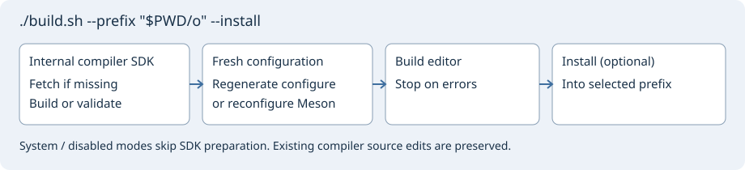

# Geany Insight

[English](README.md)

Geany Insight — редактор исходного кода на GTK на базе Geany. В нём есть навигация по символам и ссылкам проекта, панель контекста, история Git, сравнение и слияние файлов, локальный, SSH и последовательный терминалы. Для анализа C/C++ используется Clang C++, для Verilog/SystemVerilog — slang.



## Сборка в Linux

Нужны компиляторы C и C++17, Git, Python 3, CMake, Ninja, pkg-config и пакеты разработки GTK **3.22+** и GLib **2.56+**. В Debian/Ubuntu для сборки через Autotools:

```sh
sudo apt update
sudo apt install build-essential git python3 python3-docutils cmake ninja-build \
  pkg-config libgtk-3-dev autoconf automake libtool gettext autopoint
git clone https://github.com/bhgv/geany-insight.git
cd geany-insight
./build.sh --prefix "$PWD/out" --install
./out/bin/geany
```

При первом запуске собираются встроенный Clang и адаптированный slang. Это может занять много времени и места; повторная сборка использует уже подготовленные файлы. `./build.sh` без аргументов показывает справку, а `--plan` выводит план без запуска сборки. Для Meson установите пакет `meson` (0.56+) и добавьте `--backend meson`. Ключ `--clang-provider system` выбирает совместимый системный LLVM/Clang, `--clang-provider disabled` отключает семантический анализ C/C++, а `--slang-provider disabled` отдельно отключает анализ HDL. Требования к компиляторам и совместимость описаны в справках по [Clang](insight/docs/ru/clang.md) и [slang](insight/docs/ru/slang.md).

## Сборка в Windows x64

Откройте PowerShell в корне репозитория:

```powershell
.\build.cmd
.\build.cmd -BuildEditor
```

Первая команда показывает справку. Вторая открывает выбор диска и базовой папки, путей к инструментам MSYS2, исходникам и установленному редактору. По умолчанию используются исходники рядом с `build.cmd`. Скрипт готовит MSYS2 UCRT64 и запускает тот же сборщик, что и в Linux. Путь к MSYS2 должен быть без пробелов и состоять из ASCII-символов. Перед обновлением инструментов закройте другие окна MSYS2.

Для запуска без диалога сначала можно проверить пути:

```powershell
.\build.cmd -BuildEditor -NonInteractive -RootDir D:\Development\Insight -Plan
.\build.cmd -BuildEditor -NonInteractive -RootDir D:\Development\Insight
```

Ключи `-MsysRoot`, `-SourceDir`, `-InstallDir` и `-CacheDir` задают пути по отдельности. Как запустить редактор из оболочки UCRT64, какие пакеты нужны и как подготовить переносимую сборку с DLL, описано в [инструкции для Windows](insight/docs/ru/windows-build.md).

Сборщики для macOS и планшетов Android запланированы. Команды выше предназначены для Linux и Windows x64.

[Документация проекта](insight/README.md) · [Лицензии](LICENSES.md)
