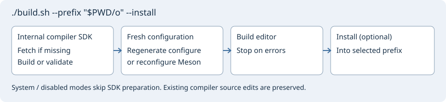

# Geany Insight

[Русский](README-ru.md)

Geany Insight is a GTK source editor based on Geany. It adds project-wide symbol and reference navigation, a context pane, Git history and diff/merge tools, and local, SSH and serial terminals. C/C++ analysis uses the Clang C++ engine; Verilog/SystemVerilog analysis uses slang.



## Build on Linux

Install a C/C++17 toolchain, Git, Python 3, CMake, Ninja, pkg-config, and GTK **3.22+** / GLib **2.56+** development files. For Debian/Ubuntu with the default Autotools backend:

```sh
sudo apt update
sudo apt install build-essential git python3 python3-docutils cmake ninja-build \
  pkg-config libgtk-3-dev autoconf automake libtool gettext autopoint
git clone https://github.com/bhgv/geany-insight.git
cd geany-insight
./build.sh --prefix "$PWD/out" --install
./out/bin/geany
```

The first build prepares the internal Clang SDK and adapted slang and can take substantial time and disk space. The driver reuses existing build trees. Run `./build.sh` for help or add `--plan` to preview the steps. For Meson, install `meson` (0.56+) and add `--backend meson`. Use `--clang-provider system` to select a compatible installed LLVM/Clang SDK, or `--clang-provider disabled` to build without C/C++ semantic analysis. `--slang-provider disabled` independently disables the HDL engine. See [Clang](insight/docs/en/clang.md) and [slang](insight/docs/en/slang.md) for compiler requirements and compatibility.

## Build on Windows x64

From PowerShell in the checkout, run:

```powershell
.\build.cmd
.\build.cmd -BuildEditor
```

The first command shows help. The second opens a folder chooser for the base drive and directory, MSYS2 tools, editor sources and installation. Sources default to the checkout containing `build.cmd`. The builder prepares MSYS2 UCRT64 and uses the same build driver as Linux. MSYS2 needs an ASCII path without spaces. Close other MSYS2 shells before the toolchain update.

For automation, specify paths and preview them first:

```powershell
.\build.cmd -BuildEditor -NonInteractive -RootDir D:\Development\Insight -Plan
.\build.cmd -BuildEditor -NonInteractive -RootDir D:\Development\Insight
```

`-MsysRoot`, `-SourceDir`, `-InstallDir` and `-CacheDir` override individual paths. Open the editor from the UCRT64 shell as described in the [Windows guide](insight/docs/en/windows-build.md), which also lists packages and explains runtime DLLs and portable packaging.

macOS and Android tablet build launchers are planned. The commands above are for Linux and Windows x64.

[Project documentation](insight/README.md) · [Licenses](LICENSES.md)
