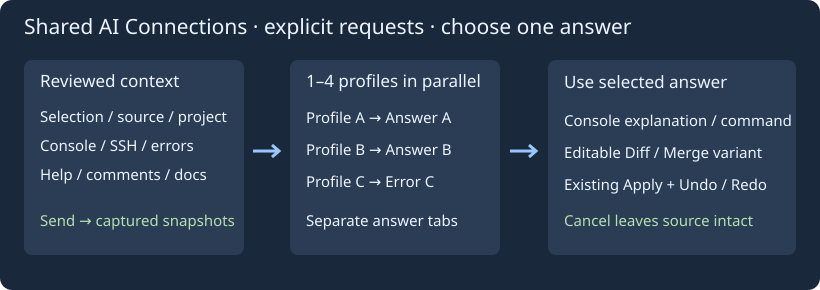
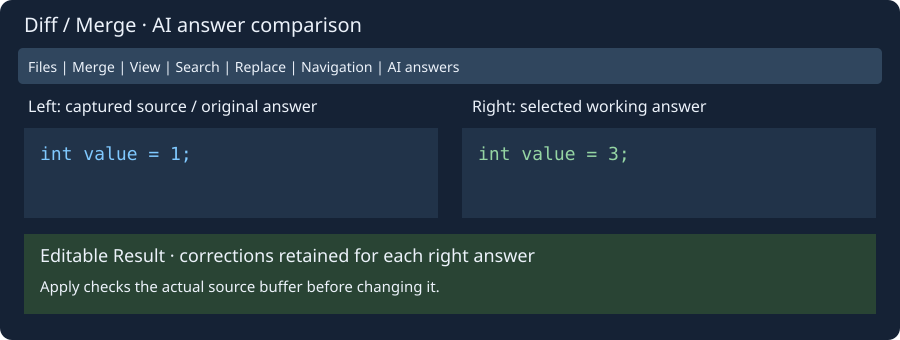

# Общие подключения к ИИ

Откройте **Tools → Подключения ИИ…** или одноимённую кнопку в помощнике. Общие именованные профили используются редактором и проектом, поиском выделения, документированием и комментариями, обычной и SSH-консолями, сообщениями компилятора и справкой программы. Выбор профиля и изменения соединения передаются открытым окнам помощников. Старые endpoint/model/Python импортируются в Default; старый файл остаётся зеркалом без секретов.

Профиль содержит имя, полный URL chat/completions API, идентификатор модели, Python 3, ключ и имя переменной окружения для ключа. Заготовки OpenAI/ChatGPT API, xAI/Grok, DeepSeek, Qwen и локального/совместимого API заполняют URL и имя переменной. Укажите реальные модель и endpoint своего аккаунта. Подключение работает через совместимый API, без входа в веб-аккаунт. Транспорт требует HTTPS, кроме локальных тестовых адресов.

Можно добавить до 16 профилей, менять и удалять их; один должен остаться. Выбор конкретного профиля подключает один ИИ. Если изменить поля подключения в помощнике, Send сохранит их в выбранный общий профиль. Настройки находятся в `insight-ai-profiles.conf`; запросы, контекст, история разговора и ответы туда не пишутся. Смена соединения не отправляет запрос.

По умолчанию ключ хранится в памяти; при пустом поле его можно взять из переменной окружения. Флажок **Сохранять ключ в приватном конфиге (без шифрования)** явно разрешает запись ключа этого профиля обычным текстом в файл, создаваемый с приватными разрешениями платформы. Снимите флажок и нажмите «Обновить профиль», чтобы исключить ключ из следующей сохранённой конфигурации. Это не шифрованное хранилище паролей. Поля ключей скрыты; старое зеркало настроек ключей не содержит.

## Подключение шаг за шагом

1. Откройте **Мастер подключения…** в видимой строке профиля помощника или в окне **Подключения ИИ…**. Выберите провайдера и нажмите **Далее**. Мастер заполнит имя профиля, пример адреса API и имя переменной для ключа, а также поищет Python в PATH.
2. Нажмите **Открыть инструкцию провайдера** и настройте доступ к API. Создайте ключ и скопируйте точный ID модели, доступной вашему аккаунту. Для своего сервера запустите его и скопируйте полный URL chat/completions и ID модели. Для Qwen укажите полный адрес вашего рабочего пространства и региона.
3. Введите ID модели и вставьте ключ. Если ключ задан через предложенную переменную окружения до запуска Geany, оставьте поле ключа пустым. Локальный сервер может работать без ключа. Если Python отсутствует в PATH, укажите путь к исполняемому файлу Python 3.
4. Нажмите **Проверить подключение**. Мастер отправит короткий запрос, который может расходовать квоту API. Исходник, история и вложения не передаются. При HTTP 401 или 403 проверьте ключ и права доступа. При HTTP 404 проверьте URL и ID модели. При HTTP 429 проверьте квоту и ограничения частоты запросов.
5. Нажмите **Сохранить и выбрать**. Профиль станет доступен всем помощникам. Сохранить его можно и до проверки. Вставленный ключ действует до закрытия Geany, если явно не включить его сохранение.

После подключения откройте [помощник консоли](console-ai.md) или [помощник редактора](editor-ai.md). Введите вопрос, проверьте контекст и вложения, затем нажмите **Отправить**. Предложения по коду можно проверить в Diff/Merge перед применением.

В окне **Подключения ИИ…** выберите профиль и нажмите **Проверить подключение**. Проверка использует текущие значения полей, включая несохранённые изменения. Чтобы сохранить их, после проверки нажмите **Обновить профиль**.

## Одновременные запросы и выбор ответа

Отметьте от одного до четырёх профилей для параллельного сравнения и обновите их. В помощнике выберите **Сравнить отмеченные профили ИИ**, проверьте запрос, контекст и вложенный исходник и нажмите Send. Запросы идут одновременно; каждый получает одинаковый снимок запроса, контекста, кода и истории. Последующие правки подключений не меняют отправленные снимки.

В окне **Сравнение ответов ИИ** у каждого профиля своя вкладка. Ошибки и ответы независимы. Просмотрите объяснение, команду и предложенный код, скопируйте объяснение либо нажмите **Использовать выбранный ответ**. Остальные запросы отменяются. Кнопка отмены, закрытие сравнения или Cancel родительского помощника отменяют выбор. Ошибочный или незавершённый ответ выбрать нельзя; готовый ответ можно выбрать до завершения остальных.

Выбранный ответ консоли использует существующие вставку команды без Enter и проверку кода в Diff/Merge. Ответ редактора становится вариантом в редактируемом диффе, с накопленными требованиями и Undo/Redo вариантов. Исходник не меняется и команды не запускаются автоматически. Отмена сравнения сохраняет исходник и принятые варианты. Уже полученный провайдером запрос локальная отмена отозвать не может.

## Выделение, ошибки и справка

Пункт **Поиск → Найти и объяснить выделение с ИИ…** есть и в контекстном меню редактора. Он берёт обычное выделение до 64 КиБ или слово под курсором. Текст виден в редактируемом контексте; отправка — только по Send. Это объяснение и поиск по знаниям ИИ, без утверждения о выполненном веб-поиске. Для браузерного поиска используйте Search Web.

Кнопка **Спросить ИИ…** в справке берёт выделенный текст или фрагмент показанной страницы до 64 КиБ. Пункт **Спросить ИИ о сообщениях…** в меню компилятора, сообщений и статуса берёт выбранную строку либо до 200 последних строк в пределах 64 КиБ. Проверьте контекст перед отправкой. Текущий исходник для предложения правок прикрепляется отдельной кнопкой.

Стандартные задачи редактора — документация, комментарии, имена, алгоритмы — работают с теми же профилями. Кнопки обычной и SSH-консоли открывают тот же помощник и выбор подключений. При общих настройках каждый разговор сохраняет отдельные контекст, историю и вложение исходника.

## Вкладки Diff/Merge и ответы ИИ

Параметры над исходниками собраны во вкладки: **Файлы и сравнение**, **Сведение и история**, **Вид**, **Поиск**, **Замена**, **Навигация**. Элементы управления уменьшены примерно до двух третей прежнего размера; шрифт исходников сохраняется. Если элементы не помещаются, область вкладки прокручивается.

После выбора ответа параллельного запроса вкладка **Ответы ИИ** позволяет сравнить каждый ответ с захваченным исходником либо с другим ответом. Слева выбирается исходник или первоначальный ответ; справа — рабочая версия ответа. Ручные исправления Result сохраняются отдельно для каждого правого ответа при переключении. Пояснение меняется вместе с ответом. Применение проверяет реальный исходный буфер даже при сравнении двух ответов.

Сохраняются успешные ответы, уже полученные к моменту выбора; незавершённые запросы отменяются. Список относится к текущему раунду. Переход к принятому варианту через историю редакторского помощника сбрасывает этот список, сохраняя обычные Undo/Redo вариантов.

Все три области исходников используют лексер и цвета редактора по типу файла. Подсветка обновляется после изменения текста, а не движения курсора; ограничена 1 МиБ и 20 000 переходов стиля на область.

## Поля подключения, сворачивание и общий экран общения

Поля адреса API, модели, ключа и исполняемого файла помощника имеют объясняющие тултипы и расширяются с окном. Во вкладке **Свернуть** верхний блок сжимается до корешков; выберите любую рабочую вкладку, чтобы вернуть её содержимое. Освободившуюся высоту получает основная консоль.

В обычном окне ИИ ввод и ответы находятся на одном чёрном экране. История сообщений защищена от изменения; текущий запрос редактируется после **You>**. **Enter** добавляет строку, **Ctrl+Enter** или **Отправить** отправляет запрос. Поддерживаются выделение, копирование и вставка. Предыдущий запрос можно выбрать из сохранённой истории и отредактировать. Действия с командами, вложениями и вариантами ответов доступны в верхних вкладках. Помощник редактора сохраняет основную область Diff / Merge для проверки кода.

Начальное окно ограничивается рабочей областью текущего монитора с учётом заголовка. Кнопки заголовка сворачивают окно, разворачивают/восстанавливают его и закрывают. При изменении размера свободное место получает прежде всего консоль общения (в редакторе — область сравнения кода).
