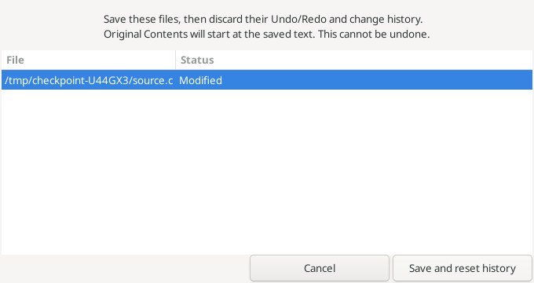
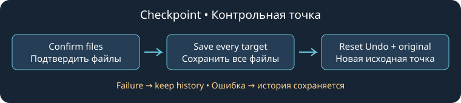

# Checkpoint and Checkpoint All

File → **Checkpoint…** saves the current file, discards its Undo/Redo and change history, and makes the saved text the new **Original Contents**. **Checkpoint All…** applies this to every open file. Both commands are available in the command browser and Editor keybinding preferences; no shortcut is assigned by default.

The confirmation lists complete file paths and Modified/Saved status. **Cancel** is the default response. Choose **Save and reset history** deliberately: earlier text, encoding and BOM changes cannot subsequently be undone. Later edits still have normal Undo/Redo. `Restore Lines`, `Restore File`, `Original Changes` and original-change navigation now use the checkpoint as their baseline. A normal Save continues to preserve that baseline.

Files must already have names and be writable. Save untitled files first; close read-only reference views before using Checkpoint All. Changes to text, encoding, BOM, paths, writable state or the target file set during confirmation cancel the operation. Checkpoint All includes clean tabs too. It never silently skips a tab.

All files are saved before any history is cleared. If a save fails, a save callback changes another target, or a snapshot cannot be retained, no target's history is cleared. Earlier files can already have been saved; this is not an atomic multi-file disk transaction. Save-time whitespace and newline preferences still apply. Files changed on disk use Geany's normal conflict handling.

Snapshots require valid UTF-8 without embedded NUL, at most 8 MiB per document and 64 MiB across retained originals. A failed checkpoint leaves the previous originals available. Checkpoint does not create a backup or a Git commit.

Linux validation exercises the real editor and confirmation dialog: Cancel, stale text/tab/file sets, read-only and untitled guards, single/all menu and key dispatch, save-callback interference, native BOM history, text Undo/Redo, invalid UTF-8, disk contents and replacement original snapshots. The screenshot is a production dialog captured by that test under Xvfb. Windows and Android were not run.

Reference: Source Insight 4 [Checkpoint](https://www.sourceinsight.com/doc/v4/userguide/Manual/Command_Reference/Checkpoint.htm) and [Checkpoint All](https://www.sourceinsight.com/doc/v4/userguide/Manual/Command_Reference/Checkpoint_All.htm). This implementation adds confirmation and bounded snapshots.
