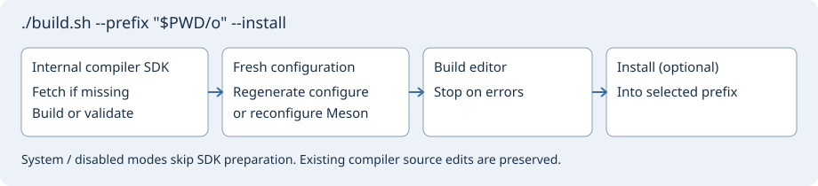
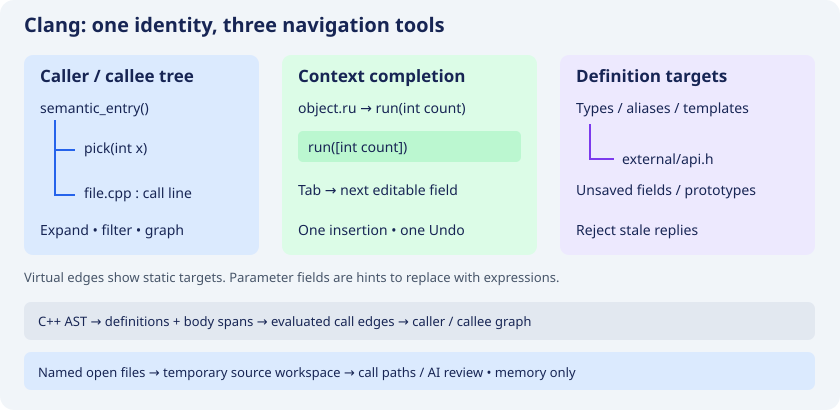

# Clang C/C++

> **Default Clang provider:** the internal SDK from `external/llvm-project`, staged in `_external-clang-sdk`. System Clang requires `-Dclang-provider=system` or `--with-clang-provider=system`. Missing internal files are prepared automatically, never replaced by a system fallback. Native C++ APIs supply parsing, symbols, coloring, preprocessing and Sema; libclang is not required.


Clang-enabled portable builds carry clang-cpp, LLVM and their shared dependencies,
resource headers and redistribution notices. Neither the `clang` executable nor
Python is needed by the native frontend. Project headers, generated files and
external SDKs still come from the project.

## One-command build

```sh
./build.sh --prefix "$PWD/o" --install
```

This prepares the internal SDK, initializes missing compiler sources, regenerates
stale configure scripts, builds the editor, and installs into the selected prefix.
Without `--install` it only builds. Existing compiler source edits are preserved.
The first LLVM build is expensive; later runs reuse the SDK or incrementally rebuild
after compiler edits.

Running `./build.sh` without arguments displays help without starting a build.

Meson: `./build.sh --backend meson --prefix "$PWD/o" --install`.
System Clang: `./build.sh --clang-provider system --install`.
Minimal build: `./build.sh --clang-provider disabled`.
`--jobs 2` controls parallelism; `--plan` prints commands without executing or writing.
`--configure-only` refreshes configuration without compiling the editor. Builds
normally use `_editor-build`; an existing in-tree Autotools build is reused without
cleanup. Additional configure/setup arguments follow `--`.

Fresh `./configure` and `meson setup` also prepare a missing internal SDK automatically.
Use `--disable-clang-bootstrap` or `-Dclang-bootstrap=false` to require a prebuilt SDK.
CI may explicitly use the driver's `--skip-sdk-build` after preparing a trusted SDK.
System and disabled modes never fetch or build LLVM. Unknown nonempty SDK directories
and incomplete nonempty source trees are not overwritten.



## Project symbols and cache

The project index uses compiler-parsed C/C++ definitions when parsing succeeds.
Compiler symbol identities (USR), reference/call locations and dependencies are
stored in the existing project database. Unchanged files reuse cached results.
An included header or compilation-database change invalidates dependent files.
Sources with compiler errors retain the lexical indexing fallback.

The frontend reads `compile_commands.json` from the project root or `build/`.
Include paths are resolved against the compilation command's working directory;
defines, language standard and target are retained. Command strings are never
executed. Compiler plugins, response files, linking and code generation are not
imported. Without a database, default compiler settings and the project include
root are used. Diagnostics may therefore indicate missing build settings.

## Identifier coloring

**Navigate → Clang C/C++ → Clang C/C++ semantic colors** toggles identifier colors.
**Reanalyze C/C++ buffer with Clang** refreshes the active source and reports
symbol/token counts and the argument source. Types, functions, fields, constants,
variables, namespaces and macros use a separate foreground indicator; comments,
strings and source text retain the original lexer/editor behavior. Parsing runs
in a worker; painting is split into short idle batches. A changed buffer rejects
stale results. Named open files, including unsaved headers, are Clang overlays.

## Build and portable runtime

Advanced/manual SDK preparation (normally handled by build.sh):

```sh
git submodule update --init --depth 1 external/llvm-project
python3 insight/tools/build_external_clang.py --jobs 2
meson setup build-editor
meson compile -C build-editor
meson install -C build-editor
```

No provider or SDK option is needed for a normal source build. An internal SDK
elsewhere uses `-Dclang-sdk=/absolute/prefix` or `--with-clang=/absolute/prefix`.
Its source manifest must match the pinned revision; its own headers and exact
library paths are selected together.

### Refresh Autotools after git pull

`configure` is a locally generated file, not a Git-tracked source. Its printed
Git revision can be current while its compiler checks are stale. If it still
searches `/usr/bin/llvm-config` without an explicit system-provider option or
prints the old instruction to install system Clang, regenerate it first:

```sh
NOCONFIGURE=1 ./autogen.sh
./configure --prefix="$PWD/out"
```

Repeat this after updates to `configure.ac` or `m4/`. Prepare the internal SDK
with the commands above; no system Clang installation is needed. The current
script reports `Clang provider: internal` after SDK validation.

| Provider | Meson | Autotools |
| --- | --- | --- |
| Internal SDK (default) | `meson setup build-editor` | `./configure` |
| System Clang (explicit) | `-Dclang-provider=system` | `--with-clang-provider=system` |
| Minimal lexical build | `-Dclang=disabled` | `--without-clang` |

Internal Linux/Windows Meson installs automatically carry the SDK runtime,
resource headers and licenses. A system-provider portable installation uses
`-Dclang-bundle=true`. Linux bundling needs `patchelf`. Autotools internal builds
link the selected SDK directly and retain its runtime path on Unix; use Meson
for a self-contained portable installation. Minimal builds need no SDK.
GTK 3.22 / GLib 2.56 remain the minimum versions.

Parsing is bounded to 2 MiB per source, 32 MiB of unsaved overlays, 200000 visited
cursors/tokens, 50000 declarations and 100000 relation records. Cancellation is
checked around the synchronous compiler parse and during traversal; a running
Clang C++ parse is not force-interrupted. Missing declarations, project flags,
compiler extensions and incomplete files still limit semantic results. A compiler
frontend does not determine runtime condition values or arbitrary pointer targets.

**По-русски:** в переносимую поставку входят Clang/LLVM, зависимости и служебные
заголовки. Для проекта нужны его собственные заголовки и параметры сборки.
Положите `compile_commands.json` в корень проекта или `build/`. В «Навигации»
доступны семантическая подсветка и повторный разбор активного C/C++ исходника.
Неизменённые файлы используют базу. Изменение заголовка обновляет зависимые
исходники. Для неполного исходника сохраняется резервный лексический индекс.

Official APIs: [LibTooling](https://clang.llvm.org/docs/LibTooling.html),
[compilation database](https://clang.llvm.org/docs/JSONCompilationDatabase.html).

## Semantic references and call graphs

**Navigate → Clang C/C++ → Clang references…** selects **References (Clang C/C++)** in Relations.
If the caret's analyzed identifier has a known USR, results use that exact compiler
identity, distinguishing overloads. Otherwise the status explicitly says the
query is by name. Text/comment searches remain separate lexical operations.
References reuse the project database when their sources and dependencies match;
open buffers are parsed for the query. Partial files contribute results with a
skipped/incomplete indication instead of being claimed as complete.

Call paths use compiler-resolved call occurrences and function bodies for fresh
Clang-indexed C/C++ sources, including unsaved open-source/header overlays.
Calls in an uninvoked lambda are not attributed to its enclosing function.
Virtual calls are omitted by default; uncertain mode displays the statically
referenced virtual target with a dashed edge, without claiming its runtime
implementation. Unresolved function-pointer targets remain unresolved. The graph
status distinguishes Clang-resolved calls from lexical fallback. Branch rendering
is still the bounded structural view described in [source routes](source-routes.md).

Project snapshots now allow up to 1 million records / 256 MiB per index and
768 MiB for the complete project snapshot, to accommodate reference records.
These storage bounds do not expand independent UI/report/work budgets.

Successful live C/C++ parses also publish compiler declarations into the native
TagManager through its existing asynchronous tag-publication path. File Symbols,
completion and native definition consumers therefore receive Clang-derived tags;
invalid/incomplete buffers keep their native parser fallback. The existing
workbench definition chooser prefers a fresh compiler identity where available.
Turning off semantic colors only changes painting; compiler analysis continues.

**По-русски:** результаты Clang поступают и в обычный механизм тегов редактора:
панель символов файла, подсказки и переходы получают разобранные компилятором
объявления. «Ссылки Clang…» доступны в «Навигации» и в «Поиск/замена» контекстного
меню. Выключение семантических цветов не выключает разбор символов.

The **Navigate → Clang C/C++** submenu groups coloring, reanalysis, semantic
references and this help page. The color preference persists in the Geany profile
and does not disable compiler-derived symbols or references.

Clang preserves function parameter names, macro parameters and underlying `typedef` types for completion and symbol information. Reanalysis with unchanged declarations does not rebuild the symbol panel. Portable-build tests parse a source using the bundled Clang resource headers.

## Semantic call trees and completion

**Navigate → Clang C/C++ → Callees / Callers (Clang tree)** opens a lazy Relations tree. Exact USRs distinguish overloads. Nodes retain call-site file, line and available target signature. Double-click opens the occurrence; expanding continues traversal. Repeated USRs stop recursive branches. Loaded branches also feed the existing graph, filtering, history and printing. Limits remain 200 occurrences per branch, 2000 nodes and depth 32. These are index snapshots: refresh after background analysis. Virtual edges show a static target, never a proven runtime implementation. Sources with errors are not treated as complete.

Contextual Clang completion runs after `.`, `->`, `::` and on explicit completion. It uses receiver types, inheritance, accessibility, overloads, compilation-database flags and named unsaved header overlays. A short debounce and at most two worker requests avoid parsing on every keystroke. Changed source, overlays, project or caret reject stale replies. Compiler failure retains native tag completion. Completion options can disable this path.

**Insert editable function parameter fields (Clang)** inserts the compiler-provided placeholders: replace them with expressions; Tab / Shift+Tab visits fields and Escape ends the session. These are editable parameter hints, not guessed argument values. The insertion is one Undo/Redo; existing arguments are preserved. Ordinary tags retain parentheses-only insertion. Spacing between inserted parameters is configurable and persisted.

Definition navigation also uses compiler target locations in headers outside project membership; declarations are available when no body exists. The ordinary reference command prefers fresh compiler analysis while lexical modes remain separately selectable.



Ambiguous function names produce separate selectable roots with signatures and file locations. Snapshot preparation runs in a worker. A newly published parse refreshes tracked Relations and Context even when declarations are unchanged. Calls through pointers are not presented as resolved direct function calls.

The detailed list combines symbols and language-eligible templates from the active global/project Clips store. Template rows have a separate icon and kind; equal symbol/template names remain distinct. Accepting reuses the existing parameter dialog and one Undo; cancelling preserves the typed prefix. Templates are excluded after member operators. The proposal option persists in the profile. Native Geany text snippets invoked by Tab retain their separate mechanism.

The up/down navigation buttons browse callers/callees from the selected node, retaining its exact USR. Back/forward restores that overload even if the source caret has moved to another same-named function.

Automatic Context tracking also selects the compiler-bound definition, including external headers. Its worker retains snapshot guards and rejects replies after the corresponding parse was replaced or invalidated. Without a fresh successful parse it retains the native tag fallback.

## Compilation settings for C/C++ headers

Headers commonly have no explicit `compile_commands.json` entry. Without an exact command, settings are inferred from a companion source: matching filename stem first, then directory proximity. `.hpp`, `.hh` and `.hxx` use C++ commands only. Equally ranked C and C++ commands for `.h` decline inference and report ambiguity. Same-language ties use canonical filename ordering, independent of JSON entry order. Inference is bounded to 8192 commands. This is a heuristic, not proof that the chosen source includes the header; an exact header command takes precedence.

Language standard, defines, target and include paths remain available. Relative paths use the command's `directory`, including databases in `build/`. C++ driver language is preserved; explicit `-x` overrides it. Header indexing, relations, colors and completion share this selection. Database and included-header changes invalidate cached analysis.

**Navigate → Clang C/C++ → Clang analysis details…** displays parse language, exact/inferred settings source, errors, limits and compiler diagnostics in a selectable, copyable report. Use it to diagnose missing graph edges or symbols, and supply an exact header command when a heuristic is unsuitable.

An ambiguous `.h` result is explicitly partial and does not replace the native symbol index. Definition lookup, graphs and completion keep their fallback until suitable unambiguous or exact settings are available. A diagnostic-free default C parse is not treated as proof of correct C++ project settings.

Completion viewport height is reserved on the scroller, using font size, visible row count and monitor work area. The native GUI check requires both overload rows to be fully visible, rather than merely present in the model.


## Открытые файлы без проекта / Open files without a project

Без сохранённого проекта открытые **именованные** файлы образуют временную
рабочую область в памяти. В ней доступны ссылки, деревья вызывающих/вызываемых,
цепочки вызовов и проверка исходников ИИ. Учитываются несохранённые изменения
и открытые заголовки. Неоткрытые файлы из соседних папок в область не добавляются;
Clang по-прежнему читает заголовки, подключённые директивами `#include`.
Закрытый файл исключается из следующего снимка. База проекта и `.geany` не создаются.
Безымянным буферам сначала нужно назначить имя файла.

Without a saved project, named open files form an in-memory source workspace for
references, caller/callee trees, call paths and AI source review. Unsaved edits
and open headers participate. Neighboring unopened sources are not members;
Clang can still read headers included by the source. Closing a file removes it
from the next snapshot. No project file or project database is written. Untitled
buffers need a filename first. At most 256 files are captured; excess files are
marked as an incomplete snapshot. Existing parser/overlay byte limits still apply.

If Clang commands are greyed out, that executable was built without the native Clang C++ backend.
Installing a `clang` executable afterwards cannot enable a compiled-out backend.
**Clang analysis details…** now opens an explanation even in a minimal build;
**Reanalyze** reports missing support or an unsupported file instead of silently
returning. Only the explicitly selected system provider uses installed packages such as `libclang-dev libclang-cpp-dev llvm-dev` on Debian/Ubuntu; the default uses the source SDK.
For intentional minimal builds use `-Dclang=disabled` or `--without-clang`;
`auto` remains an explicit opt-in to optional detection. For portable installs,
keep `-Dclang-bundle=true` so target systems do not need system Clang C++ libraries.


## Editable source and direct C++ AST adapter

The pinned LLVM/Clang source is now in `external/llvm-project` (Git submodule). Build it with `python3 insight/tools/build_external_clang.py`; pass the resulting prefix as `-Dclang-sdk=... -Dclang-cpp=enabled`. Direct C++ AST call edges now feed caller/callee trees and call paths. The same AST supplies symbol-list declarations, semantic tokens, references, function definitions and body spans. Sema supplies completion, and the C++ preprocessor supplies macros and include dependencies. See [parser-engines.md](parser-engines.md) for exact scope, source build instructions and other-language candidates.

## Expression references through the C++ AST

With `clang-cpp` enabled, `DeclRefExpr` and `MemberExpr` references now come from the direct C++ AST pass as well as call edges. Resolved USRs preserve the identity of shadowed variables and overloaded functions. Member occurrences cover the member name rather than the whole object expression; stored offsets are bytes and displayed columns count UTF-8 characters. These rows feed existing definition lookup and reference searches.

Completed compiler snapshots replace file data. Cancellation, parse errors or limits prevent incomplete results from replacing usable project metadata. Macros use native preprocessing records; unsupported dependent or runtime-only targets remain unresolved, with lexical search available separately. No libclang fallback is involved. Project caches invalidate once for the new backend generation.

### Lambda capture evaluation

Direct AST traversal distinguishes a lambda's capture initializers from its deferred body. In `auto task = [value = load()] { return work(value); };`, the enclosing function has a direct call edge to `load`, not to `work`. Both references remain searchable. Nested deferred bodies do not create enclosing-function edges. This does not infer when a stored lambda will be invoked.

## Definition destinations through the C++ AST

For resolved expression references and calls, the direct Clang pass now emits destination records. It prefers a function or variable definition available in the current translation unit, otherwise its declaration. USRs distinguish overloads; an out-of-line method leads to its body and a field leads to its class declaration. Named unsaved headers are evaluated with the current source buffer.

One destination per USR atomically replaces that symbol's old destinations together with the references. Parse errors, cancellation and limits retain the previous result. Implicit declarations without editable source positions do not invent jump targets. Macro declarations and uses come from preprocessing records. Definitions in other translation units still use the shared project/open-file index. No project compilation or execution is involved.

## Types, function definitions and graph accuracy

The direct C++ AST pass collects references to records, enums, typedef/using aliases, class templates, template type parameters and namespace qualifiers. A record use prefers its complete definition over a forward declaration. Unsupported and dependent forms retain the existing fallback; not every possible C++ type is resolved.

Explicit function definitions and compound-body spans now come from the same pass: exact USRs, internal visibility, parameter signatures and physical brace coordinates. Symbol lists and function metadata share the same parameter formatter so call-path identity matching remains compatible. Unsupported body forms are not claimed as resolved compound bodies.

`sizeof(sink())`, `noexcept(sink())` and `decltype(sink())` keep searchable references without inventing executable call edges. The pass distinguishes potentially evaluated `typeid` and C variable-length-array `sizeof`. Declaration default arguments are not attributed to the declared function body; their dynamic invocation is not inferred. Deferred lambda bodies likewise do not create enclosing-function edges.

The normal frontend builds one AST and produces fresh symbol/reference/token snapshots. Canonical USRs are cached for that traversal; repeated AST visits to a call site are deduplicated. **Clang analysis details** lists the native AST, preprocessor and Sema services. No second C frontend is run.

On Debian/Ubuntu, `libclang-dev` supplies the Clang C++ development headers; its package name does not imply that the editor links the libclang C runtime. Install it together with `libclang-cpp-dev llvm-dev`, or build the pinned source SDK.

Multiline macro parameter lists accept both LF and CRLF line continuations. Reference results include the source line; their display columns count UTF-8 characters, including Cyrillic text. Repeated expansions share one definition destination.

`clang-bundle=auto` is the default: it bundles internal Linux/Windows SDKs. `-Dclang-bundle=true` also bundles the system provider; `-Dclang-bundle=false` keeps an SDK-linked development install without copying the runtime.

Existing Meson build directories can be reconfigured explicitly with `meson setup --reconfigure build-editor -Dclang-provider=internal -Dclang-bundle=auto`. The internal SDK resolver accepts ELF, Darwin dylib and Windows import-library names; runtime validation for this change uses Linux.
