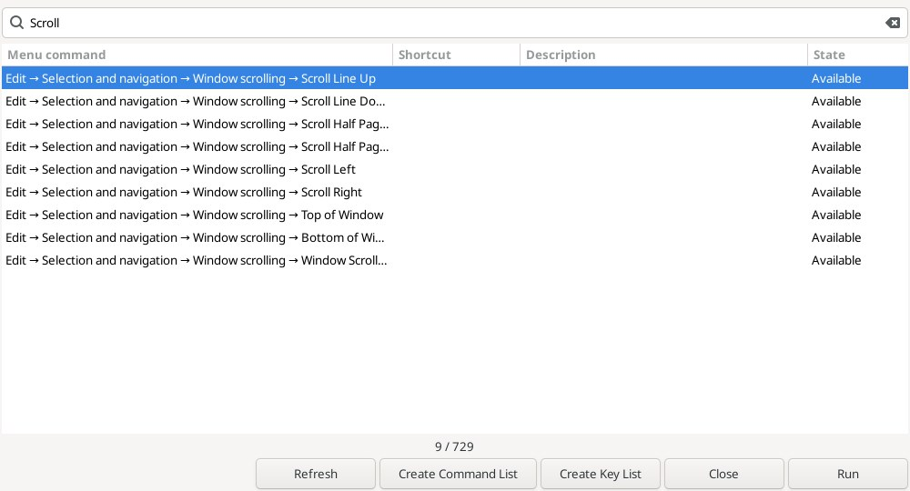
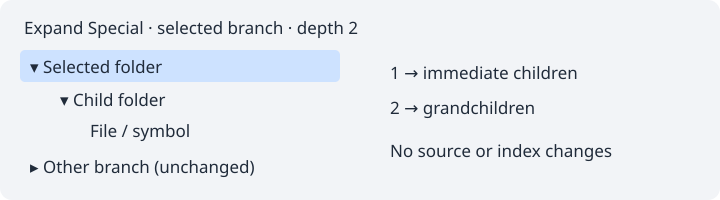

# Command references / Списки команд и клавиш

**Help → Create Command List** creates an editable, unsaved **Command List.txt**
buffer containing the currently materialized main-menu leaf commands, full menu
paths, registered shortcuts and tooltip descriptions where available. Hidden menu
items are excluded; disabled commands remain listed. Dynamic popup-only menus and
items not yet materialized are outside this snapshot. A description can be empty.

**Help → Create Key List** creates an editable, unsaved **Keylist.txt** buffer with
all registered native/plugin keybinding groups, command labels and current shortcuts.
Unassigned commands are explicitly marked. This is the actual current registry,
including user changes, not a factory-default shortcut chart. Menu-only commands
without registered bindings belong in Command List instead.

Both outputs are tab-separated text, with tabs/newlines in labels flattened to
spaces. Each complete result is bounded to 10000 visited items and 1 MiB; exceeding
limits produces no new document. Existing text, clipboard and source Undo remain
unchanged. No files are written until you save the new buffer normally. Existing
files with the suggested names are not read, replaced or reused.

**Справка → Создать список команд** создаёт обычный несохранённый буфер
Command List.txt: пути команд главного меню, зарегистрированные сочетания и
описания из всплывающих подсказок. Описания могут отсутствовать; динамические
контекстные меню вне снимка. **Создать список клавиш** создаёт Keylist.txt
со всеми зарегистрированными командами клавиш, включая плагины и неназначенные
команды. Используются текущие настройки, а не заводские значения.

Созданные списки можно редактировать, искать, печатать и сохранять штатными
командами редактора. Запись на диск происходит только при обычном сохранении.
Пределы: 10000 элементов, 1 МиБ. Исходные документы и clipboard не меняются.

References: [Create Command List](https://www.sourceinsight.com/doc/v4/userguide/Manual/Command_Reference/Create_Command_List.htm),
[Create Key List](https://www.sourceinsight.com/doc/v4/userguide/Manual/Command_Reference/Create_Key_List.htm).

## Command Browser / Поиск команд

**Help → Command Browser…** opens a modal command finder over the same bounded
main-menu snapshot. Space-separated search tokens match the full path, shortcut
and tooltip with Unicode case folding; all tokens must match. Columns can be
sorted/resized. The count shows visible/total commands. Refresh rebuilds names,
shortcuts and availability; use it after changing the interface language.

**Run**, Enter or double-click closes the browser and activates the selected
native menu command. The editor receives focus first. The original menu ancestry,
visibility and sensitivity are rechecked; menu show handlers refresh dynamic state
before running. Destroyed, detached, hidden, disabled or now-nonleaf targets are
rejected and the list is refreshed. References use weak widget handles and do not
keep plugin menu commands alive. Normal native action behavior still applies.

Create Command List / Create Key List close the browser and open the corresponding
editable snapshot. Close/Escape leave the editor untouched. This finder is inspired
by Source Insight's searchable command list and Run control in Key Assignments;
it does not reassign shortcuts, record macros or enumerate popup-only commands.
Use the native Preferences keyboard page to change existing bindings.

**Справка → Поиск команд…**: поиск по словам в названии, пути меню, клавишах и
описании. Все слова запроса должны присутствовать; регистр Unicode не учитывается.
Столбцы сортируются. Refresh обновляет снимок. Run, Enter или двойной щелчок
закрывают окно и запускают выбранную штатную команду после проверки её доступности.
Удалённые и отсоединённые элементы меню не запускаются. Кнопки списков открывают
новые редактируемые документы. Назначения клавиш этим окном не меняются.

Reference: [Key Assignments: command search and Run](https://www.sourceinsight.com/doc/v4/userguide/Manual/Command_Reference/Key_Assignments.htm).

## Keyboard assignments / Назначения клавиш

The native Preferences → Keybindings page now exposes **Cut Word / Cut Word Left**
in Clipboard, **Delete Line / Delete Character** in Editor and **Command Browser**
in Help. All five start unassigned. Normal user keyfile persistence, conflict
handling and keyboard dispatch apply. Word/delete shortcuts only act while the
current source editor has focus; search/other text fields are not redirected to
source edits. Browser can be invoked from other main-window focus locations.
Current assignments appear in menu accelerators, Key List and Command Browser.
Existing keybinding IDs retain their values; new IDs are appended.

Штатные настройки клавиш: Clipboard — Cut Word/Left, Editor — Delete Line/Character,
Help — Command Browser. По умолчанию сочетания не назначены. Пользовательские
назначения сохраняются обычным механизмом Geany. Сочетания удаления и вырезания
действуют только при фокусе в текущем исходном редакторе, не меняя документ при
вводе в строку поиска или другое поле. Назначения видны в новых списках и меню.

State reflects the current menu-widget snapshot; Run refreshes native menu state before dispatch.
Столбец состояния — снимок свойств меню; перед Run штатное состояние меню проверяется заново.

## Expand Special / Selected Branch

View → Panels → Selected Folder Branch / Selected Symbol Category Branch / Selected File Type Branch provides **Expand Special…**, **Expand Selected Branch** and **Collapse Selected Branch**. Select a row in the corresponding tree first. Expand Special reveals 1–32 levels below that row; one level reveals its immediate children. Existing deeper expansions and sibling branches are preserved. Collapse hides the selected branch and retains descendant expansion state.

Operations use the currently materialized project tree, without disk enumeration or index rebuilding. Expansion visits at most 4096 rows per invocation; the branch command uses a maximum depth of 32. A status message reports a work limit or an invalidated tree. Cancel changes nothing. If the project tree changes while the depth dialog is open, select the row again. This command is distinct from code outlining in the editor.

