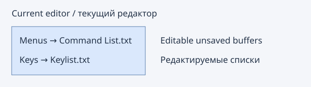

# Command references / Списки команд и клавиш

**Help → Create Command List** creates an editable, unsaved **Command List.txt**
buffer containing the currently materialized main-menu leaf commands, full menu
paths, registered shortcuts and tooltip descriptions where available. Hidden menu
items are excluded; disabled commands remain listed. Dynamic popup-only menus and
items not yet materialized are outside this snapshot. A description can be empty.

**Help → Create Key List** creates an editable, unsaved **Keylist.txt** buffer with
all registered native/plugin keybinding groups, command labels and current shortcuts.
Unassigned commands are explicitly marked. This is the actual current registry,
including user changes, not a factory-default shortcut chart. Menu-only commands
without registered bindings belong in Command List instead.

Both outputs are tab-separated text, with tabs/newlines in labels flattened to
spaces. Each complete result is bounded to 10000 visited items and 1 MiB; exceeding
limits produces no new document. Existing text, clipboard and source Undo remain
unchanged. No files are written until you save the new buffer normally. Existing
files with the suggested names are not read, replaced or reused.

**Справка → Создать список команд** создаёт обычный несохранённый буфер
Command List.txt: пути команд главного меню, зарегистрированные сочетания и
описания из всплывающих подсказок. Описания могут отсутствовать; динамические
контекстные меню вне снимка. **Создать список клавиш** создаёт Keylist.txt
со всеми зарегистрированными командами клавиш, включая плагины и неназначенные
команды. Используются текущие настройки, а не заводские значения.

Созданные списки можно редактировать, искать, печатать и сохранять штатными
командами редактора. Запись на диск происходит только при обычном сохранении.
Пределы: 10000 элементов, 1 МиБ. Исходные документы и clipboard не меняются.

References: [Create Command List](https://www.sourceinsight.com/doc/v4/userguide/Manual/Command_Reference/Create_Command_List.htm),
[Create Key List](https://www.sourceinsight.com/doc/v4/userguide/Manual/Command_Reference/Create_Key_List.htm).
