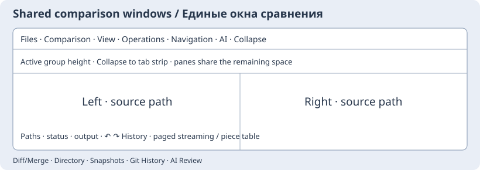
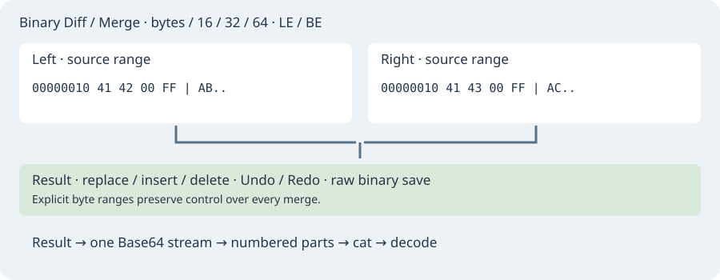

## Shared comparison window layout / Единое оформление сравнений

Comparison/Merge, Directory Compare, snapshot comparisons, Git History and editor
AI review now share the same toolbar component: compact 2/3-size controls, scrollable
tabs at the top, and control pages sized to the active group. The default window size is 1100×700;
explicitly saved Directory Compare and Diff/Merge sizes remain respected. Comparison code uses a shared 10 pt starting baseline, independent of toolbar
scaling and editor font preferences. Excess controls scroll inside their page
instead of forcing the whole window wider or taller.

Directory tabs: Files and comparison; Comparison options; View (filters, masks,
columns); File operations; Navigation. Snapshot comparison groups comparison options,
report actions and navigation. Git groups revision controls and difference navigation.
Editor AI adds request, files, connection and request-history tabs, with the same
compact controls; it no longer forces a separate 1200×950 window. Read-only modes,
confirmation dialogs, cancellation and operation guards are preserved. Ctrl+F in
Directory Compare reveals the filter tab before focusing its input.

«Сравнение/сведение», сравнение каталогов и снимков, история Git и ИИ-проверка
используют общий компонент: верхние вкладки, уменьшенные в 1,5 раза элементы,
высоту активной группы по её содержимому и начальный размер окна 1100×700. Явно сохранённые размеры
пользователя сохраняются. Начальная база кода в сравнении — 10 pt; она не зависит от масштаба параметров и шрифта основного редактора.
Длинные панели прокручиваются внутри вкладки, сохраняя место для содержимого.
У каталогов отдельные группы файлов, сравнения, вида/фильтров, файловых операций
и навигации; у ИИ — запроса, файлов, подключения и истории запросов.



## Бинарное сравнение, выборочное слияние и hex-редактор

В «Файлы и сравнение» окна Diff/Merge кнопка «Бинарное сравнение / Hex-редактор»
открывает бинарное представление выбранных файлов, сохраняя текстовое окно.
«Инструменты → Hex-редактор» открывает тот же инструмент самостоятельно.
Файлы до 16 МиБ загружаются без преобразования кодировки, включая NUL.
Пустой путь означает пустой поток; результат изначально равен левому файлу.

Источники расположены слева и справа, результат под ними. Адреса строк выводятся
в hex, справа — печатные ASCII-символы. Представления: байты, слова 16/32/64 бит,
little/big endian. Это меняет только показ, а не сохранённые байты. Каждая страница
содержит 4096 байт (256 строк), номер страницы начинается с нуля. Прокрутка
источников синхронна; отличающиеся строки выделены цветом. «Следующее отличие»
находит последовательный диапазон разных байтов по одинаковым смещениям.
Сдвинутые блоки автоматически не выравниваются.

Щелчок по hex-слову или ASCII-байту задаёт его диапазон; выделение мышью задаёт
целые строки. Для точного диапазона используйте поля смещения/длины.

На вкладке слияния четыре десятичных поля задают смещение/число байтов источника
и смещение/число заменяемых байтов результата. «Взять диапазон слева/справа»
вставляет выбранные байты, заменяя указанный диапазон результата. Нулевой размер
замены означает вставку. За концом более короткого источника отсутствующие байты
означают удаление соответствующего диапазона результата. Перед переносом проверьте
поля, особенно после вставок и удаления, меняющих смещения. Hex-поле принимает пары
цифр с пробелами или без них; пустое поле удаляет диапазон. Undo/Redo сохраняет до
64 переходов, с общим ограничением снимков 32 МиБ. Сохранение пишет именно байты,
без адресов/форматирования; при закрытии изменённого результата запрашивается подтверждение.

Текстовый Diff/Merge сохраняет выбор блоков и добавляет «Вставить выделение слева/справа»:
выделите произвольный фрагмент источника и место или заменяемый текст в результате.
Последнее выделение источника сохраняется, пока вы выбираете диапазон результата,
и сбрасывается при изменении текста источника. Операция отменяется одним Undo. Это работает и с предложениями ИИ: можно взять только
нужную часть ответа, поправить результат вручную и применить его обычной кнопкой проверки.

Вкладка Base64 экспортирует **результат**, включая ручные правки. Можно выбрать целый
поток, части 10/100 КиБ, 1/10 МиБ или собственный размер **закодированных** частей
в байтах (0 — весь поток). Не более 4096 частей за одну операцию. Кодирование выполняется один раз перед разбиением.
Имена частей: `name.b64.part000001`, `name.b64.part000002` и т. д.; существующие части
не перезаписываются, при ошибке новые части этой операции удаляются. Сборка:

```sh
cat name.b64.part* > complete.b64
base64 --decode complete.b64 > restored.bin
```

В буфер обмена копируется полный поток либо часть с указанным номером (с нуля).
Части предназначены для сборки перед декодированием; отдельно они могут быть неполными.



### Высота верхних вкладок и сворачивание

Высота верхней области рассчитывается по элементам **активной** вкладки с учётом
шрифта, дополнительных строк и горизонтальной прокрутки. Короткая группа не
резервирует высоту самой большой группы. Причина прежнего обрезания — фиксированные
86 px для всех групп. Теперь дополнительное место забирается у областей сравнения
ниже; разделители сохраняют пропорциональное распределение места.

Корешок «Свернуть» оставляет только строку корешков, освобождая место для файлов.
Щелчок по обычному корешку возвращает его группу и нужную ей высоту. Файлы,
выделения, незавершённый результат и Undo/Redo при этом сохраняются. Если группа
физически не помещается в маленькое окно, остаётся внутренняя прокрутка; это
позволяет добраться до последнего элемента, сохраняя место для сравнения.
