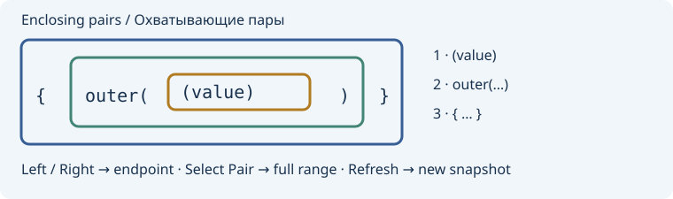

# Delimiter navigation / Переходы по скобкам

**Edit → Selection and navigation → Delimiters and blocks** exposes four
Source Insight-style movements and four explicit selection variants:

| Command | Destination |
| --- | --- |
| Paren Left | Opening `(` of the nearest enclosing matched parentheses, strictly left of the active caret |
| Paren Right | Closing `)` of the nearest enclosing matched parentheses, strictly right of the active caret |
| Block Up | Previous literal code `{`, including an unmatched brace |
| Block Down | Next literal code `}`, including an unmatched brace |

Repeating Paren Left/Right at an endpoint moves to an outer enclosing pair.
There is no wrapping. A caret immediately after a closing delimiter is outside
that pair. Block Up/Down follow brace characters, not function or AST boundaries.
The destination is on the delimiter, not after it. A normal movement collapses the
selection; Extend Mode and explicit Select To variants keep its original anchor.
Read-only navigation/selection is allowed. Text, clipboard, savepoint and Undo are
unchanged. Named documents record exact byte destinations in Back/Forward history.
No default shortcuts are reassigned: all nine new commands are unassigned in
native Preferences → Keybindings → Go to.

**Enclosing Delimiters…** opens a resizable list of matched `()`, `[]`, `{}` pairs
containing the active caret, innermost first. Columns show nesting level, pair,
one-based opening/closing line and visual column, and a UTF-8-safe 96-byte excerpt.
The first 256 pairs are listed with shown/total counts. **Go To Opening/Closing**
move to endpoints; **Select Pair** or double-click selects the complete pair,
including delimiters, preserving forward/reverse orientation. Endpoint moves also
honor Extend Mode. **Refresh** explicitly recomputes for the same active document.
Text, caret/anchor, lexical dialect or selection-mode changes reject stale actions;
a switched or closed document cannot be targeted. Cancel leaves state unchanged.

Supported lexical masks: C/C++, C#, Java, JavaScript/TypeScript, Python and Lua.
Quoted strings/comments are excluded using the existing lexical masker. This is
not semantic parsing: preprocessing, language interpolation and malformed source
can differ from a compiler. A mismatched closer discards pending enclosing pairs;
unclosed pairs are not fabricated. Limits: 8 MiB complete UTF-8 without NUL, one
normal selection without virtual positions, caret/anchor outside UTF-8 characters
and CRLF pairs, at most 4096 pending nested delimiters for matched-pair operations.
Brace scans need no pairing stack. Unsupported file types are rejected.

**Правка → Выделение и навигация → Скобки и блоки** добавляет переходы к
охватывающим круглым скобкам и предыдущей `{` / следующей `}`. Повтор на границе
круглых скобок переходит к внешней паре; зацикливания нет. Режим расширения и
четыре команды «Выделить до…» сохраняют anchor. Обычные переходы сворачивают
выделение; read-only разрешён. История переходов хранит точные позиции.

**Охватывающие скобки…** показывает пары `()`, `[]`, `{}`, диапазоны и фрагменты
текста, с кнопками переходов и выделения пары. Обратное выделение сохраняет
направление. После изменения текста, курсора или языка нужно явное обновление;
другой или закрытый документ не используется. Первые 256 пар из общего числа,
лимит вложенности 4096, UTF-8 без NUL до 8 МиБ. Прямоугольные/множественные
выделения, виртуальные позиции и неподдерживаемые языки отклоняются. Строки и
комментарии исключаются лексически; семантический анализ не выполняется.

References: [Paren Left](https://www.sourceinsight.com/doc/v4/userguide/Manual/Command_Reference/Paren_Left.htm),
[Paren Right](https://www.sourceinsight.com/doc/v4/userguide/Manual/Command_Reference/Paren_Right.htm),
[Block Up](https://www.sourceinsight.com/doc/v4/userguide/Manual/Command_Reference/Block_Up.htm),
[Block Down](https://www.sourceinsight.com/doc/v4/userguide/Manual/Command_Reference/Block_Down.htm).
