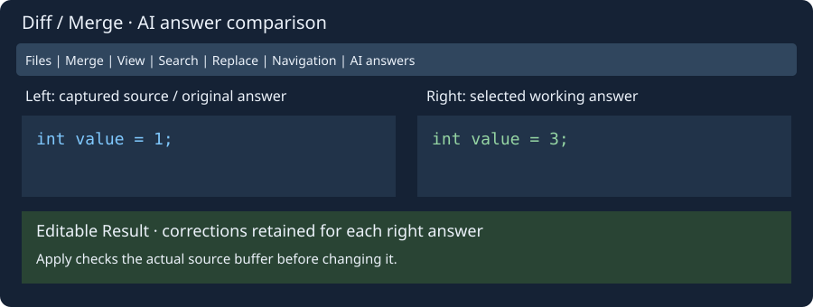

# Shared AI Connections

Open **Tools → AI Connections…** or **AI Connections…** in any assistant. The same named profiles serve source lookup, editor/project review, documentation/comments, local terminal, SSH, compiler messages and program help. Open assistant windows share profile selection and receive updated connection settings. Previously saved endpoint/model/Python settings are imported into Default; the old settings file remains a nonsecret compatibility mirror.

A profile contains name, complete chat/completions API endpoint, model ID, Python 3 interpreter, optional API key and key environment variable. OpenAI/ChatGPT API, xAI/Grok, DeepSeek, Qwen and local/custom compatible API presets fill endpoint and environment-variable names; supply your account's actual model ID and endpoint. The transport supports compatible chat/completions APIs, not browser logins or subscriptions. HTTPS is required except for local development endpoints, as enforced by the existing API client.

Add, Update and Remove manage up to 16 profiles; one must remain. The profile selector in every assistant selects one connection. Existing connection fields can be edited; Send saves those fields back into the selected shared profile. Connection settings live in `insight-ai-profiles.conf`. Query/context/conversation/answers are not stored there. Changing connections does not send a request.

Keys stay in memory by default; an environment variable can supply the key when the profile key is empty. **Save API key in private config (not encrypted)** explicitly opts that profile into plaintext persistence using the platform's private-file creation mode. Clear that option and Update to omit the key from the next saved configuration. This is not an encrypted credential vault. Key fields are masked. The nonsecret legacy mirror does not contain keys.

## Parallel answers

Mark **Include in parallel comparison** on between one and four profiles and Update each. Choose **Compare checked AI profiles** in an assistant, inspect the visible context/prompt/attachments, then Send. Every chosen API receives its own captured copy of the same prompt/context/code/history. Requests run concurrently; subsequent connection edits cannot change those snapshots.

**Compare AI Answers** has a separate tab for each profile. Results and failures appear independently. Inspect explanations, suggested commands and any replacement source, copy an explanation, then **Use selected answer**. Other requests are cancelled. Cancel requests, the parent Cancel button or closing the comparison discards the pending choice. A failed or unfinished answer cannot be selected; a completed answer may be used while another is still pending.

The chosen console answer uses the existing command-insertion and guarded Diff/Merge review. The chosen editor answer stages a variant in the existing editable review, with accumulated requirements and variant Undo/Redo. No answer automatically applies source changes or runs a command. Cancelling a comparison leaves source and accepted variants intact. Provider requests already received cannot be retracted by local cancellation.

## Lookup and context entry points

**Search → Look up selection with AI…** and the editor popup capture an ordinary selection up to 64 KiB, or the caret word when empty. The editable assistant context shows exactly that text; Send is explicit. This is AI explanation/lookup, without a claim that the model performed live web research. Use Search Web for browser searches.

**Ask AI…** in the help viewer captures selected rendered help text, or a bounded page excerpt (64 KiB). **Ask AI about messages…** in compiler/messages/status popup menus captures the selected row or up to 200 recent rows within 64 KiB. Review context before sending. Attach the current file explicitly if a code proposal is needed.

Editor documentation, comment generation, naming and algorithm tasks use these same profiles through the existing standard-task list. Local terminal and SSH buttons use the same assistant and selection controls. Each conversation retains its own source attachment and history; shared connection settings do not combine those contexts.

## Diff/Merge tabs and AI answers

Controls above the source panes are grouped into **Files and comparison**, **Merge and history**, **View**, **Search**, **Replace**, and **Navigation** tabs. Controls use roughly two thirds of their former size; source text retains its font size. Overflowing tab contents can be scrolled.

After choosing a parallel response, **AI answers** compares any completed answer with the captured source or another answer. Left selects the source or an original answer; Right selects a working answer. Manual Result corrections stay with each right answer when switching. The explanation follows the answer. Applying still checks the actual captured source buffer, including when comparing two answers.

Only successful responses completed at selection time are retained; pending requests are cancelled. Choices belong to the current round. Navigating accepted variants in the editor assistant clears these choices while preserving the normal variant Undo/Redo history.

All three code panes use the editor lexer and palette for the file type. Coloring refreshes after text changes rather than cursor movement; work is bounded to 1 MiB and 20,000 style transitions per pane.

