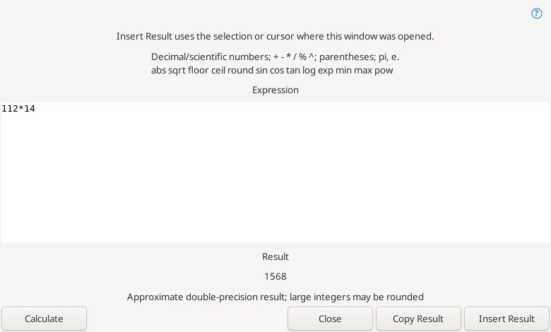
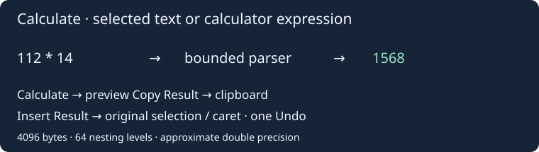
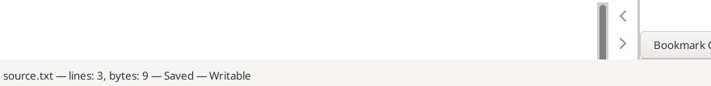

# Calculation and file status

**Edit → Calculation → Calculate Selection** evaluates the exact ordinary selection and replaces it in one Undo action. For example, `112*14` becomes `1568`. Reverse selections, Unicode surroundings and original line endings are preserved. Invalid expressions leave the buffer unchanged; a result identical to the selected text does not create an Undo entry. This command requires a writable selection.

**Calculator…** opens a multiline expression field prefilled from a supported selection. Without a selection it starts empty. **Calculate** previews the result, **Copy Result** recomputes and copies it, and **Insert Result** recomputes and replaces the selection or inserts at the caret where the window was opened. Copy/preview remain available for read-only buffers and unsupported selections, with insertion disabled. Changing the expression clears the previous result. The calculator does not evaluate code or run commands.

Supported decimal/scientific notation uses a dot: `.5`, `2.`, `1.5e-3`. Operators: `+ - * / % ^`, parentheses and unary signs. `^` is a right-associative power: `2^3^2 = 512`, `-2^2 = -4`, `2^-2 = 0.25`. `%` uses floating-point remainder. Constants: lowercase `pi`, `e`. Whitelisted functions:

| One argument | Two arguments, comma separated |
| --- | --- |
| `abs sqrt floor ceil round sin cos tan log exp` | `min max pow` |

Trigonometric arguments are radians; `log` is natural logarithm; `round` rounds halfway cases away from zero. Function names are case-sensitive. Assignment, variables, implicit multiplication, hex/binary literals, bitwise operations, comments and arbitrary code are not supported.

Calculations use approximate IEEE double precision (about 15–17 significant decimal digits), not exact integers, arbitrary precision or decimal accounting arithmetic. Large integers can round; `1/3` displays `0.33333333333333331`. Output uses locale-independent round-trip decimal formatting; negative zero is normalized to `0`. Zero divisors, non-finite results, function domain/range errors and out-of-range numeric literals are rejected. Limits: 4096 UTF-8 bytes without NUL, 64 nesting levels and 2048 values/operators. Diagnostic byte offsets are zero-based.

Insertion rechecks document identity, edit generation, exact selection, current tab and writable state. Edits, moved selections, tab switches or closed targets cancel insertion. Ordinary single selections only; rectangle/multiple selections and virtual space cannot be insertion targets. Direct calculation preserves the clipboard; the dialog changes it only with **Copy Result**. Results and expressions are not saved as a calculator history.

## Show File Status

**File → Show File Status** reports the current buffer's basename, native Scintilla line count, UTF-8 byte count, modified/saved state and read-only/writable state in the native status bar and Status messages log. The report uses in-memory contents, including unsaved edits, and does not access or save the disk file. Empty buffers count as one line; a terminal newline leaves an empty EOF line in the count. Selection, cursor, text and Undo are unchanged. UI language switches apply on the next report.

References: [Calculate](https://www.sourceinsight.com/doc/v4/userguide/Manual/Command_Reference/Calculate.htm), [Show File Status](https://www.sourceinsight.com/doc/v4/userguide/Manual/Command_Reference/Show_File_Status.htm).
