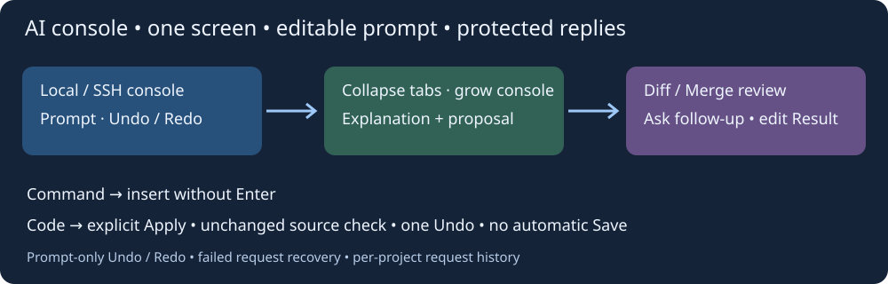
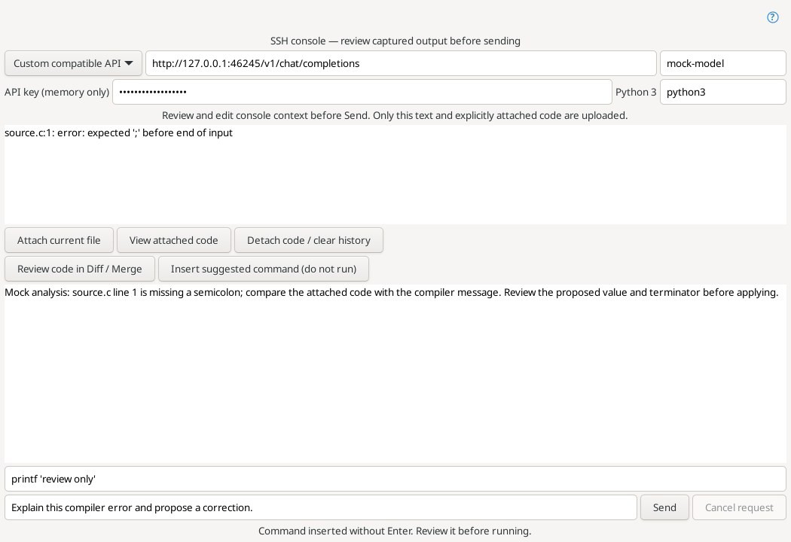
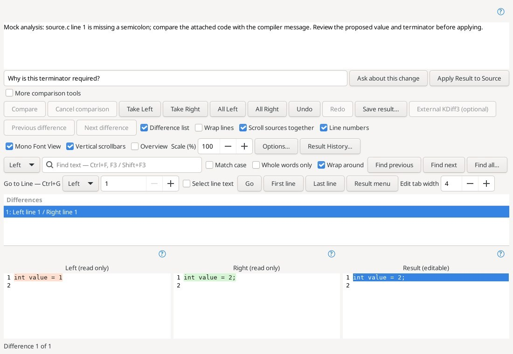

# Console AI assistant

Open **AI Assistant…** in the SSH shell toolbar or the local Terminal context menu. **Tools → Console AI Assistant…** opens an empty context for pasted diagnostics. Python 3 is required at runtime; the helper uses its standard library, without an SDK.

## Configure an API

Choose OpenAI / ChatGPT API, xAI / Grok, DeepSeek, Qwen / Model Studio, or a custom OpenAI-compatible API. Enter the **model ID available in your API account**, API key, complete chat/completions endpoint and Python 3 executable. API access uses provider credentials; a ChatGPT web subscription does not configure this integration.

| Provider | Endpoint / setup | Optional key environment variable |
| --- | --- | --- |
| OpenAI | `https://api.openai.com/v1/chat/completions` | `OPENAI_API_KEY` |
| xAI | `https://api.x.ai/v1/chat/completions` | `XAI_API_KEY` |
| DeepSeek | `https://api.deepseek.com/chat/completions` | `DEEPSEEK_API_KEY` |
| Qwen | Replace `YOUR_WORKSPACE` and region in the preset with the endpoint from your Model Studio workspace | `DASHSCOPE_API_KEY` |
| Custom | Complete compatible endpoint; HTTP allowed only on loopback | entered manually |

Provider changes replace the endpoint and read the corresponding environment key. Model IDs are deliberately editable rather than pinned to a changing provider catalog. Settings remember only provider, endpoint, model and interpreter in `insight-ai.conf`. Keys are held in memory and passed to the helper through stdin, not command-line arguments. Console text, code and conversation are not saved by the assistant. HTTPS is required for remote APIs; redirects are rejected. Normal application session, editor and shell settings retain their existing behavior.

## Ask about output and code

1. The SSH button captures selected output, or its last 16,000 characters. The Terminal menu captures selected text where the installed VTE supports it, otherwise visible output. Review and edit the context before sending; nothing is uploaded just by opening the window.
2. To connect an error to source, select the document and press **Attach current file**. This captures the complete current UTF-8 buffer, including unsaved edits, and its path. **View attached code** shows exactly that snapshot. Attachment is explicit, limited to 128 KiB, and supports empty files. No other project files are read automatically.
3. Ask a question about commands, configuration, a diagnostic or its relation to the attached code, then press **Send**. Each request sends the displayed context, attached snapshot/path, question and in-memory explanation history. Context is limited to 64 KiB. A new attachment or **Detach code / clear history** clears the conversation; history also resets when it exceeds 64 KiB.
4. The answer can include an explanation, a single-line command and a complete replacement for the attached buffer. Unstructured answers remain readable but cannot change source. Incomplete/truncated responses are rejected. **Cancel request** terminates the pending helper; closing the window cancels it too. Network operations have a 60-second timeout.

**Insert suggested command (do not run)** places a command into the SSH input or a clean local terminal prompt without Enter. It does not connect SSH or execute anything. A dirty local prompt rejects insertion to avoid appending to an existing command. Inspect the command and run it yourself when ready.

## Review corrections

**Review code in Diff / Merge** opens the actual comparison window with captured source on the left, the proposed replacement on the right and editable Result. Its explanation area displays the model's reasoning; the adjacent question field and **Ask about this change** send an explicit follow-up through the assistant.

Use **Take Right**, **All Right**, or manual Result edits to choose the correction. **Apply Result to Source** updates the attached editor buffer in one Undo action. The document must still have the same identity, filename and exact contents as when attached, and must be writable. Changed, closed, renamed or read-only buffers reject application; attach fresh code and ask again. Result must fit the same 128 KiB UTF-8 limit. Applying does not save files or upload remote files. Review the result and use the editor's normal Save / remote upload actions.

This version handles one attached buffer at a time. It does not run model tools, search the project automatically or apply multiple-file patches. Follow-ups reuse the captured attachment until you replace it. Provider output is a proposal and may require correction.

## Validation

The transport tests use a loopback mock API and cover all four compatible provider request shapes, authentication, malformed and truncated answers, redirects, bounds and command controls. The native Linux test exercises real SSH/assistant/Diff widgets, source attachment, follow-ups, command insertion without execution, stale/read-only rejection, one Undo, unchanged disk, cancellation and the local VTE menu. No live provider keys were supplied; live OpenAI/xAI/DeepSeek/Qwen accounts, Windows and Android were not tested.

Provider references: [OpenAI](https://developers.openai.com/api/reference/resources/chat/subresources/completions/methods/create), [xAI](https://docs.x.ai/developers/model-capabilities/legacy/chat-completions), [DeepSeek](https://api-docs.deepseek.com/), [Qwen compatible API](https://www.alibabacloud.com/help/en/model-studio/qwen-api-via-openai-chat-completions).

In AI review, **More comparison tools** expands the file/whitespace/regex/replacement rows; Ctrl+H also opens replacement controls. These tools start collapsed to leave room for source and Result. Line numbers start enabled.

## Actual editor windows

These are real assistant and Diff/Merge windows from the complete Linux editor under Xvfb. Diagnostics, source and replies are synthetic test fixtures from a loopback mock API, not a live provider session. The screenshots show context review, an explicit source attachment, a suggested command without execution, and the explanation/follow-up area beside Apply.

Each review keeps its captured proposal. A follow-up opens the assistant with the new answer; use Review code again to compare a new proposal. Cancelled or failed comparisons cannot apply a Result.

Verified code: [`5a2f1e4271b30304e218a5664e8565e3010f9c77`](https://github.com/bhgv/geany-insight/commit/5a2f1e4271b30304e218a5664e8565e3010f9c77). [Native Linux CI 39595574834](https://github.com/bhgv/geany-insight/actions/runs/39595574834): complete build/install with VTE, comparison core and **66/66 selected tests passed**, zero failures, skips or timeouts. Includes cancelled-comparison application rejection. Live providers were not tested.

[Editor and project AI: cumulative requests, variants, manual Result and refresh](editor-ai.md).

[Shared AI Connections / Общие подключения ИИ](ai-connections.md) — shared profiles, optional key storage and parallel answer selection supersede the earlier single-connection setup.

## Embedded SSH assistant, attachments and history

Ai opens a separate window for the selected SSH terminal. Connection, Context / source and Attachments group the settings at the top. The paperclip accepts up to four files totaling 512 KiB. Text is sent as text, PNG/JPEG/WebP/GIF as image parts, PDF and other binary types as file parts where supported by the API/model. ZIP/TAR/GZ are inspected in memory: the listing and small UTF-8 members are sent; binary/large members are explicitly marked as omitted. Limits: 64 entries, 512 KiB content, 64 KiB per text member, 1 MiB tar stream including headers. Archives are never extracted to disk.

Generated files returned by the model (up to four, 256 KiB combined and within the overall answer limit) appear under Attachments → Save received file. Only validated bytes from the answer are saved, to a user-chosen path; nothing opens or runs automatically. Image and binary file-part support depends on the provider/model; provider errors remain visible.

The list above the answer retains up to 32 answers in this session. Selecting one restores its text, suggested command and files; Diff uses the same explicitly attached source snapshot. Attaching/detaching source clears answer history. SSH Run reviewed command executes the selected suggestion only when clicked. The jump button next to terminal input opens a selected file:line diagnostic in an existing local source or SFTP cache.

## One terminal group and a floating Ai window

The bottom **Terminals** tab contains **Local / SSH / TTY**. Context remains a separate tab. Every terminal screen has an **80%-opaque Ai** button: drag it to a free area; resizing keeps it inside the screen.

Ai opens a separate resizable system window with window controls, prompt, answers, model settings and attachments. In the regular style it is transient for the main window; independent-window mode removes that relationship. Pressing Ai again raises the existing window and refreshes context unless a request is active. Destroying the source terminal closes its assistant. This is a floating system window; no internal MDI container is introduced.

**Errors → source**, **Shell help**, **Explain output** and **Connection help** stage an editable prompt. History and the four frequent requests are separated by usage context: Local terminal, SSH, TTY, manual console, diagnostics, program help, source help, and Editor/Project. Each context retains up to **100 unique requests**; repeating a request updates its frequency and recency, and adding the 101st discards the oldest. Selecting does not send: edit the text, then press **Send**. **Delete selected** removes one entry; **Clear history** clears this context only and leaves the current prompt editable. Answer history is separate: up to 32 replies held in the window's memory.

Requests are saved immediately before dispatch in **`<project-file>.ai-history/`**, beside the project file, with a separate `.conf` per context. The directory can be tracked with the project in Git. Without a project, storage uses `insight/ai-history/` under the configuration directory. Restarting reloads the history. An open window stays bound to the project it was created for; reopening terminal Ai after switching projects creates a window with the new project's history. The history controls' tooltip shows the file path. Only request text, frequency and timestamp are stored, excluding API keys, replies, terminal output and attached source. A save failure displays an error and prevents dispatch.

SSH/TTY use selected text or the last 12,000 characters; Local uses selected text or its available transcript. The resulting context is capped at 60 KiB and can be inspected and edited. Attach source explicitly. Review code proposals in **Diff / Merge**; inserting a command does not execute it. For TTY, check the device protocol: shell commands may not apply to a COM device.

## Connection fields, collapse and a unified conversation screen

API URL, model, key and helper executable fields have purpose tooltips and expand with the window. The **Collapse** tab folds the top block down to its tab strip; select another tab to restore its content. The conversation receives the freed height.

In the regular AI window, input and replies share one black screen. Earlier messages are protected; edit the current request after **You>**. **Enter** inserts a line; **Ctrl+Enter** or **Send** submits. Native selection, copy and paste are supported. Select a saved request to edit it before resending. Command actions, attachments and answer variants are in the upper tabs. The editor assistant retains its main Diff / Merge area for reviewing code.

Initial geometry is bounded to the current monitor's work area, accounting for the titlebar. Title buttons minimize, maximize/restore and close the window. Resizing gives free space primarily to the conversation screen (or code comparison in the editor assistant).
