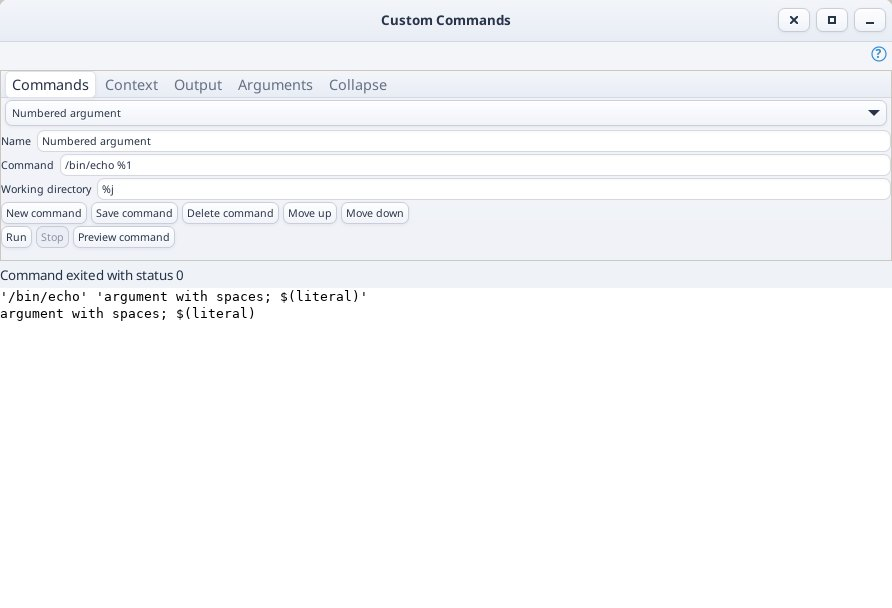
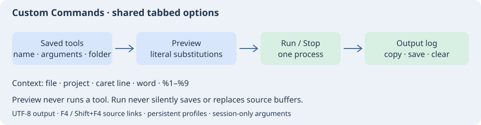
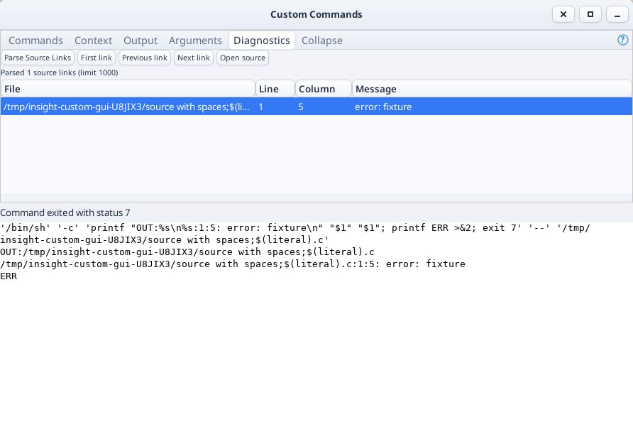
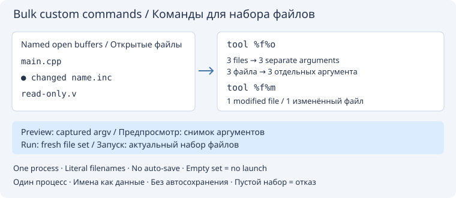
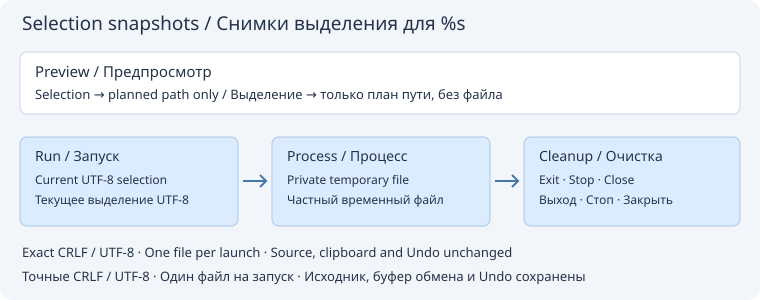

# Custom Commands

Open **Tools → Custom Commands…**. This modeless tool window adds a saved external-tool list, literal context substitutions, a launch preview, a working directory, numbered arguments and a selectable output log. It uses the shared compact top tabs and Collapse control. An unassigned **Custom Commands** Editor binding can be configured in Keybindings.





1. Choose New command, enter a name, executable/arguments and working directory.
2. Save command stores it across editor restarts. Move up/down changes the saved order; Delete command removes the selected entry. Save edits before switching profiles or closing the window.
3. Fill `%1`–`%9` on Arguments when needed. These values are session-only and are not saved with a profile.
4. Preview command shows the expanded argument vector, directory and available context. Run samples the current editor/project context again; preview does not start a process.
5. Output merges stdout and stderr. Stop ends the directly launched process; Copy output and Save command output export the captured text. Clear output only clears the local display.

| Variable | Value |
| --- | --- |
| `%f`, `%n`, `%b`, `%e` | Full current filename, filename, stem, extension without dot. Require a named source file. |
| `%r`, `%d` | Filename relative to the project source root (absolute outside it), current file directory. Without a named source, `%d` is the home directory. |
| `%j`, `%J` | Project source root; project-data directory. Without a project, `%j` uses the named file's directory or home. `%J` requires a project. |
| `%p`, `%o` | Project path without extension; project name without path/extension. |
| `%l`, `%w` | One-based caret line; first whitespace-delimited word in a normal selection, or native word at the caret. Word capture is limited to 4096 bytes. |
| `%s` | Temporary UTF-8 file containing the current selection; created only for Run. |
| `%a`, `%t` | Current local date (`YYYY-MM-DD`) and time (`HH:MM:SS`). |
| `%1`–`%9` | Fields on the Arguments tab. Empty fields produce empty arguments. |
| `%%` | Literal percent sign. |
| `%PROJECT_SOURCE_DIR%`, `%PROJECT_DATA_DIR%`, `%PROJECT_NAME%` | Long project variables, case insensitive. |
| `%PROGRAM_DIR%`, `%TEMP_DIR%`, `%APPDATA_DIR%`, `%LOCAL_APPDATA_DIR%`, `%DESKTOP_DIR%`, `%MYDOCUMENTS_DIR%` | Predefined system folders, using the existing project-path resolver. Windows also supports `%PROGRAMFILES_DIR%`, `%PROGRAMFILESX86_DIR%`, `%WINDOWS_DIR%`. Unavailable folders decline the launch. |

## Arguments and examples

The template is parsed into an argument vector **before** substitutions. Values are substituted exactly once inside each argument. A filename containing spaces, quotes, dollar signs or semicolons remains one argument and cannot add another executable. Quote literal arguments that contain spaces. Ordinary shell operators are not interpreted; explicitly launch a shell if desired. For an explicit shell, pass substitutions as separate arguments and reference quoted positions such as `"$1"`, rather than inserting them into the script text. When writing shell scripts in the template, escape literal percent signs as `%%`, including printf formats. The preview quotes arguments for display; this display string is not executed.

Examples:

```text
cc -fsyntax-only %f
python3 -m py_compile %f
git -C %j diff -- %r
python3 %1 %f
```

Filename variables use on-disk files; `%s` captures selected buffer text. It does not save buffers, replace source text, clear Undo or silently apply output as code. External tools have their normal filesystem permissions and may modify files themselves. The working directory must exist and be absolute after expansion; blank uses `%j`. File timestamps, source parsing and project membership are unaffected by merely opening or previewing this window.

## Bounds and platform scope

Up to 64 named commands are stored in the editor profile's `insight/custom-commands.conf` by atomic replacement. Templates are at most 16384 bytes, names 128 bytes, settings 1 MiB; launch supports up to 128 arguments, each expanded argument 65536 bytes and all arguments together 256 KiB. Unknown variables, invalid UTF-8, line breaks and unavailable required context reject a launch.

Output is decoded as UTF-8 across pipe chunks; invalid bytes use replacement characters and NUL is displayed as `␀`. The process is stopped at 4 MiB, 50000 lines or 64 KiB on one line. This is an output log, not a terminal: no VT escape interpretation or interactive stdin. Stop/Close terminates the directly launched process and cancels the local output read; it does not promise to terminate independently forked descendants. No auto-run occurs when a project opens or settings are loaded.

Source Insight ShellExecute and automatic per-command hotkeys are not implemented. Numbered arguments use explicit fields instead of modal argument prompts. Native GUI testing uses Linux; Windows shell syntax and runtime behavior require separate validation.

Reference: [Source Insight Custom Commands](https://www.sourceinsight.com/doc/v4/userguide/Manual/Command_Reference/Custom_Commands1.htm).

## Source links from diagnostics



On **Diagnostics**, **Parse Source Links** scans a snapshot of the latest command output into a sortable File / Line / Column / Message table (up to 1000 records). The displayed launch command is excluded. Typical GCC/Clang `file:line[:column]: message`, MSVC `file(line[,column]): message` and Python traceback `File "name", line N` formats are recognized; ANSI SGR colors are stripped for parsing. Parsing does not read source files or change project membership.

Double-click a row or choose Open source. First/Previous/Next link and **F4 / Shift+F4** within this tool window use native editor navigation history. The file opens in the editor without closing the tool window; the reported line is used, while the optional column is displayed as diagnostic metadata. Missing files and line numbers beyond the current buffer are reported. No code or Undo contents are modified by navigation.

Relative paths resolve against the **captured launch directory**, even if another project is active when you parse the log. The tool's internal `chdir`, remote path mappings and custom regular-expression templates are not inferred. Foreign Windows drive/UNC paths are declined on non-Windows systems. Synthetic stdin/URI locations and invalid coordinates are omitted. Run and Clear reset the old diagnostic list; new output is included only on the next explicit Parse. Copying or saving the output retains the full log.

This is a bounded set of built-in diagnostic formats, rather than all Source Insight custom parsing patterns. Reference: [Parse Source Links](https://www.sourceinsight.com/doc/v4/userguide/Manual/Command_Reference/Parse_Source_Links.htm).

## Commands over open and modified files



Append `%o` (all named open files) or `%m` (only named open files with modified buffers) to a filename variable:

| Argument | Value for each selected file |
| --- | --- |
| `%f%o` / `%f%m` | Full path |
| `%r%o` / `%r%m` | Project-relative path; absolute outside the root |
| `%n%o` / `%n%m` | Filename including extension |
| `%b%o` / `%b%m` | Filename stem |
| `%e%o` / `%e%m` | Extension without dot |

For example, `cc -fsyntax-only %f%o` checks named open sources in one launch. `python3 %1 %f%m` passes modified files to the script from the first Arguments field. Each filename remains a separate argument, even with spaces, quotes, `$`, `;` or `%`. Values are never reparsed. `--file=%f%o` repeats the prefixed argument per file; `%n=%f%o` uses the name and path of the same file. One bulk marker is permitted per argument, with multiple such arguments permitted per command.

Preview displays the complete expanded argv. Run rebuilds the snapshot, so subsequent opens, closes and modified-state changes are included. Snapshot order follows the editor's internal document array; reordering visible tabs does not promise to change it. Read-only sources are included; unnamed buffers are skipped. `%m` uses the open buffer's modified flag, rather than Git status or disk timestamps.

Commands receive on-disk paths. Buffers are not automatically saved and their text/Undo are untouched. An empty selected set, multiple bulk markers in an argument, a bulk executable or the combined 128-argument / 256-KiB bounds reject the entire launch. Bulk modifiers work in command arguments only, not the working directory. Standalone `%o` still means the project name; `%%` produces a literal percent. Saved profiles retain the template, not a file list.

## Selected text in a temporary file: `%s`



`%s` in command arguments expands to a temporary filename containing the **current editor selection**. For example, `python3 -m json.tool %s` prints formatted selected JSON to the output log. Output is not automatically pasted into source. `python3 %1 %s` passes the selection to the script from the first Arguments field.

One nonempty ordinary selection up to 1 MiB is supported: forward or reversed, named or untitled, including read-only documents. The snapshot preserves the editor buffer's exact UTF-8 bytes, without adding a BOM, reindenting or converting CR/LF/CRLF. Repeated `%s` tokens share one file. Empty, rectangular, multiple or virtual selections, NUL and invalid UTF-8 reject the launch. `%%s` is literal `%s`; values substituted through `%1` or other variables are never expanded again.

**Preview** validates selection and displays a planned path without creating a directory or file. **Run** captures selection again, validates all arguments and the working directory, then creates a new private temporary directory and file. Selection changes after Preview are included; source edits during a process do not change its snapshot. Unix permissions are 0700 for the directory and 0600 for the file. Snapshot encoding is always UTF-8, independent of the original disk encoding.

The file is removed after the process and output capture complete, including nonzero exit, Stop and closing the command window. Creation/spawn failures release owned resources too. Only the owned file and empty directory are removed; extra child-created files are not recursively deleted. Cleanup cannot be guaranteed after editor/OS crashes. Snapshot contents are not saved in command profiles; source, clipboard and Undo stay unchanged. `%s` is not a working directory or a persistent file for detached child tasks.
