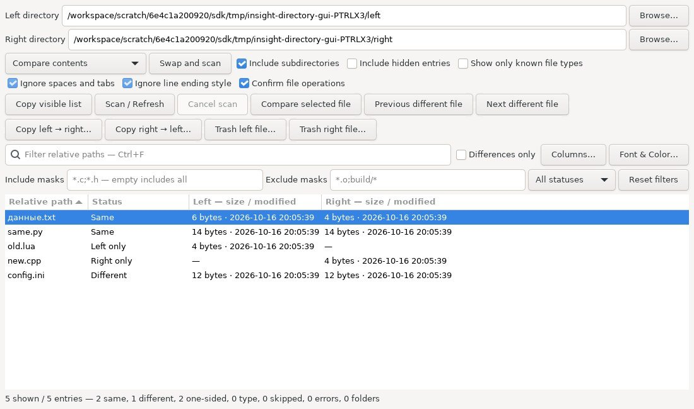
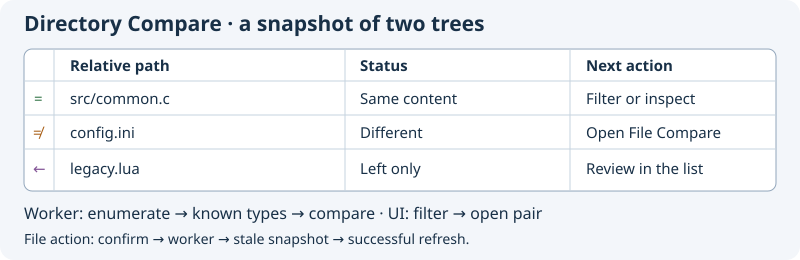
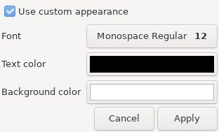
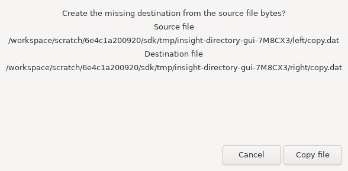

# Directory Compare

Open **Tools → Directory Compare…**, or **Compare directories…** in File Compare.
Enter Left and Right directories (or Browse), then press **Scan / Refresh**, Enter
in a path, or F5. Scanning, content reading and comparison run in a cancellable
GTask worker. Completed rows are prepared in UI idle slices of roughly 3 ms.
Cancel, a missing root, a scan error or an entry/depth limit leaves the previous
snapshot intact. A late worker completion cannot update a destroyed window.

## Choose what to compare

| Method | Meaning of Same for regular files |
| --- | --- |
| Compare contents | Equal bytes, independently of modification dates |
| Compare modification dates | Equal modification time including microseconds; contents and size are not read |
| Compare sizes and dates | Equal size and modification time; contents are not read |

**Include subdirectories** recursively matches exact relative paths. Turn it off
to inspect direct children only. **Include hidden entries** includes dot names
and entries marked hidden by the filesystem. These options apply on the next
scan. There is no filesystem watcher in this window; F5 refreshes the snapshot.
Filename matching is exact and case sensitive, even when both filesystems fold
case. Directory roots must be representable in the interface filename encoding;
child names retain their native bytes internally and use display names in the UI.

In content mode, **Ignore spaces and tabs** skips ASCII horizontal whitespace
(space, tab, vertical tab, form feed). **Ignore line ending style** normalizes
CR, LF and CRLF to one terminator. Missing final terminators remain significant.
This is a linear normalized-byte comparison, not a language parser. Unlike the
line-based File Compare engine, an unterminated whitespace-only fragment can
normalize to empty content. Text options require valid UTF-8 without NUL and at
most 1 MiB per side; unsupported text receives Skipped, never Same. With text
options off, binary content is compared exactly in bounded streaming reads.

## Read the result

| Status | Meaning |
| --- | --- |
| Same | Regular files satisfy the selected method |
| Different | Regular files differ; the label also indicates the newer side when times differ |
| Left only / Right only | The relative path exists on one side |
| Type mismatch | One side is a file and the other a directory |
| Folder | Both sides are folders; inspect their child rows |
| Skipped | Symlink, special file, unsupported text, file-size or byte-budget limit |
| Read error | File cannot be read or changed while being checked; hover for details |

Folders do not claim that their complete contents are identical. Enumerated
symlinks are shown but not followed; a symlink root is rejected. Size, time,
file identity and etag are rechecked around reading where the filesystem supplies
them. This is a best-effort snapshot, not an atomic filesystem transaction or a
security boundary against concurrent path replacement.

**Differences only** hides Same and paired Folder rows, while retaining skipped
and error rows. **Ctrl+F** focuses a case-insensitive Unicode substring filter on
displayed relative paths. Click Relative path or Status to sort; filter and sort
remain active after refresh. Counts distinguish same, different, one-sided,
type, skipped, errors and paired folders. Left/Right columns show size and local
modification date; the full diagnostic is in the row tooltip.

**Previous / Next different file** or Ctrl+Up / Ctrl+Down selects a non-Same,
non-Folder row in visible sort order, stopping at the ends. Double-click, Enter
or **Compare selected file** opens a pair of regular files in a new File Compare
window. The action uses roots and text flags from the completed snapshot, even
if path fields or options have since changed. Content is re-read there; it can
have changed since this scan. File Compare has its own 1 MiB / UTF-8 and LCS limits.
One-sided paths, folders and links do not open as a fabricated empty file.

The context menu also copies a relative display path or the **visible list**.
Copy visible list preserves the displayed sort/filter and produces UTF-8 TSV with
path, status and left/right metadata. Backslashes, tabs and line breaks inside
fields are escaped as `\\`, `\t`, `\r`, `\n`. It is a human-readable report,
not a lossless native-filename manifest. The list remains a snapshot; regular-file
copy and trash commands are described below. Path variables and backup comparison
remain future work.

The JPEG is a real production-widget capture with synthetic temporary files,
not a full-editor screenshot. The selected Cyrillic pair compares equal after
horizontal-space and line-ending normalization; it retains different byte sizes.

## Bounds and verification

Defaults: 20,000 union entries, 100,000 visited entries across both trees, depth
32 and relative paths up to 16,384 bytes. Exact content mode reads paired files
up to 64 MiB per side; normalized text mode reads up to 1 MiB per side. A scan has
a conservative 256 MiB content allowance, charged by both snapshot sizes before
reading; a pair that cannot fit is Skipped. Exact-mode size mismatches need no
content read. Skipped/error counts must be inspected before treating a report
as complete. Subdirectory enumeration errors abort the scan rather than report
an incomplete tree as equal.

Meson tests: **Insight directory comparison snapshots**, **Insight isolated
Directory Compare GUI**, **Insight native Directory Compare routing GUI**.
The first two pass locally on Linux with UBSan, strict warnings and fatal GLib
criticals. They cover content/text/metadata modes, binary bytes, hidden and nested
paths, links, limits, cancellation, filter/sort, clipboard, snapshot-root routing,
empty results and closing while a worker is pending. The native test boots the
complete editor, opens the Tools command, scans a pair and verifies the real
File Compare result. Linux CI includes all three and the existing editor tests.
Windows and Android have not been executed in this series.

Reference: [Source Insight Directory Compare](https://www.sourceinsight.com/doc/v4/userguide/Manual/Command_Reference/Directory_Compare.htm)
and [Directory Compare Options](https://www.sourceinsight.com/doc/v4/userguide/Manual/Command_Reference/Directory_Compare_Options.htm).

**Columns…** toggles Status, Left metadata and Right metadata for this window.
Relative path stays visible. Hiding a sorted column keeps its sort order;
Copy visible list still exports all four report fields for the visible rows.

### File masks and status

Use **Include masks** (`*.c;*.h`) and **Exclude masks** (`*.o;build/*`) to narrow the completed snapshot without rescanning. Masks are case-sensitive GLib globs: `*` matches any sequence, `?` one character; semicolons separate masks and surrounding spaces are trimmed. Each mask matches the relative path or basename. Empty inclusion means all entries; exclusions win. Folders are filtered by their own names. The status selector combines with path search and Differences only. Hidden rows still count toward scan limits. Clipboard export and difference navigation use the visible rows.

**Swap and scan** exchanges the input paths and starts a fresh comparison. The previous snapshot remains usable if the scan fails or is cancelled. **Reset filters** clears search, masks, status and Differences only together. The row context menu copies either side’s full path from the completed snapshot; an absent side is disabled. Editing input paths does not change these clipboard targets.

### Known file types

**Show only known file types** takes a fresh snapshot of editor filename patterns and language-profile extensions on each scan. Unknown files are removed before content reads; real directory rows remain so traversal and type mismatches stay visible. Entry, visit and depth limits still apply to the complete enumeration. This recognizes names, not binary content: a broad pattern can include binary files. Unlike display masks, changing this option requires Scan / Refresh. Explicit individual-file profile bindings do not extend this filename filter.

**Font & Color…** in the filter bar or row menu opens the shared list appearance dialog. Enable custom appearance to choose a font, text color and background; Apply commits the change and Cancel preserves the current style. Theme selection highlighting remains visible. Turn custom appearance off to restore the theme. Each open comparison has its own style.

### Remembered window options

Closing a comparison remembers its input paths, comparison method, recursion/hidden/text/known-type options, search, masks, status, Differences only, visible columns, sort direction, window size and list appearance for newly opened windows. At editor exit the most recently opened comparison still alive supplies these defaults to `insight/workbench.conf`; otherwise the last closed window does. Existing windows keep independent controls. Restoring options never starts a scan and never restores result rows. Press Scan / Refresh to get a fresh snapshot. Invalid or unsupported saved values retain the normal defaults; the relative-path column always remains visible. Reset filters clears display filters only, leaving comparison options and appearance intact.

The appearance dialog below is captured from the production GTK widgets in the isolated Linux fixture (editor host stubs).

### Copy and Trash from the completed snapshot

Select a regular-file row and use **Copy left → right…**, **Copy right → left…**, **Trash left file…** or **Trash right file…** in the toolbar or context menu. A copy can create a missing file or replace an existing regular file. With **Confirm file operations** enabled (the default), confirmation shows the source and destination taken from the completed snapshot, even if the directory entry fields have been edited. Cancel is the default. Cancelling this dialog changes nothing.

Both operation paths must be closed in the editor, including unmodified buffers. The guard is checked again after confirmation. During the worker task this window is modal, the other actions are disabled, and **Cancel file operation** requests cancellation. Closing the window cancels its task. Cancellation cannot undo an atomic replacement that has already completed. After every attempt, including a failure or cancellation, the old list is marked stale and further file operations are disabled until a successful Scan / Refresh. Existing comparison rows are never presented as an updated filesystem result.

Copying reads at most 64 MiB of exact source bytes, including binary data. Text normalization options do not alter the copied bytes. Source identity, etag, size and timestamps are rechecked before and after reading. An existing destination needs its original identity and etag; GIO conditional replacement prevents silently replacing a different snapshot version. A previously missing destination is staged in a private sibling temporary file and moved without overwrite or recursive fallback. Source and destination referring to the same file are rejected. Roots and parent components must remain real directories; missing parents are not created, and folder, symlink and special-file operations are unavailable. Parent checks and etags do not provide a filesystem lock.

These are content operations: ownership, permissions, executable bits and timestamps are not copied. GIO private-file creation is requested for newly written/replaced content; there is no automatic backup or undo. Trash uses the system backend and never falls back to permanent deletion. If that backend refuses the operation, an error is shown and the source is retained.

The confirmation below is captured from the real production widgets in the isolated Linux GTK fixture, with editor-host callbacks supplied by the test.

A successful refresh keeps the currently selected relative path and scrolls it into view, including when sort order changes. Selection is restored only if the row still exists and passes the current filters. A removed or filtered-out row is not replaced with an unrelated selection; cancelled and failed scans preserve the old model and selection.

**Confirm file operations** controls both copy and Trash prompts and is remembered with window options. Turning it off makes the toolbar/context-menu action start immediately; editor-buffer guards, identity/etag checks, cancellation and the mandatory refresh after an attempt still apply. Invalid saved confirmation values restore the enabled default.
