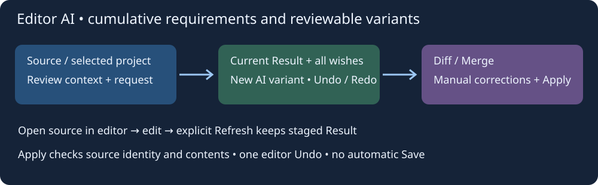
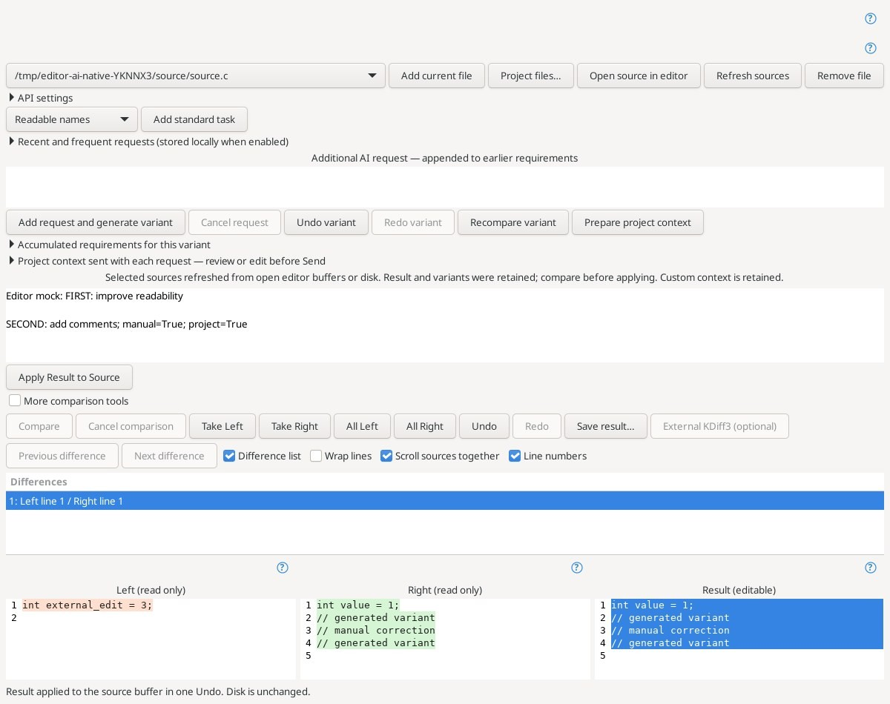

# Editor and project AI assistant

Open **Tools → Editor / Project AI Assistant…** with the source document selected. The assistant lives inside the existing Diff/Merge window. It shares [console assistant](console-ai.md) API settings: OpenAI/ChatGPT API, Grok, DeepSeek, Qwen and compatible servers. Python 3, an API key and a model ID are required. Expand **API settings** to configure them. Keys remain in memory; only endpoint, provider, model and Python executable are saved.

## Tasks and accumulated requirements

Choose a standard task and press **Add standard task**, or enter a custom multiline request. Tasks cover syntax/diagnostics, logic/edge cases, formatting, better solutions, readable function/variable/class/struct/macro names, algorithms, function reference, useful comments and documentation.

**Add request and generate variant** sends the new request together with all requirements of the selected variant, the current editable Result, the target path and the displayed project context. Requests accumulate. **Accumulated requirements for this variant** shows the full text. While a request is pending, Result is locked; **Cancel request** preserves the previous variant and the draft request. Closing the window also cancels it.

This is model analysis, not a compiler or test run. Review syntax and logic claims against actual tools. Standard tasks ask for evidence, uncertainty, preserved contracts and any cross-file changes still needed. Unstructured answers are shown as explanations without replacing code.

## Variants and manual correction

Left shows the captured source; Right shows the proposal; **Result is manually editable**. A successful reply stages its complete proposal in Result, leaving the source document unchanged. The next request uses Result, including manual corrections.

- **Undo variant / Redo variant** restore code, accumulated requirements and explanation together. Manual Result changes are retained as a variant before the next request or variant navigation. A new request after Undo branches the history and drops the old Redo branch.
- Normal Diff/Merge **Undo / Redo** operate on Result edits and block choices within the current comparison.
- Each file retains up to 32 in-memory variants. Switching files captures Result and restores that file's own history.

**Apply Result to Source** changes the editor buffer in one Undo only if the captured source still matches and is writable. It never silently overwrites changed/renamed sources. No automatic Save or SSH upload occurs. Use normal editor Save and project validation afterwards.

## Open source and refresh

**Open source in editor** selects the original document in the main editor, keeping AI Diff open and Result staged. Edit there, then press **Refresh sources** in AI Diff. Refresh is explicit; returning focus does not overwrite anything.

Selected sources are reread from open editor buffers (including unsaved edits), or disk. Result and variant histories are retained while Left is refreshed. Automatically generated, unmodified project context is rebuilt too; custom context is retained. Compare the new source against the retained Result before applying. Explicit refresh can reread a closed saved file; an open renamed document must be added again.

## Project review

**Project files…** displays actual indexed project membership. Wait for indexing, select files and press **Add selected files**. **Add current file** captures the current open document. **Remove file** removes the selected file from this session; rebuild context if it included that source.

**Prepare project context** collects complete snapshots of the other selected files. Expand **Project context sent with each request** to inspect or edit it. Selecting files and preparing context do not upload data. Rebuild context for another target as needed. Proposals and application are per file: switch targets and request the corresponding changes. No automatic multifile patches or command execution occur.

Limits: **16 files** per session; **128 KiB** per complete UTF-8 source/Result; **64 KiB** project context per request; **4 KiB** additional request; **16 KiB** accumulated requirements. Oversize input is rejected without silent truncation. This reviews the selected group, not necessarily a complete large project; use separate sessions for other groups.

## Recent and frequent requests

**Recent and frequent requests** offers up to 20 recent and 20 most-used requests. Selection appends text to the draft without sending it. Standard tasks also append to the current draft.

When **Remember request text for recent/frequent lists** is enabled, successful new request texts, counts and timestamps are saved privately in `insight-ai-prompts.conf` (up to 64 entries). Code, replies and API keys are not recorded there. Disable the checkbox to exclude current requests from these lists. Code variants and accumulated requirements remain in memory only.

## Validation

Core tests cover accumulated requirements, variant Undo/Redo, branching, bounds and durable prompt usage. The full-editor Linux GUI test uses a real indexed project and loopback mock API to check project context, manually edited Result in subsequent requests, cumulative requirements, variant navigation, source opening, refresh without Result loss, stale/read-only guards, one Undo, unchanged disk, prompt lists and cancellation. Live provider accounts, Windows and Android were not tested.

The **Project consistency** task reviews the target and selected context together and lists evidence and cross-file corrections. Standard task prompts follow the selected interface language.

**Recompare variant** retries a cancelled/failed comparison without losing the retained variant. It first captures manual Result corrections when a complete comparison is available.

## Actual application window

This is the real editor/project AI panel in the complete Linux editor under Xvfb. The project source, requests and replies are synthetic loopback mock API fixtures, not a live provider session. The snapshot shows cumulative requirements, a retained manual correction, explicit refresh and editable Result.

Verified implementation: [`08eb8655d4d40be8c8c61f62a07d65224c0791cb`](https://github.com/bhgv/geany-insight/commit/08eb8655d4d40be8c8c61f62a07d65224c0791cb). [Native Linux run 39602110109](https://github.com/bhgv/geany-insight/actions/runs/39602110109): complete editor build/install with VTE, comparison-core checks and **68/68 selected tests passed**, zero failures, skips or timeouts. Includes variant recovery after cancelled comparison, compact search keyboard commands and prompt usage shared by review windows. Live provider accounts were not tested.

[Shared AI Connections / Общие подключения ИИ](ai-connections.md) — shared profiles, optional key storage and parallel answer selection supersede the earlier single-connection setup.

[Shared comparison layout / Единое оформление сравнений](comparison-layout.md).
