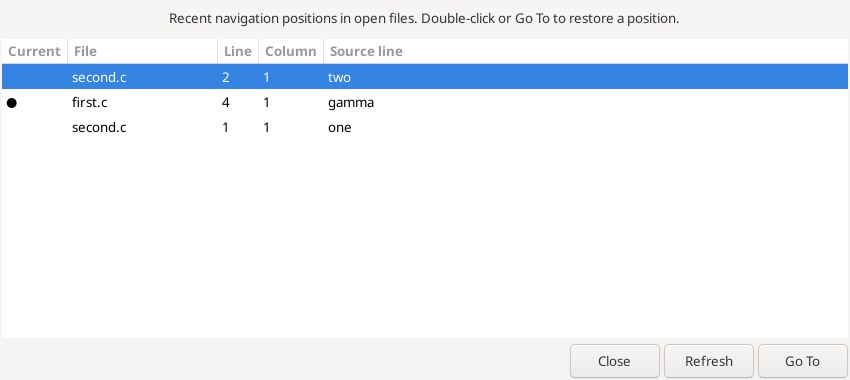
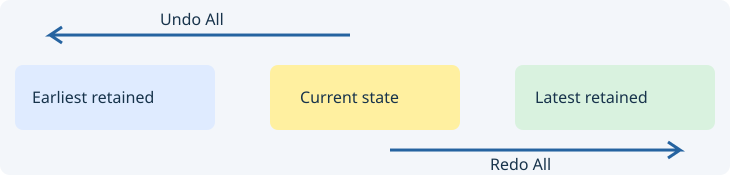
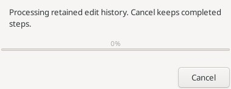

# Navigation and edit history

## Selection History

Open **Edit → Selection and navigation → Selection History…**. Recent navigation positions in named open files show the filename, one-based line and visual column, and a source-line excerpt. Hover for the full path. ● marks the current position when present. Double-click or **Go To** restores the selected position; **Refresh** reloads the list and **Close** exits without navigating.

The list shares the native **Back/Forward** queue. Choosing an entry preserves forward navigation. A new ordinary jump from inside the queue starts a new branch. Insertions shift retained positions; deletion covering a position collapses it to the deletion start. Undoing a deletion does not recover its former interior position.

At most 512 queue entries are retained; an unqueued current position may appear as an additional row. Closing a file removes its entries. If history changes while the dialog is open, Go To refreshes it first; choose a row again. This records navigation commands plus the current position, not every mouse motion, selection or enclosing symbol. Untitled buffers and history persistence across restarts are not supported yet.

Actual Linux dialog with navigation between two files:

## Undo All / Redo All

**Edit → Undo All / Redo All** traverse all retained edit history in the current document. The boundaries are the earliest/latest available Scintilla history states, not the most recent Save or a disk reload.

Work is processed in batches with a progress dialog. **Cancel** stops further steps, retaining completed work and the available Undo/Redo branch. Ordinary undo-group boundaries, the document's savepoint state and line endings are preserved. A new edit after Undo branches the history and discards old redo steps as usual.

Read-only documents and open undo groups refuse these commands. Closing or switching the document, changing its history, or enabling read-only during a run stops processing. Neither command writes to disk.

Actual Linux bulk-undo progress dialog:

Reference: [Selection History](https://www.sourceinsight.com/doc/v4/userguide/Manual/Command_Reference/Selection_History.htm), [Undo All](https://www.sourceinsight.com/doc/v4/userguide/Manual/Command_Reference/Undo_All.htm).

## Go Back Toggle / Переключить последний переход

Edit → Selection and navigation → Go Back Toggle alternates normal Back and
Forward over the latest pair. A normal Back/Forward command, a different caret or
active document, a text edit or a changed/pruned history starts a fresh Back pair.
Failed boundary moves do not arm a toggle. Untitled buffers have no queue identity
and do not start a pair. The existing open-file history, edit anchors and Extend
Mode behavior remain in use. No bytes, clipboard or Undo are changed. A new
unassigned Go to keybinding allows a user shortcut without replacing defaults.

Повторная команда переключает две последние позиции через штатные Back/Forward.
Ручной переход, смена курсора/документа или изменение истории начинает новую пару.
На границе истории команда ничего не меняет. Новые несохранённые буферы без имени
не создают пару. В настройках клавиш Go to можно назначить своё сочетание.

Reference: [Go Back Toggle](https://www.sourceinsight.com/doc/v4/userguide/Manual/Command_Reference/Go_Back_Toggle.htm).

Read-only source browsing: [Browser Mode](browser-mode.md).
