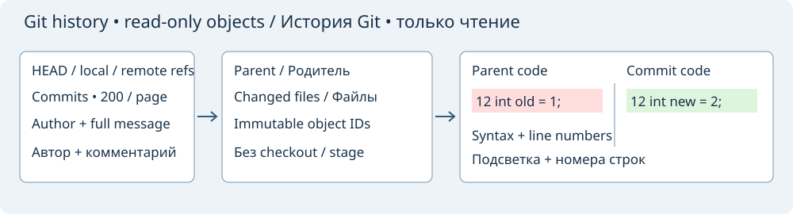

# Git history and read-only diff

Open **File → Git History and Diff…** for the current project, or for the repository containing the current saved file when no project is open. Git must be installed. The Editor command **Git History and Diff** also appears in the command browser and has an initially unassigned shortcut.

Select **HEAD**, a local branch or a remote-tracking branch. The commit list shows the short object ID, subject, author and author date. Selecting a commit loads its full ID, author, date and complete commit message, followed by its changed files. **Newer commit / Older commit** move within the current page; arrow keys also change the selection. **Previous page / Next page** browse 200 commits at a time. Branch tips are captured as immutable IDs; **Refresh** reloads refs and starts at the newest page of the selected branch.

The parent selector chooses the comparison base for merge commits. A root commit compares against an empty version. Selecting a changed file automatically loads its historical contents on both sides: parent on the left, selected commit on the right. Added/deleted files have an empty opposite side. Renames currently appear as deletion and addition. File mode changes appear in the changed-file list even when text is identical. Submodules display their recorded commit ID; symbolic links display their stored target text without following the link.

Both code panes are **read-only Scintilla views**, with syntax coloring selected from the historical filename, visible line-number gutters and colored changed-line backgrounds. You can select and copy text. The difference list gives one-based starting lines; **Previous difference / Next difference** select and scroll the corresponding ranges in both panes. Insertions and deletions use an empty-side anchor. Comparison is exact, including spaces and line endings, using the existing Diff/Merge comparison core. The window has no apply/merge/save action.

Loading runs in cancellable workers. Changing a branch, commit, parent or file cancels older work; stale results cannot replace the new selection. **Cancel loading** stops the current request; selecting another item or Refresh resumes browsing. Closing the window cancels outstanding work.

Browsing does not check out branches, stage files, commit changes, save dirty documents or modify the working tree. Objects are read by full IDs, without invoking shell commands, external diff/textconv tools, pagers or lazy object downloads. A missing object or an unavailable repository produces a status message. Remote-tracking refs are local snapshots; the viewer does not fetch remote branches. GitHub review comments are not downloaded: the displayed comments are the commit's own message.

Text views support UTF-8 without NUL, up to 1 MiB per side. Binary/non-UTF-8 or oversized files report why the text diff is unavailable. Limits also include 1000 branch refs, 10000 changed files, 64 KiB commit messages, 100000 skipped commits and 4 million two-sided LCS cells. Oversized lists are rejected rather than silently truncated. Tags, history search, arbitrary revision-pair comparison, blame and a commit graph are not part of this window.

See [Git projects](panel-project-git.md), [Diff / Merge](internal-diff.md) and [snapshot comparison](snapshot-comparison.md). Git command formats follow the official [log](https://git-scm.com/docs/git-log), [diff-tree](https://git-scm.com/docs/git-diff-tree) and [cat-file](https://git-scm.com/docs/git-cat-file) documentation.
