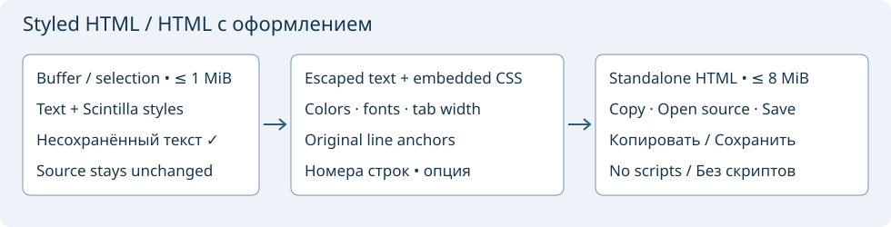

# Export styled source as HTML

**File → Export File as HTML…** captures the current decoded buffer, including unsaved edits. **Export Selection as HTML…** captures one nonempty normal selection; reversed selections work. Rectangular/multiple/virtual-space selections, split UTF-8 characters and split CRLF boundaries are not supported. A read-only source can be exported. Both commands have initially unassigned Editor shortcuts and appear in the command browser.

The dialog contains **Captured source**, a read-only Scintilla snapshot with captured styling, and **HTML source**, a read-only view of up to 32 KiB of generated markup. The code preview numbers its own local lines; the exported document uses original source line numbers, including for a partial selection. **Line Numbers** controls the exported gutter. Changing it clears generated output; press **Generate** to rebuild from the same snapshot. Closing and reopening captures later edits. The preview is not an embedded web browser.

Formatting captures foreground/background colors, font families, whole-point font sizes, bold, italic and underline from the editor's active styles. Tabs use the captured tab width. The standalone HTML5 file embeds CSS and does not require external styles, fonts, images or scripts; font families fall back to installed monospace fonts. Custom fonts still need to be installed on the viewing machine. Font sizes and tab widths are bounded to 1–100 pt and 1–32 columns. Zoom, folding, selections, indicators, semantic links, letter-case decorations and exact fractional font sizes are not exported. Browser line spacing may differ from the editor.

**Copy HTML** copies the full document as plain text. **Open HTML Source** creates a uniquely named editable unsaved HTML tab; it does not launch a browser or execute the HTML. **Save…** proposes `<source>.html`, confirms replacement of an existing ordinary file and writes UTF-8 without a BOM. The captured source, currently open document paths/identities and current project file are protected against replacement. Symbolic-link destinations and linked parent directories are rejected. Export leaves source text, filename, dirty state, selection and Undo intact. These checks are not a filesystem lock.

Source text, titles and CSS font names are escaped for their respective contexts. Source identifiers remain text; there are no generated hyperlinks to definitions. The HTML includes a restrictive Content Security Policy and no executable content. CRLF/CR line breaks become LF in HTML, with stable `L<number>` line anchors; a final line break produces a final empty line, as in Scintilla. This is a styled presentation, not a byte-identical source backup.

Limits: 1 MiB captured text and 8 MiB generated HTML. UTF-8 without NUL is required; C0 control characters other than tab/CR/LF are rejected. Excessive style-run expansion can exceed the HTML limit even for a smaller source. Generation runs in a cancellable worker; errors/cancellation do not enable Copy/Open/Save, and closing cancels pending generation. Options are not persisted. This command exports one captured file or selection; project-wide HTML snapshots, external CSS, symbol links and a table of contents are not implemented here.

Source Insight reference: [Export File as HTML](https://www.sourceinsight.com/doc/v4/userguide/Manual/Command_Reference/Export_File_as_HTML.htm). Selection export and this preview dialog are Geany Insight extensions. See [Project reports](project-report.md) and [Save Selection / Save a Copy](file-text.md).
