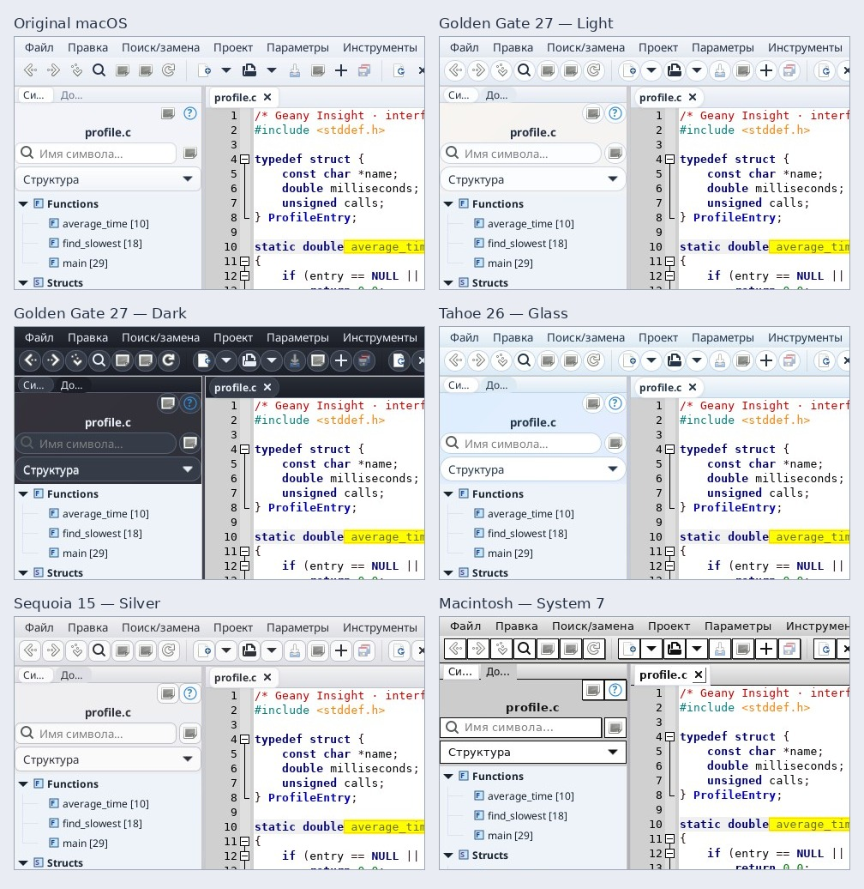
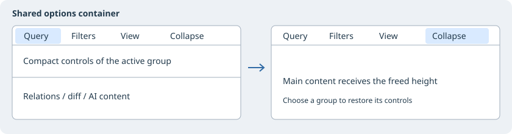

# Classic and macOS-inspired interface

Open **Options → Interface style** or **View → Interface style** and choose **Classic** or **macOS style**. Switching immediately affects existing application windows and future windows, including Context, Window List, AI and Diff/Merge. Both menus stay synchronized. No restart is required; the choice persists between launches.

The macOS-inspired style provides light gradient surfaces, translucent panel layers, rounded fields/buttons/tabs, thin separators, quiet scrollbars and a blue accent. Active editor tabs remain bold and compact Diff/Merge controls remain compact. UI fonts use the first installed family: SF Pro Text, Helvetica Neue, Segoe UI, Noto Sans, system sans-serif. Apple fonts are not distributed.

**Opacity 100%, 90%, 80%, 70%** controls native window alpha. RGBA gradients provide materials within the window; desktop blur and macOS system refraction are not implemented. GTK title buttons use the current system theme and decoration layout. Panel functions and source palettes are preserved.

Interface style is independent of the source **Visual theme**. It preserves Scintilla font/syntax colors, text, selection, savepoint and Undo. A light shell can be combined with dark code. Explicit panel Font & Color overrides keep priority. **Classic** removes the appearance layer and restores the current GTK look without resetting the source palette or other preferences.

Settings are stored in `insight/interface-style.conf` under the configuration directory. Atomic save failures leave the previous style active. macOS is the initial default for a new profile; an explicitly saved style remains in effect. Installed CSS is `styles/appearance-macos.css`, scoped to the `insight-macos` class; the system GTK theme is not changed. Windows are styled on mapping, without background redraw timers.

## Actual application appearance

[Real Classic and macOS-inspired captures are available in the successful Linux GUI run artifact](https://github.com/bhgv/geany-insight/actions/runs/39900274485/artifacts/12479155454), as `interface-classic.jpg` and `interface-macos.jpg`. They show the production GTK editor in an isolated Linux/Xvfb fixture with the same demo source and panel widths, not mockups or a native macOS run.

Verified on Linux: [108 full-editor checks](https://github.com/bhgv/geany-insight/actions/runs/39900274485), including switching, saved startup state, failed-save rollback, future windows and independent code palette/font behavior. Autotools and GTK 3.22 / GLib 2.56 builds passed. Windows/macOS GUI was not run in this stage.

## Compact menus and independent windows

**View / Options → Interface style → macOS — Independent Windows** moves menu and toolbar into a separate top-level palette. File Symbols, Project and Context occupy three other GTK windows. Native source tabs remain in the original editor window, preserving document identity and keyboard handling; these are not MDI children. Existing panel Float/Dock and project-tab grouping controls remain available.

Choosing normal macOS or Classic restores the pre-entry layout. Closing the tools palette also joins windows and selects normal macOS. Panel Close uses existing docking behavior. The style choice survives restart; entry arranges windows in the monitor work area. Positions are not a separately persisted workspace yet: use named Layouts for custom arrangements. This is an application palette, not an OS global menubar. Rebuilt native toolbars return to the palette.

Menus explicitly reset GTK minimum row heights, margins and icon/check spacing, with 10pt UI type and compact padding. Font preference is SF Pro Text, Helvetica Neue, Inter, Segoe UI, Noto Sans, sans-serif, depending on installed families. Apple fonts and SF Symbols are not redistributed. Available themed symbolic icons replace corresponding named/stock icons at 16px; Classic restores originals. Bespoke application icons retain their artwork.

New floating windows use GTK client-side headerbars with round close/minimize/maximize controls on the left, rounded decoration edges and soft CSS shadows. Outer frames and shadow visibility depend on the platform/window manager/compositor. Already realized editor windows retain their OS frame; no desktop blur is added. Source fonts, syntax palettes, selection and Undo are unchanged.

macOS tabs use 9pt labels, 16px minimum tab content height, small rounded corners, reduced margins, unobtrusive close buttons and a light selected-tab surface. The active source filename remains bold; inactive filenames remain normal. Classic retains its previous tab styling.

## Compact menus / Компактные меню

Menu rows use a 16 px icon slot instead of the former 40 px reservation. Unknown
commands have no placeholder icon; check/radio rows retain their native indicator.
The native accelerator label and shortcuts stay intact. In macOS styles all ordinary
rows use compact spacing, including Find Next, Find in Files and Replace. Menu width
is determined by the longest label and shortcut, with a small icon/arrow allowance.
Menus have a soft shadow and a layered blue/lilac gradient. Reduce transparency
removes the material gradients and makes menus and chrome opaque; unticking restores
the translucent layers immediately. Source text remains opaque. RGBA visuals are
selected for composited popup windows before realization; opaque editors retain their native visual; desktop blending and outer shadows depend on
the desktop compositor. No desktop blur or global fading of source text is used.

Строки меню используют место под значок 16 px вместо прежних 40 px. Для неизвестных
команд нет значка-заглушки; чекбоксы и радиокнопки используют собственный индикатор.
Пункты «Найти следующее», «Найти в файлах» и «Заменить» имеют одинаковые компактные
отступы. Ширина определяется самым длинным названием и сочетанием клавиш.
Мягкая тень и голубовато-сиреневый градиент оформляют меню. «Уменьшить прозрачность»
сразу убирает градиент материала и делает поверхности непрозрачными, снятие отметки
возвращает слои. Исходник остаётся непрозрачным. Смешивание с рабочим столом и внешние
тени зависят от композитора ОС; размытие рабочего стола не применяется.

Tooltips retain native GTK styling and geometry. The application does not change their font, visual, icons or rendered labels during show/map; tooltip text is translated on the source control. Menus and ordinary windows retain the selected interface style.

## Edge placement, reversible motion and native opacity

Independent mode centers tools against the workarea top, File Symbols against the left edge, the project shelf against the right, the complete Context/terminal notebook against the bottom, and the source window in the workarea center. Monitor workarea offsets and native frame sizes are included. Existing terminal widgets and sessions are moved intact.

Splitting and joining are immediate, without animation. Windows are placed directly at workarea edges; a short nonblocking geometry check accounts for final native frame sizes without covering system panels. Joining immediately restores the previous layout. Source viewports and terminal sessions are preserved.

Four radio choices replace Reduce transparency: 100%, 90%, 80%, 70%. The value is persisted and controls native GTK window opacity, including the unified main window. Splitting resets the choice to 100% and immediately restores actual opacity to 100%. Legacy per-panel alpha is overridden during independent mode, rather than multiplied into the global value. Users can explicitly choose a different level afterward. Outside independent mode, individual panel settings remain available.

Actual positioning and desktop transparency depend on the window manager/compositor; Wayland may restrict window moves. Linux/Xvfb checks coordinates and GTK opacity, not the visual output of every desktop compositor.

Independent palettes have no transient parent, so the editor can be raised normally. The entire bottom clipping host moves with its notebook, leaving no empty splitter child in the editor. Source divider changes and tab switches cannot hide the detached Context. Every open document retains its first visible line and horizontal offset through split/join allocations, without moving its caret or selection.

Position requests use explicit North-West frame gravity and absolute workarea coordinates, without inheriting offsets from the window manager’s initial placement. Quintic easing has zero velocity and acceleration at both endpoints.

Independent palette headers reserve a single title line, without an empty subtitle row. Compact padding and buttons reduce their height to approximately half the previous chrome; joining restores ordinary styling.

Edge anchors use the visible CSD frame, excluding transparent CSS shadow padding. Shadows may extend outside the workarea while the actual palette remains inside it, clear of system docks.

## Separate macOS appearances

Options / View → Interface style → **macOS appearance** selects the surface independently of Classic / macOS / Independent Windows. The optional `macos-theme` key persists the selection; old configurations keep the original appearance. Choosing a variant while in Classic stores the preference without changing the window mode.

| Variant | Surface |
| --- | --- |
| Current macOS appearance | Original palette and materials retained |
| macOS 27 Golden Gate — Light | Readable pale materials and soft glass gradients |
| macOS 27 Golden Gate — Dark | Graphite panels, menus and contrasting text |
| macOS 26 Tahoe — Glass | Brighter glass highlights and rounder controls |
| macOS 15 Sequoia — Silver | Neutral silver panels and compact corners |
| Macintosh — System 7 | Monochrome menus, gray panels, striped captions, square corners |

These are original GTK adaptations inspired by Apple’s designs, not macOS system themes. They add no dependencies and do not change source syntax palettes, editor fonts, text, selections or Undo. Liquid Glass desktop refraction/blur is not implemented. The dark variant keeps the system GTK header colors so native window controls remain readable.

Title buttons retain the current GTK theme and its decoration layout. Their allocated height is capped at 85% of the header height. Splitting and joining do not animate.

Design references: [Apple — macOS 27 Golden Gate](https://www.apple.com/os/macos/), [Apple — macOS Tahoe / Liquid Glass](https://www.apple.com/newsroom/2025/06/macos-tahoe-26-makes-the-mac-more-capable-productive-and-intelligent-than-ever/). The Linux GUI fixture captures real widgets for all six variants as `macos-theme-*.jpg` CI artifacts; the diagram above is schematic.

Real production-widget crops at native pixel scale from an isolated Linux GUI fixture. These compare interface surfaces; source syntax colors remain unchanged.

## Adaptive side-panel tabs

Left and right shelves distribute available width equally across visible tabs. If the full active caption does not fit its share, the row becomes a single active tab with compact cyclic Previous/Next arrows. Drag the caption left/right to turn the carousel; Left/Right keys also work while a tab has focus. Every caption has a full-title tooltip, updated after localization.

At nearly collapsed widths the arrows disappear rather than displacing the caption; dragging remains available. Widening the shelf restores the normal row automatically. Only navigation changes: notebook pages retain their visibility, identity, detach/dock behavior and saved panel selection.

## Compact controls and navigation

Diff/merge, AI assistants, symbol Relations and source-window links share the same compact options notebook. Collapse leaves the tab strip and gives the space to the main content. Selecting another tab restores controls; the active group determines the required height.

Ctrl+mouse wheel over a side panel changes its text size (6–28 points). Preferences → Interface → Toolbar also provides the side-panel font size and toolbar height (18–64 pixels, default 24). Both settings survive restarts.

The down arrow to the right of editor tabs lists every open buffer in most-recently-used order, with full paths in tooltips. Selecting a row activates its source. Undo/Redo use the active editor. Main-toolbar and editor-popup arrows follow editor position history; Context buttons and its popup use independent preview history. Navigation commands reveal the containing panels and nested tabs.

Every AI receives up to 24,000 characters of relevant installed editor documentation. Help opens with a collapsed Ask AI prompt. Its answer becomes a Markdown page with the viewer's existing back/forward history and table rendering. Other assistants offer Open answer in help viewer. Requests use the selected AI connection.

## Editor footer

Hide or show the editor footer with View → Show status bar, the same check item in the editor popup, or Preferences → Interface → Show status bar. The controls share one state. Unified and independent windows remember separate choices; the footer starts hidden in independent mode. Joining restores the unified-window choice.
