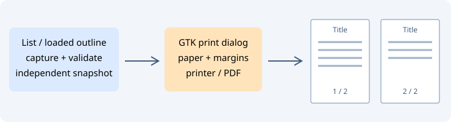

# Print lists and Relations

| Location | Command | Output |
| --- | --- | --- |
| Navigate or Relations context menu | Print Relation Window… | Current graph, or a text outline of the filtered list / loaded tree |
| View Relation Outline dialog | Print outline… | The exact captured outline shown in the dialog |
| File/Project Symbols, Project Files, Relations list/tree, Search Results context menu | Print List… | Loaded rows and visible columns in their current order |

The standard GTK print dialog offers printer selection, page ranges and page setup, including orientation and margins. On Linux its Print to File option can produce PDF. Cancelling does not alter files, the editor, selection, Undo history or clipboard. Printing itself neither reads source files nor loads more list pages or tree branches. Source changes after capture do not rewrite an already prepared print job.

## Text output

Text uses a 9-point monospace font, wraps long lines at the printable width, and continues wrapped paragraphs across pages without cutting a visual line. Every page repeats the title and has a Page n / total footer. UTF-8 and indentation are retained; CRLF/CR are normalized to LF. List columns use the same escaped tab-separated representation as Copy List. This is plain text output, not a pixel reproduction of the on-screen table or syntax-colored source.

Print List prepares data in short GTK idle intervals and validates model / column changes before opening the dialog. Its capture does not activate a result or replace the clipboard. As with Copy List, hidden columns, filtered-out rows and unloaded results are excluded. During an ongoing search, wait for it to finish to avoid invalidating capture.

Text jobs are limited to 1 MiB UTF-8 without NUL or unsupported control bytes, 20000 physical lines, 64 KiB per physical line, 100000 wrapped layout lines and 512 pages. An excessively small printable area is rejected. Narrow the list or adjust the paper/margins when a limit is reached. No file is automatically overwritten or exported: choose the destination in the system dialog.

## Relation graphs

Print Relation Window dispatches to the existing graph printer while Graph view is active. Its native Graph layout tab retains fit-to-page and tiled vector output, including coordinate footers. Graph limits remain separate (256 tiled pages). In list/tree mode the command captures the loaded outline, including the query and relation mode. The report dialog always prints its captured text; Refresh replaces that snapshot explicitly.

The Source Insight reference describes [printing the graphic Relation Window](https://www.sourceinsight.com/doc/v4/userguide/Manual/Command_Reference/Print_Relation_Window.htm). Printing text lists and the outline is a Geany Insight extension of this command family.
