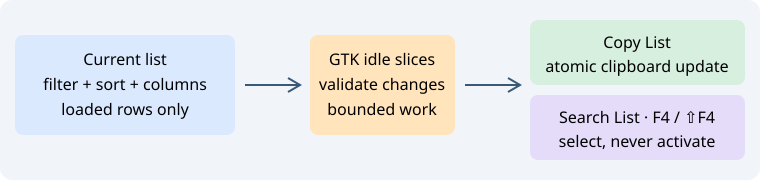

# Search and copy lists

The context menus of **File Symbols**, **Project Symbols**, **Project Files**, **Search Results** and the flat/tree **Relations** lists provide:

| Command | Action |
| --- | --- |
| Copy List | Copy loaded, filtered rows in their current sorted order |
| Search List… | Find text across visible columns in a separate dialog |
| Next list match / F4 | Find after the selected row |
| Previous list match / Shift+F4 | Find before the selected row |

Search supports Unicode literal text, case sensitivity, regular expressions, Start at beginning and optional wrapping. Each panel remembers its last pattern/options in memory until it is destroyed. F4 is intercepted only in supported lists; editor/terminal shortcuts retain their existing behavior. With no previous pattern, F4 opens Search List.

A match is selected and scrolled into view; loaded tree ancestors expand. Search does not open the file in the editor or move its caret. Normal selection-driven Context previews remain available. Filters, sorting and project membership remain unchanged. Switch a Relations graph to its list/tree to use these commands.

Copy includes headings and visible columns in their current order. Columns use tabs, rows use LF and hierarchy uses two spaces per level. Embedded tabs, line breaks, backslashes and control bytes are escaped (`\t`, `\n`, `\r`, `\\`, `\xNN`), keeping each cell on one physical row. Hidden columns participate in neither copying nor searching.

## Example

1. Filter Project Symbols and choose the sort/columns you need.
2. Open **Search List…** and enter a name or path; enable regular expressions when needed.
3. Click **Find**, then use F4/Shift+F4 in the list. Without Wrap, navigation stops at the boundary.
4. Choose **Copy List** and paste into a document or spreadsheet.

GTK work is sliced into short idle intervals. Model, sorting or column layout/visibility changes invalidate pending work; a changed selection also prevents search from replacing a newer user choice. Closing the search dialog cancels its pending search. A new command replaces unfinished work. Clipboard contents change only after the complete copy succeeds.

Limits per operation: 20000 rows, 64 tree levels, 64 KiB per cell/row and 8 MiB total text; patterns are at most 512 UTF-8 bytes. Regular expressions have additional match/depth work limits. Narrow the filter when a limit is reached. Unloaded pages/branches and source files on disk are never read. These commands operate on the current loaded list rather than exporting the entire project symbol database.

Search Results has its own context menu: right click retains the current result selection. The existing **Copy results** button retains its diagnostic-line format; **Copy List** copies visible columns with headings.

When Copy List is requested from several panels, only the most recent command may publish its result; older unfinished list copies are superseded.

[Print lists and the Relations outline](list-printing.md): Print List, Print Relation Window and Print outline, wrapping and page numbering.
