# C/C++ debugging with GDB

Launch arguments preserve spaces, empty strings, quotes and backslashes. Wildcards, `$HOME` and command substitution stay literal. On Unix, GDB uses shell startup with each argument quoted; local Windows uses Windows command-line quoting and SSH targets use POSIX quoting. Line breaks are rejected.

## Control thread execution

**Threads and stack** provides a **Thread execution** picker. It is enabled while paused after reading GDB's actual setting. The policy belongs to the current GDB session; profiles do not apply it automatically.

| Policy | Behavior |
|---|---|
| `off` | Other threads may run on Continue and stepping. |
| `step` | Step Into / Step Over run the selected thread; Continue and Step Out allow the others. |
| `on` | Continue also runs only the selected thread. Code waiting for another thread can remain blocked. |
| `replay` | GDB's replay policy: locking during replay, ordinary behavior during live execution. |

The picker shows the policy confirmed by GDB and is disabled while a change is pending. If the target rejects a change, the previous value is restored and the reason is displayed. Stops and console commands reread the setting; an unknown response is not replaced with a guessed policy. Availability depends on GDB and the target platform.

In **All thread stacks**, **Refresh thread stacks** recollects the paused tree while preserving the selected thread/frame. It sends no execution command. After refresh and confirmed navigation, the tree highlights the confirmed current frame.

Actual editor window with GDB and test workers: the selected `step` policy is confirmed by GDB.

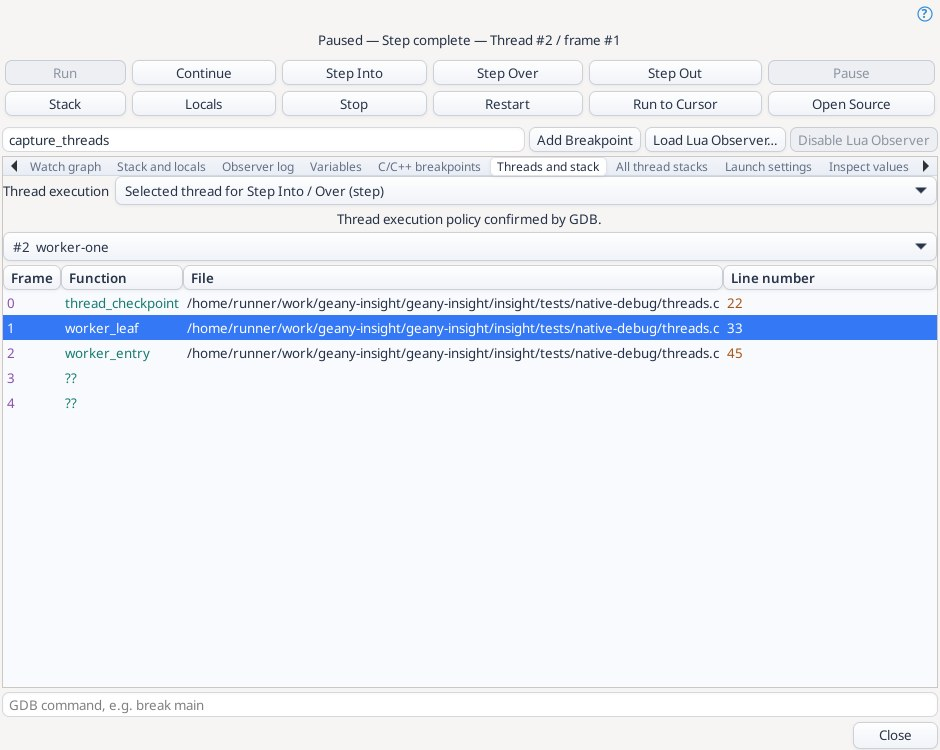


## Threads, frames and backtrace navigation

1. Stop at a breakpoint or use **Pause**. In **Threads and stack**, choose a thread and then a call frame. `#0` is the current function, `#1` its caller, and so on.
2. **All thread stacks** shows a thread → frames tree. Expand a thread and double-click a frame. After GDB confirms the context, the editor opens its file and line. A frame without source coordinates remains inspectable but cannot open a source line.
3. Use **Variables**, **Watches**, **Inspect values** and **Memory** in that context. Their requests specify the selected thread/frame; the global status displays both IDs (GDB thread IDs, not OS PIDs/LWPs). Locals depend on both, `thread_local` depends on the thread, and globals are shared. For example, a caller's `value` can be 111 in one worker and 211 in another.

Selecting a frame inspects a saved call stack; it does not reverse execution or resume the target. Double-clicking the regular stack also reopens its confirmed source position. Fetching a frame list does not confirm a frame selection: source and values switch only after GDB accepts it. Rejected selections do not open an unconfirmed source position; the picker returns to its confirmed frame when still available. Late replies from an older context cannot replace newer data.

The default is GDB all-stop mode: all threads stop together. Continue and stepping can let other threads run; selecting a thread does not itself lock the others. On supported targets, the console command `set scheduler-locking step` limits execution to the selected thread for Step Into / Step Over; Continue and Step Out can run the other threads; `set scheduler-locking off` removes that restriction. The combined tree collects at most 64 threads and 64 frames per thread. Navigation needs available source/debug information; optimization can hide variables and frames.

Actual editor with GDB and a multithreaded test program: the first worker caller frame is selected. The global status identifies the context; Variables shows its local `value = 111`.

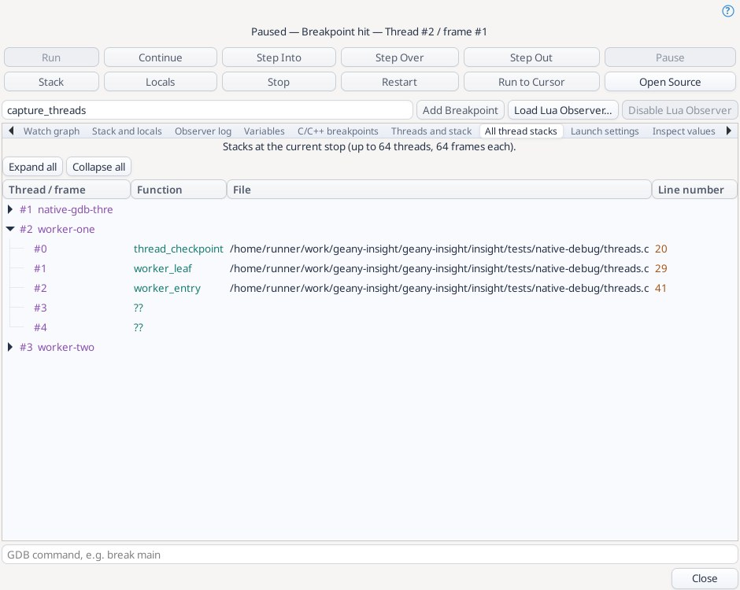

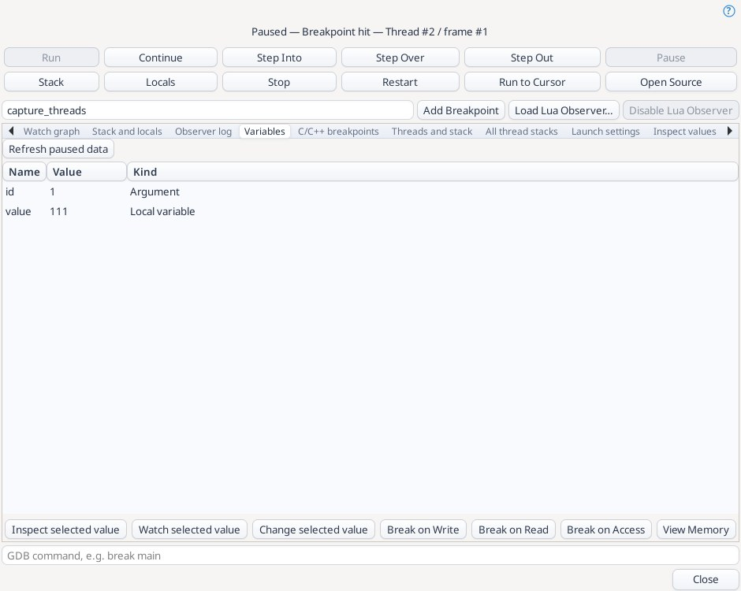

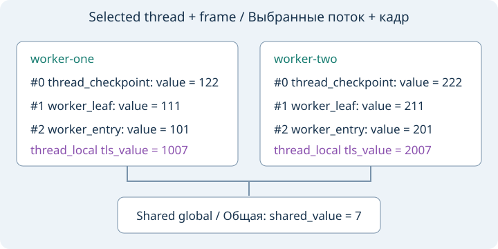


## Refresh data without stepping

**Variables** and **Inspect values** provide **Refresh paused data**. It rereads locals, watches and the open tree root in the selected thread/frame. It sends no Run, Continue or stepping command; expand the tree members again after refreshing. The button is unavailable while running, disconnected or busy.

Both assignment and manual refresh invalidate dependent address annotations and the register snapshot. Manual naming rules remain. Fresh instructions/registers use the normal automatic-follow policy or a manual instruction read.

The memory snapshot also becomes stale: with **Refresh memory at each stop** enabled the block is reread; otherwise it is cleared until **Read Memory**. Old bytes are therefore not presented as current after values or pointers change.

Actual editor and GDB window with a test program after refreshing: the tree was reread without stepping.

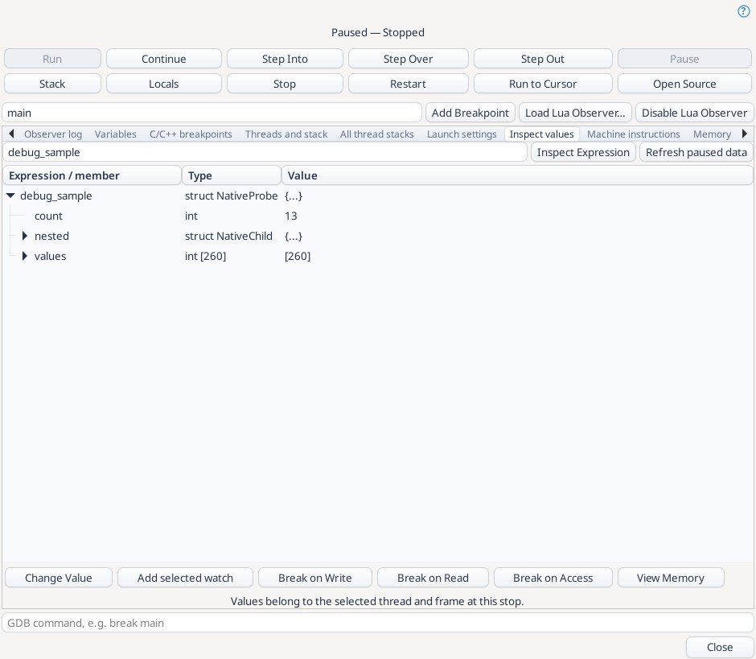

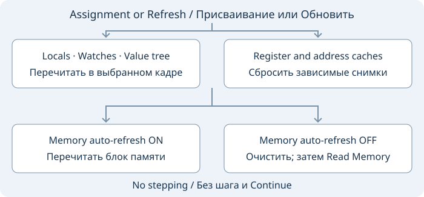


## Stop at main without a manual breakpoint

Open **Launch settings** and enable **Stop at main on Run / Restart**. Both **Run** and **Restart** use GDB's temporary entry breakpoint; after it fires, **Continue** resumes the same process. No permanent breakpoint is added. The option also applies to SSH launches in extended-remote mode and is retained by **Save debugger profile**. Old profiles leave it disabled. Auto-continuing Lua observers do not override this explicitly requested entry stop.

Build with `-g -Og` for source stepping. C++ global constructors may run before `main`; this option does not stop before those constructors. If GDB cannot resolve `main`, inspect its console message. Signal stops show both name and description, such as `SIGSEGV — Segmentation fault`; they pause the program for inspection rather than reporting process exit.


Actual editor window with GDB and a test program paused at entry; an auto-continuing Lua observer is loaded.

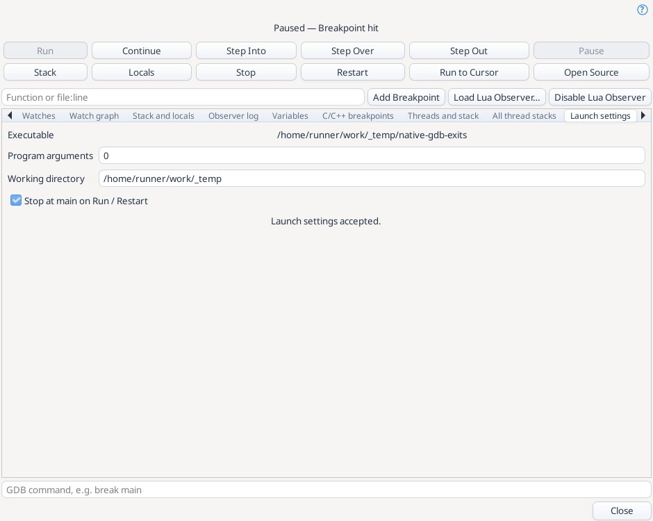

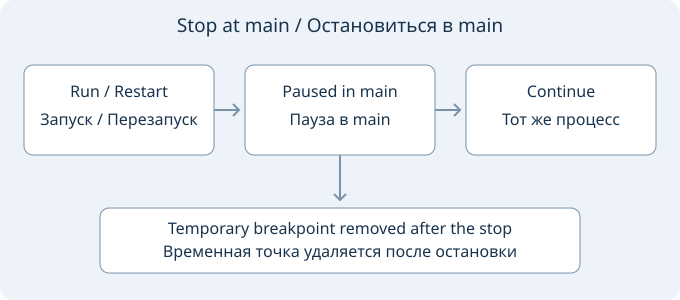


## Program exit result

After the program exits, the status retains its decimal exit code, for example **Program exited with code 31.** A terminating signal shows its name and description. The reason remains until the next run or disconnection; breakpoints and watches stay configured. **Run** starts a fresh process; **Restart** also applies the current launch settings.

A signal stop differs from a signal exit: at a stop you can inspect the stack and variables; after exit the stopped context is cleared and stepping is unavailable. Code `0` usually indicates success; the program defines other codes. Windows exit codes are also displayed as decimal numbers.

Actual editor window with GDB and a test program: the exit reason stays in the status while stepping controls are disabled.

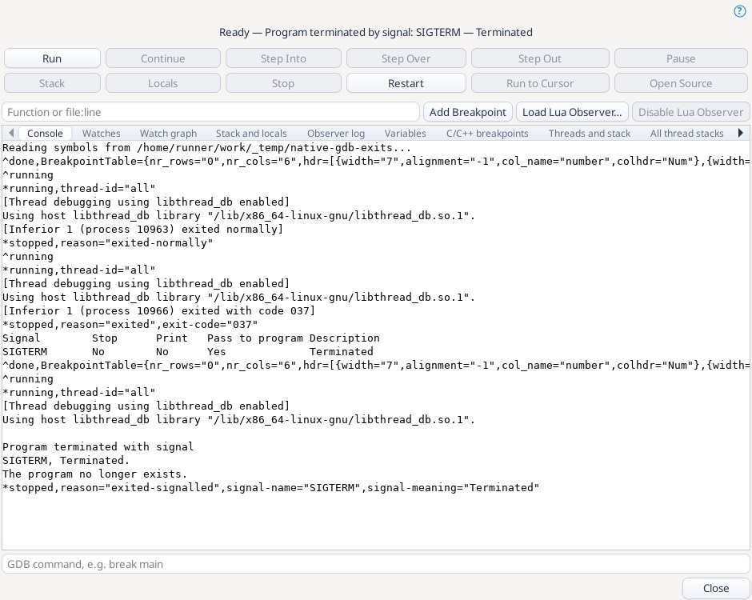

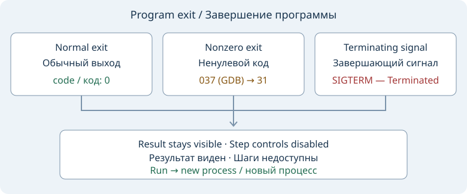


## Connection preflight

SSH port **0** means use the Port from SSH config. Profiles retain this choice, including automatic gdbserver restarts. The separate gdbserver port remains positive. Checks and key installation do not open LocalForward/RemoteForward entries from the user SSH config.

Before debugging, the wizard checks that the program is an executable file and that the working directory exists and is accessible. An empty working directory uses the program folder. The gdbserver command is required only when automatic startup is enabled; connecting to an existing service skips that lookup. Preflight does not run the program or probe the RSP port.

Specify the remote build source directory explicitly: it may differ from the executable folder. Supply both source roots or leave both blank. The wizard no longer guesses the remote build directory.

Network operations in the wizard have a two-minute deadline. A failed or timed-out retry clears the previous verification; correct the settings and check again. Long pages scroll while Back, Next and Cancel remain accessible in a small window.


## SSH debugging: simplest start

1. Install `gdbserver` on the server and GDB/OpenSSH on this computer. Build the remote C/C++ program with `-g -Og`. Keep the matching executable/debug symbols and source locally; the wizard does not upload or build your application.
2. Open **Tools → C/C++ → Debug C/C++ Executable…** and select the local executable with matching debug symbols.
3. In the debugger's **Remote / SSH** page, press **Set up SSH debugging step by step…**. Enter or restore your server/login and choose password/key authentication as described in [SSH](panel-ssh.md).
4. On **Remote program**, enter its absolute server path. Optionally set the server working directory (default: the program's folder). When build paths differ, set the source directory recorded during remote compilation and the matching existing local source directory.
5. Leave **Start gdbserver automatically on the server** enabled. Its port (default 2345) is separate from SSH port 22. The server listens on remote `127.0.0.1`; SSH carries the debugger traffic. Disable startup only when reusing an existing `gdbserver --multi`.
6. **Check connection → Next → Connect** verifies SSH, availability of `gdbserver` and an executable remote file. Connect starts the owned server, waits for its readiness, creates the tunnel and connects GDB in extended-remote mode.
7. Add a breakpoint at `main` or a source line, then **Run**. **Step Over / Step Into / Step Out**, **Continue**, **Pause**, **Variables**, **Watches** and **Threads and stack** work in the selected stopped context. Run launches the remote executable; the local executable supplies symbols.
8. **Detach and close SSH** detaches the application and closes the tunnel and wizard-owned server. Startup can be cancelled with the same button. Diagnostics remain in the debugger console. Unexpected network/server loss is reported; it does not promise that a running inferior survives.

Saved SSH passwords/passphrases are shared with the terminal and kept outside projects. The page's remember toggle and **Forget saved SSH passwords** control this computer's credentials. Advanced fields still support manually started plain or extended gdbserver sessions.

Remote-program step in the production wizard, captured in an isolated GTK fixture.

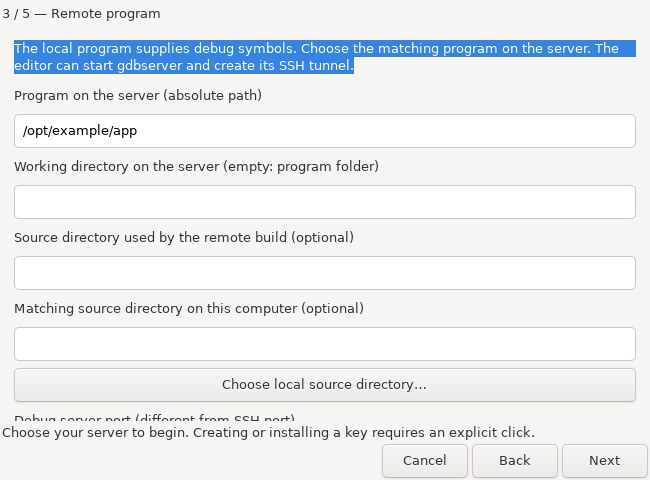

Completing the wizard saves SSH settings, remote working directory, automatic gdbserver startup, password-remembering choice and current breakpoints/watches in the project/executable debugger profile. Next time you open the same local executable, use **Remote / SSH → Connect gdbserver via SSH**: the editor starts its own server again when enabled, without repeating the wizard. Use **Save debugger profile** after editing advanced settings manually. Restoring a profile does not connect or run a program.


Build with debug symbols, for example `cc -g -Og main.c -o app` or
`c++ -g -Og main.cpp -o app`. Install GDB and make it available in
`PATH` before starting Geany.

Open **Tools → C/C++ → Debug C/C++ Executable…** and select the built program.
The C/C++ Debugger window opens with the executable directory as the
working directory.

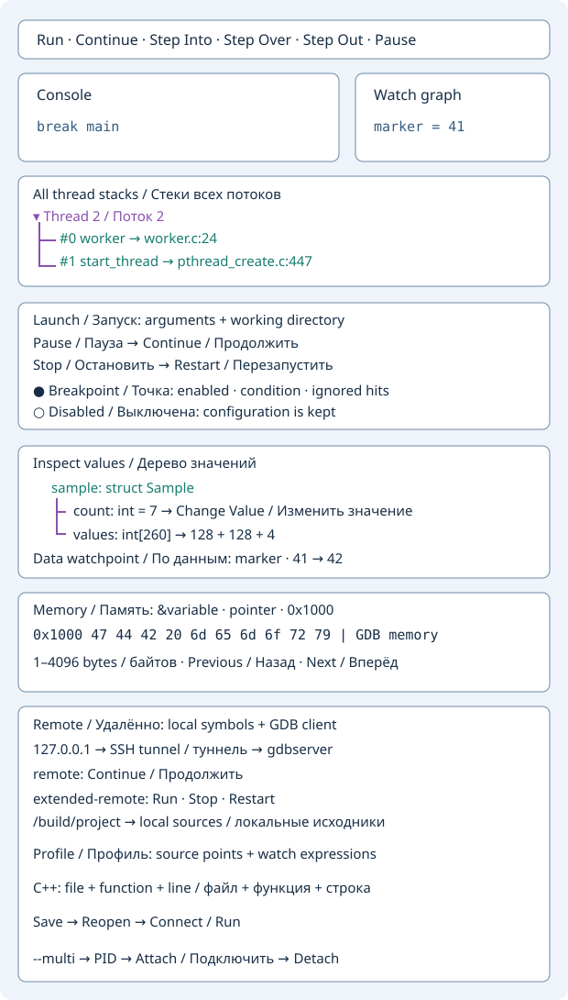

- Enter `main` or `file.cpp:42`, click **Add Breakpoint**, then **Run**.
  You can also use `break main` in the console.
- Use **Step Into**, **Step Over**, **Step Out**, **Continue**, and **Pause**
  to control execution. **Open Source** opens the current stopped line.
- **Stack** and **Locals** show the current frame information in **Stack and locals**.
  Enter GDB commands such as `print value` or `info threads` there as well.
  The command entry is for GDB. Programs that need terminal input require
  a separate terminal configured through GDB.

## Watches and graph

Open **Watches**, enter an expression such as `marker`, and select
**Add Watch**. GDB refreshes up to 32 expressions at each stop in the
current frame. Use **Remove Watch** with the same expression to remove it.
The **Watch graph** shares the Python and Lua graph controls. It shows GDB
expressions and Lua-published values, with pinning and change highlights
between stops. GDB expression values appear as cards with their text value.

## Lua observer

**Load Lua Observer…** accepts the same callback form as the Python and
Verilog observers. GDB breakpoint stops emit `native-point` with
`event.file`, `event.line`, `event.name` and the snapshot fields
`event.locals.breakpoint` and `event.locals.reason`. Here `event.name`
is the function. Read program locals with **Locals** or GDB commands.

```lua
local hits = 0
return function(event)
    if event.kind ~= "native-point" then return true end
    hits = hits + 1
    watch("Breakpoint hits", hits)
    log(event.name .. ":" .. event.line .. " hit " .. hits)
    return hits >= 2
end
```

`log()` writes to **Observer log** and **Console**. `watch()` updates
**Watches** and **Watch graph**.
Return `false` to continue or `true` to keep the program paused.
Manual pauses and stepping stops stay available for inspection.

## All thread stacks

Use **Threads and stack** while paused to select a thread or frame. If GDB
rejects the selection, the picker returns to its last confirmed selection and
values keep that context. If the confirmed row has disappeared, the picker
clears its selection instead of highlighting a different context.
Selecting a frame without source coordinates clears the previous source-line highlight.

While paused, open **All thread stacks** to collect a collapsible tree:
threads at the top, their frames underneath. **Expand all** and **Collapse all**
control the branches. Frame numbers, function names and source lines use distinct
colors. Double-click a frame to select its thread and frame, open its source,
and refresh locals, watches and the watch graph in that context.

This view collects at most 64 threads and 64 frames per thread. It refreshes
at stops while the tab is open; while running it keeps the previous snapshot
and labels it accordingly. A thread whose stack cannot be read is marked
**Stack unavailable**. GDB must supply source paths and line numbers for source
navigation; optimized code may lack locals or source locations.


## Launch, pause, stop and restart

Before running, open **Launch settings**. Enter program arguments (quote values
containing spaces) and an existing absolute **Working directory**. An empty
argument field means no arguments. Invalid paths or unmatched quotes open this
tab with an explanation; the target is not started.

**Run** starts an inactive target. **Pause** interrupts it and preserves its
state. **Continue** resumes that state. **Stop** terminates the target while
keeping the debugger open. **Restart** terminates a running or paused target,
then starts a fresh process with the launch settings. Source breakpoints,
conditions, watches and the Lua observer stay configured. Variables, thread
stacks and the stopped-line highlight are cleared when the process exits.
The main editor toolbar also provides **Stop** for the active C/C++ session.

Locals, watches and stack replies belong to the stop at which they were requested.
Late replies after execution, exit or a context change do not replace a newer
snapshot or repopulate the cleared views.

## Manage source breakpoints

**C/C++ breakpoints** lists the GDB snapshot, including points added with
**Add Breakpoint**, F2, the editor margin or GDB console commands. The table
shows the identifier, enabled state, condition, hit count and ignored hits.
Select a row to **Enable / Disable**, **Delete Breakpoint**, set a
**Breakpoint condition**, or configure **Ignore first hits**. An empty
condition makes the point unconditional; zero ignored hits stops on the next
matching hit. Conditions use C/C++ expressions evaluated by GDB. Invalid
expressions are reported by GDB and do not replace the previous condition.

Double-click a resolved point to open its source. Enabled points have red
margin dots, disabled points gray dots, and the current stopped line has a
background highlight. Stops with source coordinates open the editor
automatically. Unresolved points remain in the list until GDB can resolve
them (for example after loading a shared library). Source navigation and dots
require a full source path and line number from GDB. Only the session's own
markers are removed on debugger close.

For C++ overloads and templates, all GDB sub-locations (`1.1`, `1.2`, …) are
listed with their source coordinates. Their condition and counters are inherited
from the parent. **Enable / Disable** can change one sub-location; it becomes
active only when the parent is enabled too. Condition, ignored hits and deletion
apply to the whole parent breakpoint, including all its locations. If several
locations share a source line, its dot is red whenever any location is active.

## C++ exception catchpoints

In **Breakpoints**, choose **C++ throw**, **C++ catch** or **C++ rethrow**,
optionally enter a regular expression for the exception type, then click
**Add Exception Catchpoint** or press Enter in the filter field. Empty matches
all types. For example, `std::.*` matches standard-library exception types when
GDB and the target C++ runtime support type filtering.

The common list shows the event and filter. **Enable / Disable**, **Breakpoint
condition**, **Ignore first hits** and **Delete Breakpoint** also work for these
catchpoints. An invalid regular expression is reported by GDB without replacing
existing points. **Save debugger profile** preserves the event, type filter,
condition, enabled state and remaining ignored-hit count. Version four profiles
restore source and exception points together; older profiles leave current
exception catchpoints intact.

On a hit, the status identifies the catchpoint and its number. GDB may initially
stop inside the C++ runtime; select your application's frame in **Stack** to see
its source, locals, watches and tooltips. If the target runtime cannot filter by
type, remove the filter to catch all exceptions, or use the error in Console to
check target support. These controls use GDB's C++ exception support, including
remote gdbserver sessions.

## Structured values and editing

On a stop, select a variable in **Variables** and choose **Inspect selected
value**, or enter an expression in **Watches** and use **Inspect watch
expression**. **Inspect values** also accepts any C/C++ expression directly.
The tree shows member names, types and values. Expand a structure, class,
array or pointer to request its children from GDB. C++ members use GDB's
resolved expression paths, including access groups and base classes where
supported by GDB. Installed GDB pretty-printers are enabled when available.
Nested pretty-printed containers can be expanded even when GDB has not yet
counted their members. Expanding an empty container removes its placeholder.

Large arrays load 128 children at a time. Activate **Load next 128 members…**
for another page. A tree is limited to 4096 entries and depth 64; inspect a
sub-expression to narrow a large object. **Add selected watch** adds the
selected member's full expression to the regular watches and watch graph.

If a later page fails, loaded members stay in place. Retry with **Load next
128 members…**; collapsing and reopening the node does not reload earlier pages.
If the first page fails, double-click **Expand to load members** to retry it.

Double-click a scalar in the tree, use **Change Value**, or select a local
and use **Change selected value**. Enter a C/C++ value expression and apply
it. This modifies the paused program in the selected thread/frame. On success,
locals, watches and graph values refresh; an existing tree is re-created and
can be expanded again. Rejected writes preserve the previous snapshot and
show GDB's error. Run, stop and thread/frame changes clear the tree; with automatic refresh off, inspect
the expression again in the new context. Stale asynchronous replies are discarded.

### Follow an inspected expression

Enable **Refresh inspected expression at each stop** on **Inspect values** to
re-evaluate the last expression explicitly submitted with **Inspect Expression**
after stops and confirmed thread/frame changes. This session option is off by
default. It starts no inspection until an expression has been submitted.
The root is recreated for the selected context; expand members again to load
their current values. Expressions unavailable in a new frame show GDB's error
and can be retried automatically at the next stop.

Draft edits in the entry remain untouched and are not evaluated by automatic
updates or by refreshing an already open tree. Press **Inspect Expression** to
make the draft the active expression. Memory's automatic refresh is a separate
setting.

Actual editor with the multithreaded test program: automatic inspection follows
`value = 211` in the second worker. The entry contains the unevaluated
`shared_value` draft; the root row identifies the active expression.

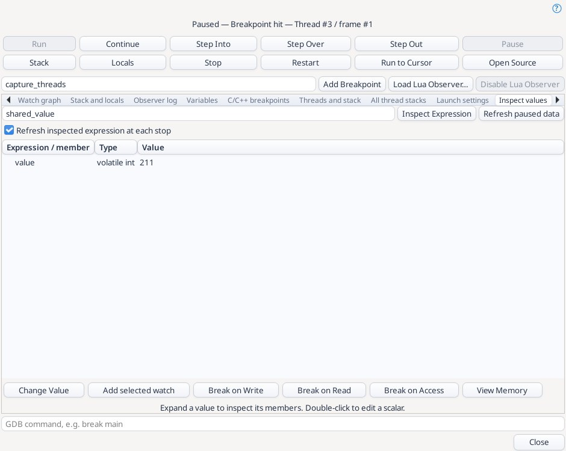

## Data watchpoints and execution to cursor

On a pause, select a local or a member in the value tree and choose
**Break on Write**, **Break on Read**, or **Break on Access**. The same actions
use the expression entered in **Watches**. These are GDB data watchpoints:
write stops when the value changes, read stops on a read, and access stops
on either read or write. The selected expression must be meaningful in the
current frame. Hardware support and available watchpoint slots depend on
the target; GDB reports unsupported requests. Local watchpoints can be
removed automatically when their scope ends.

The breakpoint table's **Type** distinguishes source breakpoints from data
watchpoints. It supports the same enable, delete, condition and ignored-hit
controls. A data stop opens its source when GDB provides coordinates; the
status includes its expression and old/new values when supplied by GDB.

Place the editor caret on a saved source line and click **Run to Cursor**.
The selected thread runs using GDB's `until` command. Existing breakpoints,
watchpoints, signals or returning from the current frame can stop it before
the requested line. Invalid source locations leave the program paused.

## Memory inspection

Open **Memory** while paused. Enter `&variable` to view a variable's storage,
a pointer or array expression such as `buffer` to view its target, or a numeric
address such as `0x1000`. Choose **Bytes to read** (1–4096) and **Read Memory**,
or press Enter. The snapshot displays 16 bytes per row, their addresses,
hexadecimal bytes and printable ASCII. Byte order stays as stored in memory.

**View Memory** in Variables, Watches or Inspect values uses the selected
expression as an address. For a scalar, change it to `&variable` in Memory.
**Next block** and **Previous block** navigate by the last confirmed snapshot's byte
count from its successful address. They do not reevaluate pointer expressions.
The navigation base is the first displayed address of the complete snapshot,
even if GDB returns its memory fragments in a different order.
A truncated reply cannot supply an address for subsequent block navigation.

Snapshots clear on execution, target exit and thread/frame changes. Enable
**Refresh memory at each stop** to repeat the last explicit address expression and byte count
in the selected frame at each new stop or frame change. Otherwise, read manually.
Expression evaluation follows GDB semantics and can execute target code if you
enter function calls. An inaccessible address, incomplete block or truncated GDB reply clears
the snapshot and shows an error; choose a smaller block or another address.


### Saved memory requests and drafts

Automatic refresh starts only after an explicit **Read Memory** or **View Memory**.
It repeats that address expression and byte count in the selected thread/frame;
the address and size currently being edited are drafts. Apply them with
**Read Memory**. Block navigation preserves the confirmed snapshot's size.
A new request clears old bytes and its numeric navigation base before dispatch.
The status names the expression and byte count actually read, with the full
expression available as a tooltip. A late response cannot replace a newer
context or relabel itself using a subsequently queued request.

Actual editor/GDB with the multithreaded test program: the second worker's
four-byte `&value` snapshot is displayed. The `&shared_value` address and `128`
size in the input fields are unapplied drafts; the status identifies the active read.

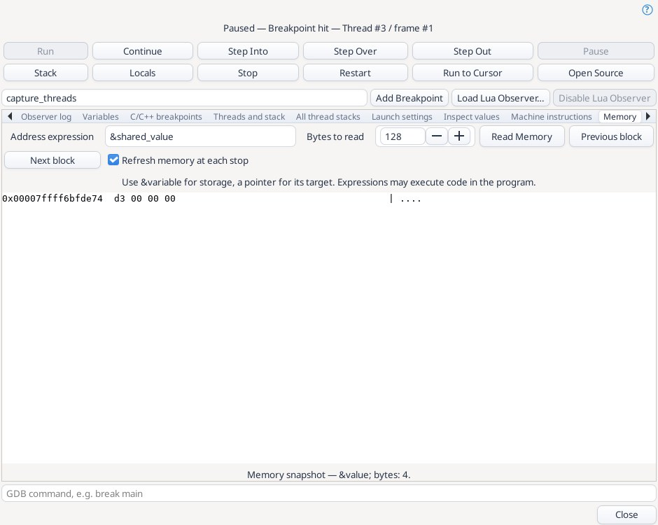

## Remote gdbserver over SSH

At executable selection, choose a **local copy with debug symbols** matching the
remote program. The extra **GDB executable** field accepts `gdb`, `gdb-multiarch`
or a cross GDB installed for the target architecture. Files are not uploaded.

On the remote POSIX host, start either:

```sh
# One program, already created by gdbserver:
gdbserver 127.0.0.1:2345 /srv/app --argument
# Or a persistent server for Run / Stop / Restart:
gdbserver --multi 127.0.0.1:2345
```

Open **Remote / SSH** in the debugger. Choose **SSH: existing gdbserver** for
the first command or **SSH: extended-remote (--multi)** for the second. Enter
SSH host/config alias, login, SSH port and optional identity/config files.
Port `0` preserves the SSH config alias's port (or OpenSSH's default port 22).
The gdbserver host is resolved **on the SSH server**; normally keep `127.0.0.1`
and port `2345`. For `--multi`, enter the executable's full **remote** path.
Arguments come from **Launch settings**; its local working directory is not
sent to the remote target. Configure the remote directory when starting gdbserver.

Click **Connect gdbserver via SSH**. An owned SSH process forwards a temporary
loopback-only local port. A constant POSIX readiness command confirms the SSH
channel before GDB connects; it never probes/consumes the gdbserver connection.
Keys and SSH agent/config work normally. The packaged SSH clients and askpass
helper are preferred, with PATH and Windows OpenSSH fallback. The tunnel has its
own SSH connection, independently of configured ControlMaster/RemoteCommand.
When `geany-insight-askpass` is available, its GUI handles password/passphrase/host-key prompts; otherwise SSH uses
batch mode and reports failures in Console. Host-key verification remains enabled.
The remote account needs a POSIX shell and permission for local TCP forwarding.
**Detach and close SSH** cancels an in-progress connection. SSH setup has a
120-second deadline; GDB remote responses use a 15-second timeout.

After connecting to an existing program use **Continue**, not Run. In extended
mode use **Run**, **Stop**, or **Restart**; Stop kills the inferior while keeping
the server connection. Both modes use the same source breakpoints, steps, Pause,
threads, stacks, variables, tooltips, watches, graph and memory view.
**Detach and close SSH** interrupts a running target, detaches it so it can
continue, disconnects GDB and closes the owned tunnel. Closing the debugger
also closes its SSH process; detach explicitly first when the remote process
must continue. The editor does not terminate the separately started gdbserver.

### Attach to a running remote process

Start `gdbserver --multi 127.0.0.1:2345` on the remote machine and connect using
**SSH: extended-remote (--multi)**. Open the local executable with matching debug
symbols. In **Remote process PID (--multi)** enter the PID on the gdbserver machine,
then click **Attach remote process** or press Enter in that field. This attaches
to the existing process and pauses it; it does not launch the remote executable.
Use the same stacks, variables, watches, memory, Continue and Pause controls.

An invalid/nonexistent PID or denied tracing permission is shown in connection
status; the SSH tunnel stays open so you can correct the PID and retry. The remote
account must be allowed to trace that process under the operating system's rules.
Attach is unavailable while another target is active and in plain `remote` mode.
**Detach and close SSH** leaves the attached process running; **Stop** terminates it.
PID is deliberately not stored in debugger profiles.

When gdbserver is on the SSH server's loopback address (`127.0.0.1`, `::1`, or
`localhost`), Pause targets the attached PID through the existing SSH channel.
This also works when the process is not a process-group leader. The SSH account
needs permission to signal that process. GDB must confirm the stop before controls
are enabled. The editor sends SIGCONT through the owned SSH channel while GDB
still holds the process stopped. If GDB reports this owned SIGCONT on Continue,
the editor clears it and continues automatically; unrelated stops remain visible.
It clears only this pause's pending SIGSTOP before continuing or
detaching, without changing global signal policies. For gdbserver on a different
forwarded host, Pause uses GDB's normal interrupt command.

If the build recorded paths such as `/build/project`, fill **Source root recorded
in remote build** with that prefix and **Matching local source root** with the
existing local project directory. GDB applies `set substitute-path` before
connection, so resolved stops and stack frames open local source files. Both
roots may be empty. **Local sysroot or target:** accepts a matching local target
library tree, or `target:` to let GDB read target libraries through gdbserver.
Disconnect restores the initial sysroot and removes only this form's source
mapping. A failed connection never falls back to running the local symbol file.
Switch explicitly to **Local program** after disconnect for local debugging.

## Save connection and launch profiles

In **Remote / SSH**, use **Save debugger profile** before connecting, while paused, or after
detaching. It saves the connection mode, SSH host/login/ports, identity/config
file paths, remote executable, source roots, sysroot, and the arguments/working
directory from **Launch settings**. SSH password prompts and key contents are
handled by SSH, outside this settings file.

Opening the same executable in the same project restores its form automatically.
Click **Connect** or **Run** explicitly to proceed. Different projects and different
executable paths have separate profiles; rebuilding at the same path keeps the
profile. The selected GDB client is still chosen in the executable picker.

**Restore debugger profile** reloads the last saved form. **Forget saved profile**
removes the saved file while keeping current form values, so they can be edited
or saved again. Saving is available while idle or paused, including an active SSH connection.
Restore and Forget require an inactive target and tunnel. Changes are saved only
by **Save debugger profile**.

Profiles are private standard INI files under `insight/gdb-profiles/` in the
editor configuration directory, with a hashed filename for project/executable
scope. Hover over the profile buttons for the exact path. Invalid/incomplete
profiles and files larger than 256 KiB show an explanation and preserve the
current form. All required fields are checked before any setting is applied.

### Source breakpoints and watches in a profile

**Save debugger profile** also records up to 256 persistent source/function
and C++ exception breakpoints in total, plus 32 watch expressions. Source points keep their condition,
enabled/disabled state and the remaining ignored-hit count reported by GDB.
On reopening the same project/executable, GDB recreates those source points and
the editor refreshes their margin markers and breakpoint list. Watch expressions
appear as **Awaiting stop** and evaluate in the selected frame at the next stop.
Runtime values and hit totals start afresh.

Watch expressions lose outer spaces and tabs on load, matching manual **Add Watch**
and **Remove Watch**. Internal whitespace, including spaces in quoted strings,
is preserved. Blank, multiline or duplicate expressions after normalization reject
the profile before its settings are applied. Version-one profiles keep current watches.

Restore replaces current persistent source and C++ exception points and watch
expressions with the saved set.
It does not run or connect the target. Pending source points use GDB's normal
resolution when their code becomes available. A rejected GDB command stops the
remaining restoration and shows an error; the saved file stays intact.

Disabled C++ sub-locations are also saved (up to 1024 per profile). The Function
column distinguishes overloads and template specializations. Restoration matches
file, full function name and line under the newly created parent breakpoint;
process addresses and old GDB numbers are never reused. Ambiguous or unavailable
locations remain pending, with a status message, until a later breakpoint refresh
can match them uniquely. Changing these settings manually after restoration takes
precedence. Save retains unresolved selectors for parents that still exist.

A queued disable is confirmed only when GDB's next breakpoint snapshot shows
that location disabled. Save retains unconfirmed selectors, including after a
rejected command. After an error, automatic retries stop; use **Restore debugger
profile** to retry explicitly. Repeated snapshots do not enqueue duplicate commands.

Data watchpoints and temporary/absolute-address breakpoints remain session-only.
Versions one through three are readable; Save upgrades to version four. The existing
256 KiB profile limit also includes C++ location metadata. Missing source coordinates
on a disabled location prevent Save with an explanation, preserving the old file.

## Machine instructions

Instructions, names, hardware points, source navigation and address history are described in the separate guide.

[Disassembly and code navigation](native-disassembly.md)

After a confirmed thread or frame change, previous locals disappear immediately and saved expressions show “Refreshing selected context…” until GDB replies. Expression names are retained. A rejected selection preserves the confirmed context’s values. The graph header shows `?` while the frame ID is not yet confirmed.

## When GDB itself ends

A read/write failure or GDB shutdown ends the current session: stale variables, stacks, memory and source highlights are cleared, and execution commands become unavailable. The status shows **GDB session ended.**; the console records the failure reason when available. Late replies cannot restore old data. The session's own SSH tunnel and remote-server launch process are closed.

Close the debugger window and open **Debug C/C++ Executable** again. **Restart** restarts the program inside a working GDB; when GDB itself has ended, open a new session. A normal program exit still allows **Run** and **Restart**.
