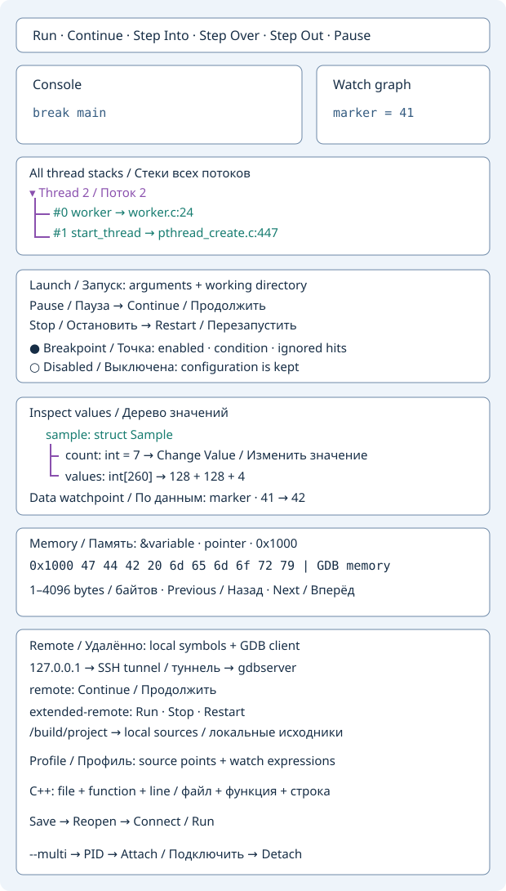

# C/C++ debugging with GDB

Build with debug symbols, for example `cc -g -Og main.c -o app` or
`c++ -g -Og main.cpp -o app`. Install GDB and make it available in
`PATH` before starting Geany.

Open **Tools → C/C++ → Debug C/C++ Executable…** and select the built program.
The C/C++ Debugger window opens with the executable directory as the
working directory.



- Enter `main` or `file.cpp:42`, click **Add Breakpoint**, then **Run**.
  You can also use `break main` in the console.
- Use **Step Into**, **Step Over**, **Step Out**, **Continue**, and **Pause**
  to control execution. **Open Source** opens the current stopped line.
- **Stack** and **Locals** show the current frame information in **Stack and locals**.
  Enter GDB commands such as `print value` or `set args one two` there as well.
  The command entry is for GDB. Programs that need terminal input require
  a separate terminal configured through GDB.

## Watches and graph

Open **Watches**, enter an expression such as `marker`, and select
**Add Watch**. GDB refreshes up to 32 expressions at each stop in the
current frame. Use **Remove Watch** with the same expression to remove it.
The **Watch graph** shares the Python and Lua graph controls. It shows GDB
expressions and Lua-published values, with pinning and change highlights
between stops. GDB expression values appear as cards with their text value.

## Lua observer

**Load Lua Observer…** accepts the same callback form as the Python and
Verilog observers. GDB breakpoint stops emit `native-point` with
`event.file`, `event.line`, `event.name` and the snapshot fields
`event.locals.breakpoint` and `event.locals.reason`. Here `event.name`
is the function. Read program locals with **Locals** or GDB commands.

```lua
local hits = 0
return function(event)
    if event.kind ~= "native-point" then return true end
    hits = hits + 1
    watch("Breakpoint hits", hits)
    log(event.name .. ":" .. event.line .. " hit " .. hits)
    return hits >= 2
end
```

`log()` writes to **Observer log** and **Console**. `watch()` updates
**Watches** and **Watch graph**.
Return `false` to continue or `true` to keep the program paused.
Manual pauses and stepping stops stay available for inspection.
