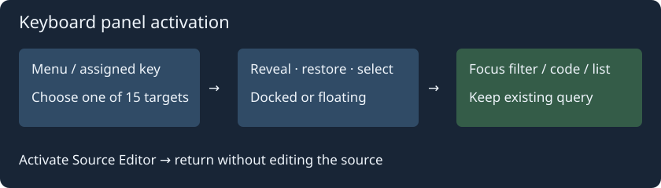

# Panel activation

**View → Panels → Activate panel** contains 15 commands: project files, folders and symbols; Relations; bookmarks; Clips; file types and symbol categories; file symbols; Context; Window List; file and project search bars; Search Results; source editor.

Activation reveals the panel and selects its tab. Detached windows are raised and restored from the Tab Tray without changing placement. Repeating activation keeps the panel open. Focus goes to its filter, or code/list for Context/results. Source Editor returns focus to the current document.

Assign keys under **Preferences → Keybindings → Focus**. New bindings are unassigned by default and preserve existing bindings. Commands also appear in the Command Browser.

Activation preserves queries and filters, without starting a search or loading the selected word. Project search reveals its bar and results page even before a query has run. Source text and Undo history are unchanged. Existing visibility toggles remain available.

Reference: Source Insight [Activate Project File List](https://www.sourceinsight.com/doc/v4/userguide/Manual/Command_Reference/Activate_Project_File_List.htm), [Activate Clip Window](https://www.sourceinsight.com/doc/v4/userguide/Manual/Command_Reference/Activate_Clip_Window.htm), and [Activate Search Results](https://www.sourceinsight.com/doc/v4/userguide/Manual/Command_Reference/Activate_Search_Results.htm). The command set is extended for Geany Insight panels; it does not reproduce MDI windows.
