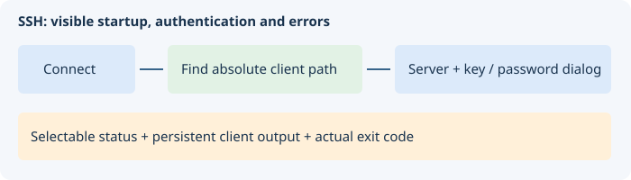
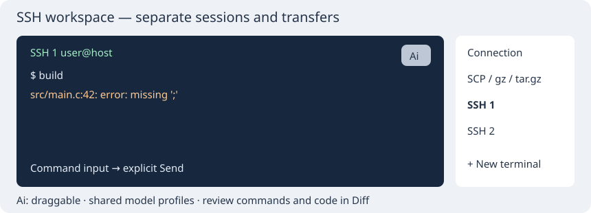

# SSH

Remote files and commands through OpenSSH.

## Controls

Set host, user, port and key. Commands open a remote file, folder or project; Save uploads changes. Stop cancels a transfer. Connect/Disconnect controls the shell; Enter sends input and Ctrl+C interrupts. This is a line-oriented shell rather than a full terminal emulator.

## Short tutorial

Enter your server settings and connect. Open a known remote file. After editing, explicitly save it remotely or enable automatic upload.

The ? button at the upper right opens this page. Help follows the interface language selected in Options.

More: [guide.md](guide.md).

[Console AI assistant: configuration, diagnostics and Diff/Merge review](console-ai.md).

## Connection feedback

Connect starts an OpenSSH client, then the client authenticates with the server. Starting a process is not reported as a completed connection. The selectable status is on its own wrapping row; startup errors, disconnects and exit codes also remain in the console transcript. Read the original client output above a nonzero exit status for the server/network reason.

Clients shipped in the application bin directory are resolved to absolute paths before spawning; PATH and, on Windows, system OpenSSH locations are fallbacks. If the password dialog helper is missing, a visible message explains that only key/agent authentication is available. Password/host-key questions use the separate SSH dialog. Spaces around the host and login are ignored.

SSH now groups connection, file access and independent terminals in a scrollable right-side tab rail. The plus button creates another terminal (up to 16); each has its own process, input queue and transcript. An 80%-opaque Ai button can be dragged within the terminal and opens an embedded assistant. Shared model profiles and guarded Diff/Merge source proposals remain available. Explicit Run sends the reviewed suggestion only to that terminal.

### Transfers independent of terminals

On Transfer, enter absolute local/remote paths, File/Folder and packing mode. Send uploads; Receive downloads to a new local name and refuses existing destinations. Plain transfers use a separate SCP process. gz packs one file; tar.gz packs a file or folder. Packed downloads run gzip/tar remotely over a separate SSH process without a PTY. Archives remain archives and are never automatically extracted. Stop cancels packing/transfer while terminal connections remain active.

Local packing requires Python 3; remote packing requires gzip/tar on the server. SCP remote paths accept ASCII letters, digits and `/._-` for compatibility with legacy remote shells; use the existing SFTP opening commands for other names. Check upload destinations: a remote file may be replaced.

## Unified terminal input/output

SSH now uses a single black VT100/xterm input/output screen with colors and native selection instead of a separate command entry. Right-hand icon tabs show a plug, file transfer and numbered terminals, with tooltip names. Local VTE also uses a black background and middle-click selection/clipboard fallback. See [TTY / COM](panel-tty.md) for the serial panel and current limits, including the shared 80×24 SSH/TTY screen.
