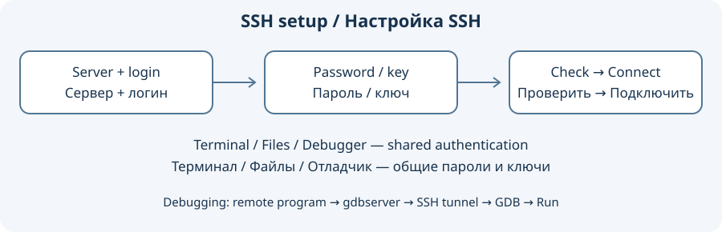
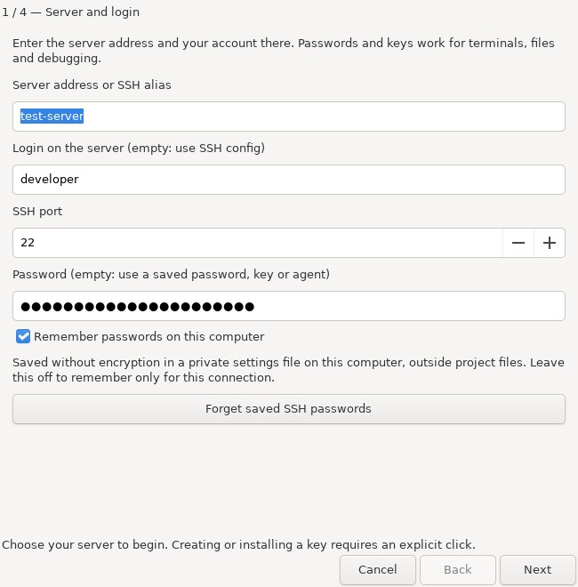
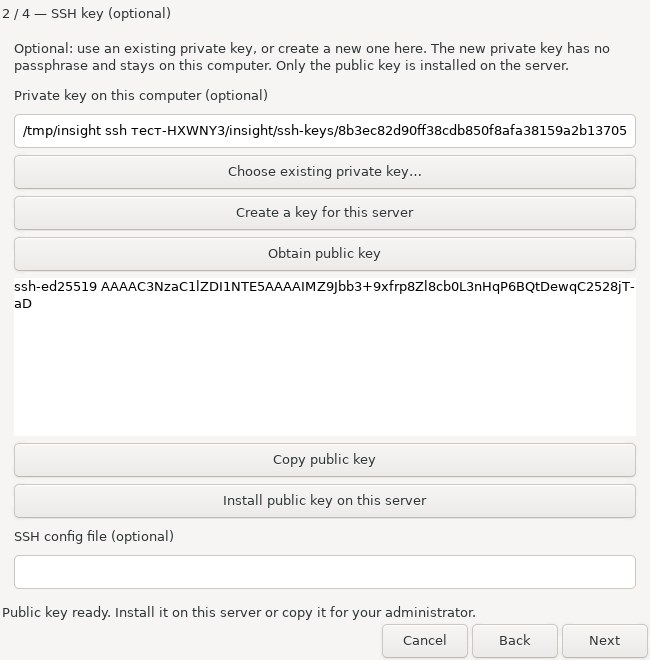
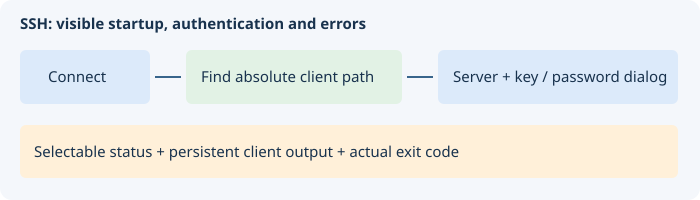
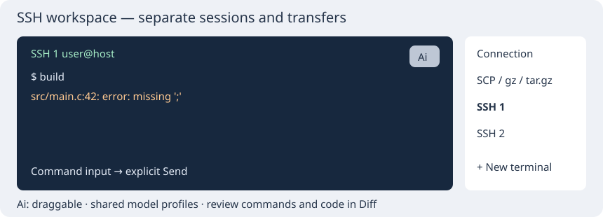

# SSH

## First connection: guided setup

Open **File → SSH files / folders / projects…**, select **Connection**, then **Set up SSH step by step…**.

1. Enter the server address, login and SSH port (usually 22). Enter a password, or leave it empty to use a saved password, key or agent. Keep **Remember passwords on this computer** enabled for future connections.
2. The key step is optional. **Choose existing private key…** selects a key already on your computer. **Create a key for this server** creates an Ed25519 key without overwriting an existing one. The new private key has no passphrase and stays in private application settings; an imported encrypted key may use its saved passphrase.
3. **Obtain public key** derives the public half of a selected private key. **Copy public key** copies only that public half for an administrator. **Install public key on this server** adds it to your remote account's `~/.ssh/authorized_keys`, preserving existing entries and avoiding duplicates. Initial installation needs a working password, agent or another authorized key. Ask the administrator if you have no initial access.
4. Press **Next**, then **Check connection**. Confirm the server fingerprint after checking it with your administrator. Read any error below the form and use **Back** to correct the settings.
5. After a successful check, press **Next → Connect**. A terminal opens using these settings. The same authentication is available to file transfers and the C/C++ debugger.

Passwords and key passphrases are saved **without encryption** in a private per-computer file (`insight/ssh-credentials.conf` under the application's configuration directory), outside project files. POSIX permissions restrict newly written files to their owner. Turning remembering off uses disposable authentication files that are deleted after the connection. **Forget saved SSH passwords** removes the selected account's password and selected key's passphrase. Existing project-stored credentials move into private settings when the local profile is saved/used.

The wizard needs OpenSSH (`ssh` and, for keys, `ssh-keygen`) and the application's `geany-insight-askpass` helper for graphical password prompts. It does not create a server account or install the server's SSH service. The remote key installer expects a POSIX shell and standard `awk`, `mkdir`, `chmod`, `touch` tools.

Production SSH wizard captured in an isolated GTK fixture with a test SSH client. The account and public key are test data; private keys and passwords are not displayed.

Remote files and commands through OpenSSH.

## Controls

Set host, user, port and key. Commands open a remote file, folder or project; Save uploads changes. Stop cancels a transfer. Connect/Disconnect controls the shell; Enter sends input and Ctrl+C interrupts. Input and output share one VT100/xterm-compatible terminal screen; screen dimensions follow the panel (see TTY / COM for history settings).

## Short tutorial

Enter your server settings and connect. Open a known remote file. After editing, explicitly save it remotely or enable automatic upload.

The ? button at the upper right opens this page. Help follows the interface language selected in Options.

More: [guide.md](guide.md).

[Console AI assistant: configuration, diagnostics and Diff/Merge review](console-ai.md).

## Connection feedback

Connect starts an OpenSSH client, then the client authenticates with the server. Starting a process is not reported as a completed connection. The selectable status is on its own wrapping row; startup errors, disconnects and exit codes also remain in the console transcript. Read the original client output above a nonzero exit status for the server/network reason.

Clients shipped in the application bin directory are resolved to absolute paths before spawning; PATH and, on Windows, system OpenSSH locations are fallbacks. If the password dialog helper is missing, a visible message explains that only key/agent authentication is available. Password/host-key questions use the separate SSH dialog. Spaces around the host and login are ignored.

SSH now groups connection, file access and independent terminals in a scrollable right-side tab rail. The plus button creates another terminal (up to 16); each has its own process, input queue and transcript. An 80%-opaque Ai button can be dragged within the terminal and opens a separate assistant window. Shared model profiles and guarded Diff/Merge source proposals remain available. Explicit Run sends the reviewed suggestion only to that terminal.

### Transfers independent of terminals

On Transfer, enter absolute local/remote paths, File/Folder and packing mode. Send uploads; Receive downloads to a new local name and refuses existing destinations. Plain transfers use a separate SCP process. gz packs one file; tar.gz packs a file or folder. Packed downloads run gzip/tar remotely over a separate SSH process without a PTY. Archives remain archives and are never automatically extracted. Stop cancels packing/transfer while terminal connections remain active.

Local packing requires Python 3; remote packing requires gzip/tar on the server. SCP remote paths accept ASCII letters, digits and `/._-` for compatibility with legacy remote shells; use the existing SFTP opening commands for other names. Check upload destinations: a remote file may be replaced.

## Unified terminal input/output

SSH now uses a single black VT100/xterm input/output screen with colors and native selection instead of a separate command entry. Right-hand icon tabs show a plug, file transfer and numbered terminals, with tooltip names. Local VTE also uses a black background and middle-click selection/clipboard fallback. See [TTY / COM](panel-tty.md) for the serial panel and current limits, including dynamic SSH/TTY dimensions and configurable 10,000-line history.

## One terminal group and a floating Ai window

The bottom **Terminals** tab contains **Local / SSH / TTY**. Context remains a separate tab. Every terminal screen has an **80%-opaque Ai** button: drag it to a free area; resizing keeps it inside the screen.

Ai opens a separate resizable system window with window controls, prompt, answers, model settings and attachments. In the regular style it is transient for the main window; independent-window mode removes that relationship. Pressing Ai again raises the existing window and refreshes context unless a request is active. Destroying the source terminal closes its assistant. This is a floating system window; no internal MDI container is introduced.

**Errors → source**, **Shell help**, **Explain output** and **Connection help** stage an editable prompt. History and the four frequent requests are separated by usage context: Local terminal, SSH, TTY, manual console, diagnostics, program help, source help, and Editor/Project. Each context retains up to **100 unique requests**; repeating a request updates its frequency and recency, and adding the 101st discards the oldest. Selecting does not send: edit the text, then press **Send**. **Delete selected** removes one entry; **Clear history** clears this context only and leaves the current prompt editable. Answer history is separate: up to 32 replies held in the window's memory.

Requests are saved immediately before dispatch in **`<project-file>.ai-history/`**, beside the project file, with a separate `.conf` per context. The directory can be tracked with the project in Git. Without a project, storage uses `insight/ai-history/` under the configuration directory. Restarting reloads the history. An open window stays bound to the project it was created for; reopening terminal Ai after switching projects creates a window with the new project's history. The history controls' tooltip shows the file path. Only request text, frequency and timestamp are stored, excluding API keys, replies, terminal output and attached source. A save failure displays an error and prevents dispatch.

SSH/TTY use selected text or the last 12,000 characters; Local uses selected text or its available transcript. The resulting context is capped at 60 KiB and can be inspected and edited. Attach source explicitly. Review code proposals in **Diff / Merge**; inserting a command does not execute it. For TTY, check the device protocol: shell commands may not apply to a COM device.

## Compact terminal height and status

Local, SSH and TTY use the full common page height. SSH/TTY panel help and SSH diagnostic navigation live in the right icon rail. Their status appears on the Local / SSH / TTY tab row, aligned right in the unused area. Tabs always keep priority: long text is clipped at the right edge, the full message is available in a tooltip, and no status row is reserved below the terminal.
