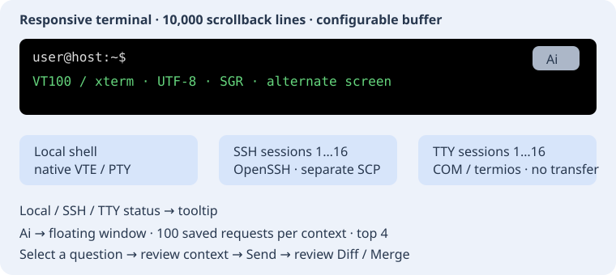

# TTY / COM serial terminal

TTY Terminal sits next to SSH Terminal in the bottom shelf. Its right-hand icon tabs contain Connection and numbered terminals. The plug icon opens connection parameters. There is no transfer tab. **+** adds an independent terminal, up to 16.

The connection page refreshes the port list whenever opened, and Refresh ports repeats enumeration. Windows lists COM1–COM256 reported by the system; Unix lists conventional ttyS/ttyUSB/ttyACM/rfcomm and macOS tty./cu. device names in /dev. The editable list accepts an explicit device name (including a PTY for testing). Enumeration reads names without opening hardware. A refresh retains a manually entered device.

Choose baud rate (300–230400 from the supported list), 5/6/7/8 data bits, 1/2 stop bits, None/Even/Odd parity, and optional Local echo, then Connect. Defaults are 115200, 8N1, echo off. Settings apply to the selected terminal when connecting. The driver can reject unsupported combinations. Disconnect closes only that terminal. Hardware/software flow control is disabled; there is no modem-control, BREAK, file-transfer protocol or saved connection profile yet. Unix device permissions remain under the OS; the editor does not change them.

Input and output share one black terminal screen, with native text selection, Ctrl+Shift+C/V, Shift+Insert, a Copy/Paste context menu and middle-click paste. Middle click sends the terminal selection first, otherwise PRIMARY selection, falling back to the clipboard when PRIMARY is empty. Pasting can send newlines; remote programs decide whether these execute commands. Bracketed paste is used when requested by the remote application.

SSH and TTY share bundled MIT libvterm 0.3.3: UTF-8, VT100/xterm, 16/256/RGB colors, alternate screen and terminal keys. The screen follows the available panel area instead of fixed 80×24 dimensions. Unix SSH uses a real local PTY and forwards window-size changes to the server. On Windows the field resizes too, but the current OpenSSH pipe transport does not forward subsequent remote PTY size changes. Serial devices have no standard window-size negotiation protocol. Scrollback defaults to 10,000 lines beyond the visible screen, without the former 4 MiB cutoff; the configurable range is 0–100,000 lines. Memory use depends on line width and colors. Historical lines keep their original wrapping when width changes. The mouse selects text; OSC clipboard requests are not connected to the system clipboard.

COM uses Windows overlapped I/O; Unix uses nonblocking termios and restores original settings on close. Input queues are bounded to 1 MiB. A read/write failure closes the connection and reports the problem. UTF-8 is the current terminal encoding; binary file transfer and legacy DOS code pages are outside this stage. Linux validation uses a real pseudo-terminal pair and loopback OpenSSH; physical RS-232 hardware and Windows runtime were not tested.

See [SSH](panel-ssh.md) and [local terminal](panel-terminal.md).

## Terminal menu and settings

Right-click exposes Copy, Cut, Paste, Select All, Search, Clear, Save to file and Settings. Search is literal, case-insensitive, forward/backward and wraps through retained text. Save to file writes an immutable snapshot of the complete current buffer as plain UTF-8 without ANSI codes; the chooser confirms overwrites. Clear resets the local screen/history without sending shell commands. Settings changes history depth for all open SSH/TTY terminals and future terminals, saved in insight/terminal.conf. Reducing it discards the oldest lines. Cut is enabled for a selected ASCII suffix ending at the terminal cursor: it copies the text and sends the corresponding Backspace keys. Older output is immutable. Mouse wheel/scrollbar and Shift+PageUp/PageDown browse history. New output preserves a scrolled-back viewport.

## One terminal group and a floating Ai window

The bottom **Terminals** tab contains **Local / SSH / TTY**. Context remains a separate tab. Every terminal screen has an **80%-opaque Ai** button: drag it to a free area; resizing keeps it inside the screen.

Ai opens a separate resizable system window with window controls, prompt, answers, model settings and attachments. In the regular style it is transient for the main window; independent-window mode removes that relationship. Pressing Ai again raises the existing window and refreshes context unless a request is active. Destroying the source terminal closes its assistant. This is a floating system window; no internal MDI container is introduced.

**Errors → source**, **Shell help**, **Explain output** and **Connection help** stage an editable prompt. History and the four frequent requests are separated by usage context: Local terminal, SSH, TTY, manual console, diagnostics, program help, source help, and Editor/Project. Each context retains up to **100 unique requests**; repeating a request updates its frequency and recency, and adding the 101st discards the oldest. Selecting does not send: edit the text, then press **Send**. **Delete selected** removes one entry; **Clear history** clears this context only and leaves the current prompt editable. Answer history is separate: up to 32 replies held in the window's memory.

Requests are saved immediately before dispatch in **`<project-file>.ai-history/`**, beside the project file, with a separate `.conf` per context. The directory can be tracked with the project in Git. Without a project, storage uses `insight/ai-history/` under the configuration directory. Restarting reloads the history. An open window stays bound to the project it was created for; reopening terminal Ai after switching projects creates a window with the new project's history. The history controls' tooltip shows the file path. Only request text, frequency and timestamp are stored, excluding API keys, replies, terminal output and attached source. A save failure displays an error and prevents dispatch.

SSH/TTY use selected text or the last 12,000 characters; Local uses selected text or its available transcript. The resulting context is capped at 60 KiB and can be inspected and edited. Attach source explicitly. Review code proposals in **Diff / Merge**; inserting a command does not execute it. For TTY, check the device protocol: shell commands may not apply to a COM device.

## Compact terminal height and status

Local, SSH and TTY use the full common page height. SSH/TTY panel help and SSH diagnostic navigation live in the right icon rail. Their status appears on the Local / SSH / TTY tab row, aligned right in the unused area. Tabs always keep priority: long text is clipped at the right edge, the full message is available in a tooltip, and no status row is reserved below the terminal.
