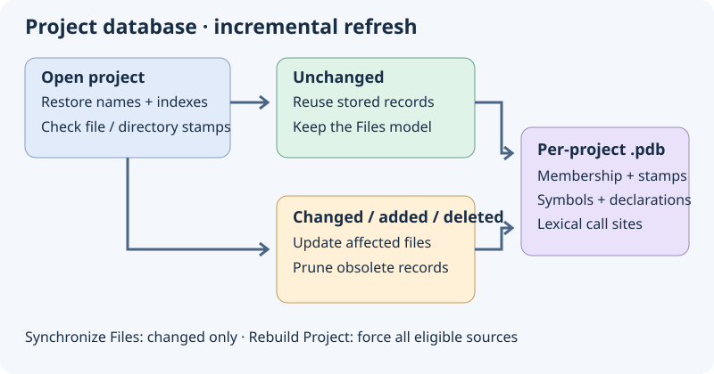
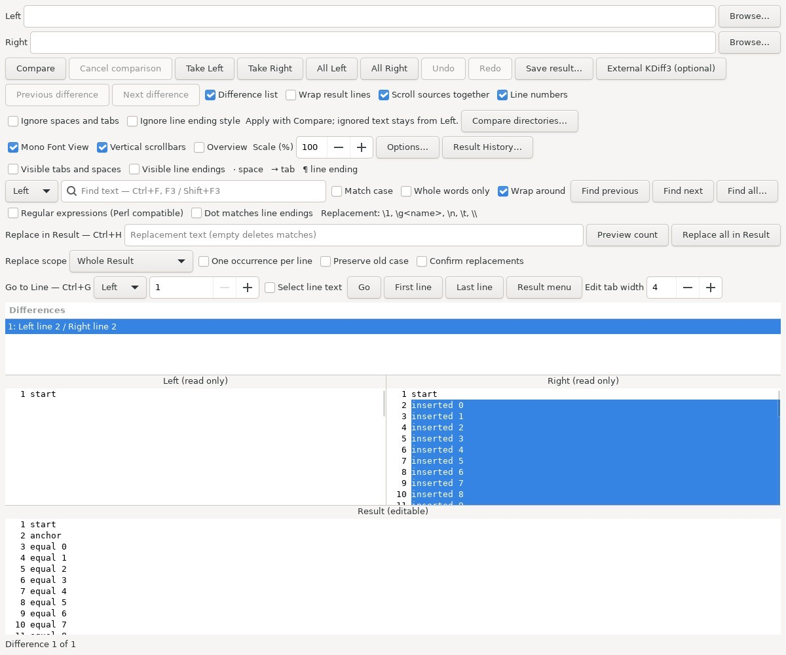

# Persistent project database and aligned comparison

The project database keeps membership (including empty and non-source files), file and directory metadata, symbols, declaration outlines and supported lexical call sites. It lives in the Geany profile at `insight/projects/<project-identity-sha256>.pdb`; closing a project does not remove it. Different project configurations have separate databases even when their source roots coincide. The file is an atomic, checksummed binary snapshot, not a relational SQL database.

On reopening, the saved membership and indexes are restored. Directory metadata is checked before deciding whether names must be enumerated again; known source files are checked by metadata and parser settings. Unchanged files are not opened or parsed, including previously detected extensionless sources. A changed source is reparsed on its own; additions/deletions or changed inclusion rules update membership and remove obsolete records. Watcher events are coalesced. Identical Project Files requests keep the existing model, including when switching editor tabs with the same language filter. Filter/profile changes may legitimately change the visible list.

The optional external master file list also checks its file and expansion-directory metadata before rereading text or expanding wildcard names. Manual refresh bypasses this shortcut. Metadata checks still involve filesystem operations: restoring a database is not a promise of zero disk I/O or a fixed startup time on network storage.

Unsaved buffers remain live overlays; they are not committed to the disk database. Cancellation retains the last confirmed disk snapshot. Missing, incompatible or corrupt databases are rebuilt from source. Projects created before this format require one initial population pass. Existing bounds remain: up to 10,000 project members, source parsing up to 2 MiB per file and bounded index serialization. Unsupported languages and incomplete lexical relationships do not become semantic analysis merely by being cached.

A synthetic Linux test restored 10,000 member names in **8.3 ms** (8303 µs, [run](https://github.com/bhgv/geany-insight/actions/runs/39698740706)), with no source reads or parses. This is not a real-project startup benchmark: the fixture has a small symbol index, and metadata validation is outside this measurement.

## Manual project commands

| Project menu command | Behavior |
| --- | --- |
| **Synchronize Files** | Recheck membership and metadata; parse only new or changed sources and remove missing records. |
| **Rebuild Project** | Force parsing of all eligible project sources and replace the saved indexes. |

These follow the roles of Source Insight's [Synchronize Files](https://www.sourceinsight.com/doc/v4/userguide/Manual/Command_Reference/Synchronize_Files.htm) and [Rebuild Project](https://www.sourceinsight.com/doc/v4/userguide/Manual/Command_Reference/Rebuild_Project.htm). They do not modify source text. This implementation exposes direct commands rather than reproducing every option of those dialogs.

## Left and Right above Result

The read-only Left and Right sources share the top row. The editable Result spans the row below; drag the splitters to change proportions. Read-only review modes can hide Result. **Scroll sources together** synchronizes vertical pixel positions and horizontal offsets. Visual padding at insertions/deletions aligns following equal lines without inserting fake characters or changing original line numbers, copied text, search positions or merge bytes. Source lines remain unwrapped; **Wrap result lines** applies to Result only. Font changes and source width changes recalculate alignment.

The layout follows [KDiff3's source/merge arrangement](https://docs.kde.org/stable_kf6/en/kdiff3/kdiff3/merging.html). It is a two-source comparison, not a newly implemented three-way merge. The screenshot is an isolated fixture using the production GTK window, not a whole-desktop capture.

See also [Project Files](panel-project-files.md), [Internal Diff/Merge](internal-diff.md) and [relationships](relations-calls.md).

## Clang relation storage

Clang-enabled builds persist compiler identities, reference/call positions,
function body locations and include/configuration dependencies in the relation
index. Header and compilation-database changes invalidate dependent C/C++ files.
The bounded binary format remains compatible with older saved snapshots; current
writers allow 1 million records / 256 MiB per index and 768 MiB for the full
project database. Unsaved semantic overlays remain in memory. See [Clang](clang.md).
