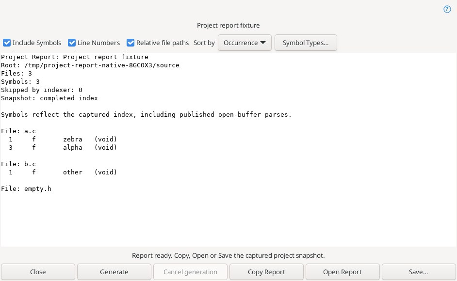
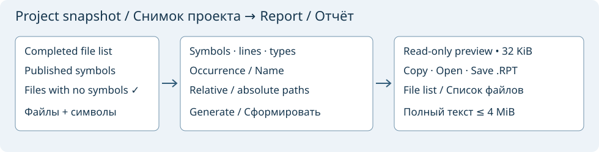

# Project Report and Export Project File List

**Project → Project Report…** captures the completed file list and published symbol index of the current Geany project. A folder opened only as a workspace is not a project. Wait for indexing to finish; a cancelled or failed scan must be restarted before capturing a report. Files without symbols are included. This uses the project's indexed membership and existing scan limits, rather than every file on disk.

The initial preview is generated in a cancellable worker. **Include Symbols** lists definitions under each file; **Line Numbers** adds their one-based definition lines. **Sort by → Occurrence / Name** changes ordering within files. **Symbol Types…** selects exact parser-kind codes from the captured index; an empty selection includes no symbols. These codes can have different meanings in different languages. **Relative file paths** uses project-root-relative paths, with absolute paths retained for files outside that root. File ordering is deterministic, by path bytes.

Changing an option clears the preview and disables Copy/Open/Save. Press **Generate** to rebuild it. This reuses the same captured snapshot; close and reopen the command to capture later project changes. Open-buffer symbols reflect their last published parse, which may lag behind recent typing. The report records project/root, file and selected-symbol counts, skipped indexing entries and whether the snapshot was bounded or incompletely monitored.

**Copy Report** copies the complete text. **Open Report** creates a uniquely named, editable, unsaved report tab. **Save…** offers `<project>.RPT` and writes UTF-8 without a BOM; an existing ordinary destination uses the normal overwrite confirmation. Source files, the captured project file, currently open documents and the current project file are protected. Symbolic-link destinations and linked parent directories are rejected. Saving leaves project settings, source text and Undo intact. These checks are not a cross-process filesystem lock.

**Project → Export Project File List…** uses the same captured membership to produce one filename per line, without report headings or symbols. Copy/Open/Save remain available; symbol settings are disabled. Relative entries are based on the project root, so import the list with that same root. A relative filename starting with `;` gets `./` to avoid becoming a comment. Names containing line breaks, `*`, `?`, or edge whitespace are rejected explicitly. This creates a list; it does not activate it as the project's Master File List or change membership.

Limits: 10000 captured files, 250000 indexed symbols, 100000 included symbols, 128 parser kinds, 4 MiB report text and 2 MiB file-list text. The read-only preview shows up to 32 KiB on a UTF-8 boundary; Copy/Open/Save use the full generated output. Report fields escape backslash, tab and line breaks. Cancellation/errors leave no output available for export; closing cancels pending generation. Options are not persisted. No HTML/PDF export or semantic reparse is performed.

Both commands have initially unassigned Editor shortcuts and appear in the command browser. See [Git projects and membership](panel-project-git.md) and the official Source Insight references: [Project Report](https://www.sourceinsight.com/doc/v4/userguide/Manual/Command_Reference/Project_Report.htm), [Export Project File List](https://www.sourceinsight.com/doc/v4/userguide/Manual/Command_Reference/Export_Project_File_List.htm).

Validation: [full native Linux build/install and 62 tests passed](https://github.com/bhgv/geany-insight/actions/runs/39571708958), verified code `1bc39c3b18f643b320fb8245ef61179dedd5f80c`, with zero failures, skips or timeouts. The formatter/storage fixture covers exact paths, scoped symbols, empty files, sorting/type/line options, escaping, cancellation, invalid UTF-8, bounded reports and the 2 MiB MFL boundary, plus guarded create/replace/source/project/open/linked-parent writes. The full-editor GUI exercises both menu/key commands, dirty source preservation, index settling, options and output invalidation, all/none type filters, complete Copy/Save/Open, exact file-list export and unchanged source selection/Undo/disk. The JPEG is a visually reviewed real production dialog in the full editor, captured by an isolated Linux fixture under Xvfb using a temporary project, without EXIF metadata. Windows and Android were not run.
