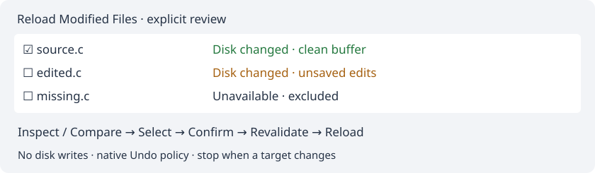

# Reload Modified Files

**File → Reload Modified Files…** checks timestamps of up to 128 open, saved local files. It does not rescan project membership or rebuild the project index. The command is also available as an initially unassigned **Document** shortcut and in Command Browser.

The list shows paths and states: unchanged, changed externally, changed externally with unsaved buffer edits, missing/inaccessible or unsupported. Only changed files without unsaved buffer edits are checked automatically. The checkboxes choose the reload batch; the highlighted row chooses **Open File** and **Compare with Disk**. **Select Clean**, **Select None**, **Copy Paths** and explicit **Refresh** support reviewing the batch. Open File closes the review and activates the selected source tab. Refresh reconstructs the snapshot and resets checks. There is no polling or automatic reload timer.

**Reload Selected…** always asks for confirmation and reports how many selected buffers contain unsaved edits. Reload replaces their buffer contents with disk contents; it writes no files. Undo/history, encoding handling, caret restoration and read-only state follow the native Geany reload implementation and preferences. Read-only source buffers can be reloaded. Cancel leaves their contents intact. This is a review workflow for the Source Insight [Reload Modified Files](https://www.sourceinsight.com/doc/v4/userguide/Manual/Command_Reference/Reload_Modified_Files.htm) command; no per-file Sharing setting is added.

Before the first reload the entire selection is validated. Before each subsequent reload its document ID, path, buffer hash, edit-history position, encoding, BOM, permissions and disk metadata/identity are checked again. A closed, renamed, edited or externally changed target stops the batch and refreshes the list. Earlier completed reloads remain completed; there is no batch rollback or filesystem lock. Native reload hooks may run between files.

The timestamp scan deliberately does not compare every disk file byte by byte. Changes with an indistinguishable timestamp and no native change notification can be missed. Files over 8 MiB, remote/untitled documents and nonregular files are not reload candidates; buffer checks are limited to 8 MiB each and 64 MiB per scan. Omitted files are counted. No background project-wide reads are introduced.

**Compare with Disk** opens the existing read-only snapshot comparison for the highlighted eligible row, without applying or saving changes. Its current UTF-8/no-NUL and 1 MiB-per-side limits remain in effect; native reload itself supports the document encoding. Close the comparison to return to the review. Missing or stale snapshots require Refresh.

