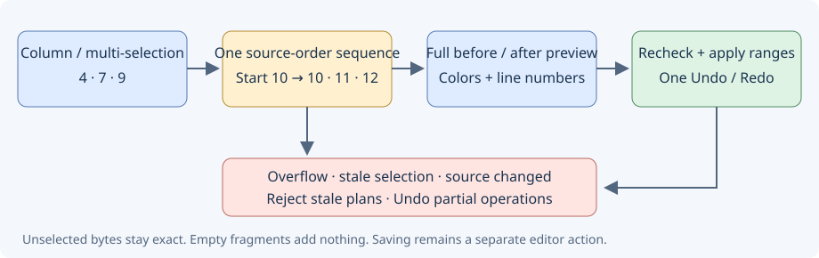

# Renumber

Edit → Insert and clipboard → **Renumber…** transforms the exact selection, or the whole document when the selection is empty. Preview does not modify the editor. Apply creates one Undo action and selects the result; Cancel leaves it unchanged.

- **Auto** counts up from the first integer; **Start at value** counts up from the entered value; **Offset** adds the value to every integer.
- Output radix: preserve each token's radix, decimal, hexadecimal (`0x`), or octal (leading zero). Input values use decimal, `0x` hex, or leading-zero octal. Signed values are supported.
- Standalone integer tokens only: identifiers, decimal fractions, exponent forms, suffixes and malformed octal/hex candidates are left unchanged. Whitespace, Unicode and line endings are preserved. This is a text operation: integers inside comments and strings are included. A selection is treated as independent text, so select complete numbers.
- Values must fit signed 64-bit integers. Overflow aborts the entire operation. Input and output are limited to 8 MiB; preview displays the first 8000 bytes. Leading zero padding, explicit plus signs and hex letter case are normalized.
- The original dialog handles a single ordinary selection without virtual space. Column and multiple selections use the range dialog below. Read-only buffers are excluded. A document edit, selection change, tab switch or closed target while the dialog is open cancels Apply.

Source Insight reference: [Renumber](https://www.sourceinsight.com/doc/v4/userguide/Manual/Command_Reference/Renumber.htm).

## Column and multiple selections

Use the same **Renumber…** command with a rectangular/thin column selection or multiple ordinary selections. The separate **Renumber selected fragments** window shows the captured document before/after with syntax colors and line numbers. The table lists source line, display column, integer count and bounded old/new snippets; choosing a row highlights the exact fragment in both panes.

**Preview** computes the full plan; options clear it and disable Apply. Auto / Start / Offset and the four output radices work across all selected fragments in source order, regardless of the order in which selections were created. A sequence does not restart on each row. Unselected bytes, indentation, comments, Unicode and CRLF/LF/CR remain exact. Selected integers inside comments and strings are included. Each fragment is independent text: select complete integer tokens.

An empty fragment contains no integers and never means the whole document. Virtual space past EOL adds no padding; short rows stay short. Boundaries represented inside a tab are rejected: align them with complete tab boundaries. Ordinary tab characters inside selected text are retained.

Apply edits only changed fragments, backwards, as one Undo/Redo action and does not save. To accommodate differently sized numbers, the result uses ordinary multiple selections covering the exact transformed fragments. Per-fragment direction and the main source row are retained; virtual-space distances are not. You can run Renumber again on those selections. No-op plans disable Apply and create no Undo entry.

The complete document and output must each fit 8 MiB, NUL-free UTF-8, with at most 4096 selections. Signed 64-bit overflow in any fragment rejects the complete plan before edits. A text edit (even followed by Undo), changed selection, non-current/closed source or lost write permission rejects Apply. If a synchronous editor extension edits the source or destroys the dialog during application, remaining fragment edits stop; Undo the operation if partial changes occurred. There is no project-wide Undo or automatic save. Windows and Android validation is not claimed.
