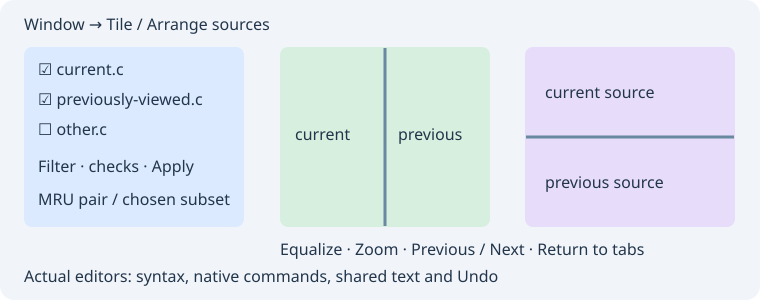

# Linked source windows

**Window → Link Source Windows…** manages project source links. The first table row contains editable **Source** and **Target** drop-down cells. Select a saved relation to load both selectors and its options, then **Apply Link** to change it. **Remove selected link** deletes just that relation.

Right-click an editor or its tab and choose **Link source window…**. The first click starts a draft with that file in the Source column. Choose Target in the first row and apply, or repeat the context command on another editor/tab. Selecting the same file does nothing; an existing pair, including the reverse ordering, is selected instead of duplicated. One file can participate in multiple links.

| Option | Effect |
| --- | --- |
| Show together | Selecting either endpoint reopens closed partners and presents the connected group side by side |
| Two Way | Either endpoint drives scrolling; otherwise Source drives Target |
| Vertical / Horizontal scrolling | Synchronize changes in visible rows / horizontal pixel offset |
| Link All Source Windows | Synchronize all open source buffers, including newly opened ones |
| Unlink All | Remove individual relations and turn off Link All |

The side-by-side window contains the actual editor widgets, with syntax highlighting, native editing, Undo/Redo and saving. Focus selects the corresponding document for editor commands. Drag the vertical dividers to resize the panes. Closing this presentation returns editors to their original notebook pages. Closing a file also restores the panes and retains named-file relations. Selecting its table row or subsequently activating a linked partner reopens it. A file that cannot be opened keeps its relation so it can be restored later.

Named-file links, direction, simultaneous-display flags and scroll axes are stored in the **project file**, with relative paths inside the project folder. They survive project close/reopen and application restart. Changes update only the link group without replacing unrelated project settings. Removing a member through the project file manager, master file list or Git membership refresh removes its relations. Untitled buffers and links without a project are session-only.

Scrolling preserves each buffer's relative offset and clamps at its own bounds. Chains and cycles visit each reachable buffer once. This uses display rows, including each file's own folding/wrapping, rather than matching-line diff alignment. Context, terminal, diff/merge and AI previews are not source-link endpoints. No source text is copied or changed by linking. Limits: 64 explicit relations; Link All supports up to 128 open source buffers. Closing the manager keeps links active.

## Source window arrangements

The Window menu now also offers **Tile Horizontal**, **Tile Vertical**, **Tile Two Windows**, **Tile One Window**, **Arrange Source Windows…**, **Return editors to tabs**, **Equalize source panes** and **Zoom source pane**. Each command has an initially unassigned Editor keyboard binding.

| Command | Behavior |
| --- | --- |
| Tile Horizontal | All open source files, wide panes stacked top to bottom |
| Tile Vertical | All open source files, tall panes side by side |
| Tile Two Windows | Current file and the previously viewed live file; adjacent tab is the fallback |
| Tile One Window | Only the current editor fills the presentation; other files stay open in tabs |
| Arrange Source Windows | Modeless checkbox list, Unicode path/name filter, select/clear visible matches, Refresh and direction choice |
| Equalize | Restore proportional sizes of source panes, without resizing editor Overview splitters |
| Zoom | Temporarily give the current pane all presentation space; repeat to restore the other panes |
| Return editors to tabs | Close the presentation and restore the original notebook pages |

The compact presentation toolbar changes direction for the **currently displayed subset**, equalizes, zooms, moves to the previous/next pane and returns to tabs. Horizontal/vertical commands in Window apply to all open files. More than three manually arranged editors use a balanced subdivision with the chosen primary axis. Named and untitled buffers are supported, up to 128 files; larger all-buffer commands refuse without changing the current layout. The chooser lists the first 128 notebook entries. Hidden filtered selections remain checked; select/clear buttons affect only visible rows. Apply rejects checked documents closed since the last Refresh, rather than substituting another tab.

Manual arrangements are independent of scroll links and do not write project relationships. Selecting a displayed tab keeps the arrangement; choosing a file outside the subset restores the ordinary notebook. Closing a displayed file restores the remaining editors before native closing and dirty-file prompts complete. Manual arrangements are session-only. Persistent **Show together** relations continue to use their own side-by-side presentation.

Source-window keyboard routing now shares the native command dispatcher and focused-widget checks with the main window. Native Copy/Paste, Duplicate, Undo and Save are tested in the real detached editors. Current document identity remains the original tab, and no source text or Undo history is copied to a preview. This adapts the Source Insight tiling commands to a native GTK presentation window; it is not an overlapping MDI/Cascade implementation.
