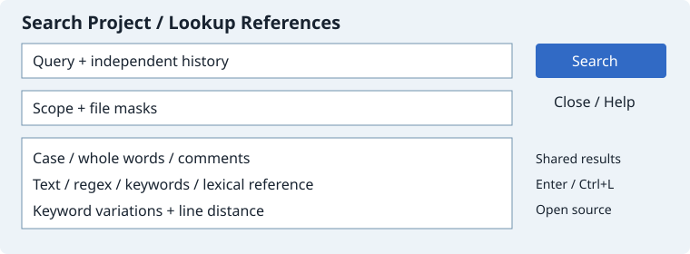

# Search Project and Lookup References

The Search menu commands share one dialog layout, with separate persistent settings and histories. Search Files in File Search and the project search toolbar button open Search Project.

- Query history retains up to 32 entries. Lookup References seeds the editor word or selection.
- Scope: project, open documents, current file, chosen files/folder. Search prompts for files when the chosen list is empty. Each command persists its own file masks.
- Methods: simple text, GLib regular expression, Boolean/keyword expression, and lexical whole-identifier references. Case is configurable; reference mode forces Whole Words Only.
- Keyword mode supports regular English ending variations and a 0–50 line distance. Turn Whole Words Only off to match fragments.
- Comment regions: all text, skip comments, comments only, or code only. Filtered searches skip unsupported languages.
- Search opens shared Search Results. Enter, double click or Ctrl+L opens a match; Alt+Up/Down previews it in Context.

Close also saves settings. Command histories remain independent. Unsaved documents are searched in memory without writing files. Existing engine bounds remain: 2 MiB per file, 10000 paths and 2000 results.

Skip Inactive Code, Smart Reference Matching and Touch files are disabled with explanatory tooltips because they are not implemented. References do not resolve overloads or types. Bidirectional edit-tracking Source Links are not implemented. This is not full Source Insight parity.

The chosen file/folder list is shared with Search Results; each command separately persists its query, history, scope, masks and options.

[Linux validation: 29/29 tests](https://github.com/bhgv/geany-insight/actions/runs/39339470701)
