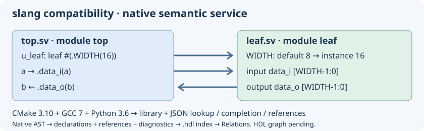

# SystemVerilog slang: old-toolchain compatibility experiment



The pinned source in `external/slang` is upstream **slang 3.0** (`7efcca2e348ecf1e01d1859f7ea85d6202fc9f91`), the last major release before the move to C++20. This is an explicit compatibility variant, not current slang 12.x and not a completed editor integration. The current editor continues using its existing Verilog/SystemVerilog Ctags and lexical highlighting.

## Build without upgrading the system toolchain

On Ubuntu 18.04 the target tools are CMake **3.10.2**, GCC/G++ **7.5**, Python **3.6** and Make. Git and CA certificates are needed for the first online source preparation. The common `build.sh` driver builds slang automatically for Meson and Autotools, independently of the Clang provider. Use `--slang-provider disabled` to skip it explicitly.

```bash
python3 insight/tools/build_external_slang.py --jobs 2 --check
```

The helper initializes only the slang submodule, fetches three exact dependency commits, applies `external/slang-compat/cmake310-gcc7.patch`, builds a static library and the slang command-line tool, then runs a **direct C++ API probe**. Its two separate SystemVerilog files declare a module and instantiate it with `WIDTH=16`; the probe resolves the cross-file instance, its overridden parameter and both ports. This establishes elaboration/API access, not completion or references inside the editor.

Sources and dependencies are editable in `external/slang` and `external/slang-deps`. Existing initialized checkouts are never reset; a wrong revision or conflicting patch stops preparation. A second run recognizes the already applied patch. `--prepare-only` downloads/prepares without CMake. `--build PATH` and `--deps PATH` select separate output/dependency directories. `_external-slang/source-manifest.json` records source/dependency revisions and the CMake version.

## Adaptation

- Remove reliance on FetchContent, modern Python discovery and newer CMake install/source-path behavior in the compatibility route.
- Pin fmt 9.1.0, unordered_dense 2.0.0 and ghc::filesystem 1.5.14 by commit; CMake performs no network downloads.
- Use ghc::filesystem consistently in the adapted public headers and implementation, avoiding GCC 7's missing `std::filesystem`. Consumers must compile against the adapted headers and dependencies; an unpatched system slang ABI is not interchangeable.
- Replace the integer-only `std::from_chars` calls missing in GCC 7; boundary tests cover signed/unsigned limits, overflow and invalid input.
- Spell out container types where GCC 7 lacks C++17 deduction guides.
- Keep C++17, original parser and semantic/elaboration code. Python bindings, slang-tidy, upstream test suite and installation/export targets are excluded from this experiment. The fixture is a focused integration check, not full language conformance testing.

The CI workflow `insight-slang-compat.yml` uses the actual Ubuntu 18.04 toolchain in a container. The host checkout avoids requiring modern Node.js inside the old container. The Windows/UCRT64 CI also builds the engine, stages the SDK on drive D and compiles/runs a separate C++ consumer from an install path containing spaces. macOS has not been validated.

## What newer versions add

Upstream [4.0](https://github.com/MikePopoloski/slang/releases/tag/v4.0) adds checkers, net aliases and parallel parsing; [6.0](https://github.com/MikePopoloski/slang/releases/tag/v6.0) adds configurations, [7.0](https://github.com/MikePopoloski/slang/releases/tag/v7.0) completes support for IEEE 1800-2023 changes, and [9.0](https://github.com/MikePopoloski/slang/releases/tag/v9.0) adds a data-flow analysis framework and substantially improved instance caching. Later releases improve diagnostics, analysis APIs and correctness. [12.1](https://github.com/MikePopoloski/slang/releases/tag/v12.1) fixes many corner cases in constant evaluation, name resolution and instance caching. Compatibility 3.0 does not inherit those features/fixes.

Current upstream [build requirements](https://sv-lang.com/building.html) include C++20 and CMake 3.28+. Supporting old build tools with 3.0 is a first experiment, not a commitment to freezing the editor's HDL engine on an old release. Porting a newer C++20 engine to GCC 7 requires a separate feasibility check, not just lowering `cmake_minimum_required`.

## Automatic build and staged SDK

`./build.sh --slang-only --install --prefix "$PWD/hdl-tools"` builds and stages only slang, without GTK/Clang prerequisites. Normal editor `--install` also stages the engine. The console tool is under `libexec/geany-insight/slang`; the static SDK is under `lib/geany-insight/slang` with merged/generated headers, dependency headers, `libsvlang.a`, `libfmt.a`, pkg-config metadata and licenses. The compatibility CI compiles the C++ elaboration probe against that installed SDK. Ninja is preferred when available; existing build directories retain their generator.

## Native HDL semantic service

The build also produces `insight-slang-semantic` (`.exe` on Windows). Installation stages it beside the slang CLI in `libexec/geany-insight/slang`. It uses the bundled engine's C++ AST directly, without LSP or a system parser.

```bash
_external-slang/insight-slang-semantic --lookup top.u_leaf.data_i -- leaf.sv top.sv
_external-slang/insight-slang-semantic --complete top.u_leaf data_ -- leaf.sv top.sv
_external-slang/insight-slang-semantic --references -- leaf.sv top.sv
_external-slang/insight-slang-semantic --symbols -- leaf.sv top.sv
```

Each request reads the explicit file set and elaborates it together. stdout contains one JSON object: `protocol: 1`, `diagnostics_count`, and `records`. Locations carry an absolute path and one-based line/column. Lookup takes a hierarchical name; completion takes a scope and case-sensitive prefix. Completion deduplicates port/internal-variable pairs. References cover instance-to-module definitions, value accesses and user function calls, including functions in a separate package file. System calls do not acquire invented source declarations.

A nonzero `diagnostics_count` marks results requiring inspection; JSON alone does not establish project correctness. Missing symbols return an empty array. Read/argument errors return nonzero, explain the failure on stderr and leave stdout empty. A 100000-record limit fails without partial JSON. Sources are never modified. An explicit file list can represent a temporary workspace without saving a project.

This prepares the editor integration: **background HDL indexing, navigation menus and the completion popup do not yet consume the service**. Each process reparses its input; persistent AST caching, unsaved overlays, include/define/top options and complete reference coverage are not connected yet. A caller can terminate the process without GTK access. Editor highlighting remains lexical.

The `slang_semantic_protocol` test exercises the real executable: cross-file targets, package function calls, deduplicated completion, exact positions, erroneous input and paths with spaces.
