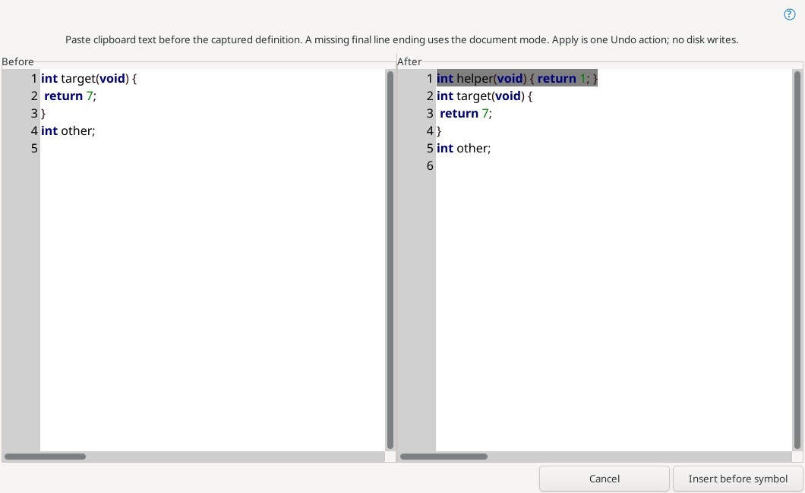

# Structural selection and symbol editing

Edit → Structural selection offers enclosing-block expansion (Ctrl+Alt+B), matching brackets (Ctrl+Alt+M), line selection (Ctrl+Alt+L) and Select Function (Ctrl+Alt+F). Function Up/Down use Ctrl+Alt+PageUp/PageDown. Lexical masks exclude comments and strings; brace, Python indentation and Lua end blocks are supported. This is lexical structure, not semantic analysis.

## Copy Symbol / Cut Symbol / Duplicate Symbol / Paste Symbol

The Edit menu operates on the smallest complete supported definition enclosing the caret or entire selection. The File Symbols context menu operates on its selected definition, independently of the caret. Project Symbols does not offer these commands yet.

| Command | Result |
| --- | --- |
| Copy Symbol | Copies the full function without moving the caret or changing Undo. Read-only is allowed. |
| Paste Symbol… | Previews clipboard text inserted before the captured definition, then applies in one Undo action. |
| Cut Symbol | Copies and removes the function. One Undo restores it. |
| Duplicate Symbol | Inserts and selects a copy immediately after the function. One Undo removes it; clipboard and symbol name are unchanged. |

The range includes indentation on the parser definition line, the body, trailing comments and its final line ending. At EOF without EOL, duplication inserts a separator using the document's LF/CRLF/CR mode. Previous decorator, annotation and return-type lines are excluded. Functions and methods in brace languages, Python and Lua are supported. The smallest nested function wins.

Named class, struct, union, enum, namespace and interface definitions are supported where the lexical range recognizer and parser agree; Python classes are supported. Variables, forward declarations, aliases with trailing declarators, unfinished bodies and neighboring definitions on one line are rejected. Fresh tags validate the name and parser line before an outline command edits text. Limits: 2 MiB document, 1 MiB definition, valid UTF-8 without NUL, one normal selection without virtual space. Read-only buffers refuse mutations.

Actual Linux editor after Duplicate Symbol from File Symbols: the new function is selected and the following function remains intact.

## Exact selection duplication

Edit → Duplicate Line or Selection / Ctrl+D duplicates exactly the selected letters, words, spaces or partial multiline text. Boundary lines are no longer expanded. With no selection the current line is duplicated. Reverse selections and Undo/Redo are supported; read-only buffers refuse changes.

[Delimiter navigation and enclosing-pair browser / Переходы по скобкам](delimiter-navigation.md).

### Paste Symbol review and guarded editing

Paste Symbol is available in Edit → Structural selection and the File Symbols context menu. It captures the original document and definition before asynchronously reading the clipboard. The colored, numbered read-only panes show full source before and after. Apply inserts before the definition, without replacing its body or the current selection; Cancel inserts nothing. A missing final clipboard EOL adds the document EOL; existing clipboard bytes and line endings returned by GTK stay exact. No indentation adjustment or symbol renaming occurs, and disk files are not saved. Clipboard payloads are plain UTF-8 text, not parsed ASTs.

All four commands have configurable Editor keybindings, with no default shortcuts. Cut/Duplicate/Paste share an exact splice planner and one Undo/Redo. Source identity, filename, file type, full text, text revision, ordinary selection, active tab and write permission are rechecked. An edit followed by Undo still invalidates Paste. Closed, renamed or switched sources refuse Apply. Legal extension substitutions are detected against the actual resulting text; inspect the source and use Undo if interrupted. Copy remains available for read-only sources. Column, multiple and virtual-space selections are refused. Limits: 2 MiB source, 1 MiB definition or clipboard payload.

References: [Paste Symbol](https://www.sourceinsight.com/doc/v4/userguide/Manual/Command_Reference/Paste_Symbol.htm), [Copy Symbol](https://www.sourceinsight.com/doc/v4/userguide/Manual/Command_Reference/Copy_Symbol.htm), [Cut Symbol](https://www.sourceinsight.com/doc/v4/userguide/Manual/Command_Reference/Cut_Symbol.htm), [Duplicate Symbol](https://www.sourceinsight.com/doc/v4/userguide/Manual/Command_Reference/Duplicate_Symbol.htm).

Complete Linux editor under Xvfb using synthetic C fixtures. The right pane selects the insertion before the original function.
