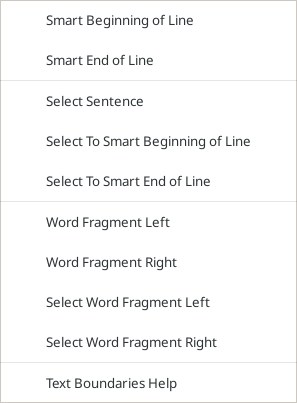
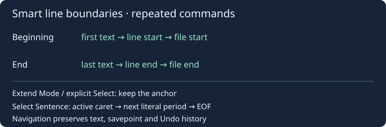

# Text boundaries

**Edit → Selection and navigation → Text boundaries** provides nine commands and a help item. They move/select text without changing buffer bytes, savepoint or Undo history; read-only documents are supported. Existing native keyboard bindings are not reassigned.

| Command | Result |
| --- | --- |
| Smart Beginning of Line | From text: first non-space/tab. At or within indentation: physical line start. At line start: file start. |
| Smart End of Line | From text: after the last non-space/tab. At or within trailing whitespace: physical line end. At line end: file end. |
| Select Sentence | Extend the current anchor to just after the next literal ASCII period (`.`), scanning from the active caret. If none remains, select to EOF. |
| Select To Smart Beginning / End of Line | Perform the same smart steps while retaining the current anchor. |
| Word Fragment Left / Right | Native Scintilla word-part movement. With Extend Mode, retain the anchor. |
| Select Word Fragment Left / Right | Always use native word-part extension, keeping the anchor. |

Smart movements collapse ordinary selections at the destination when Extend Mode is off; with Extend Mode they keep the anchor. Explicit selection commands preserve the current Extend Mode setting. All actions use the active caret, including reversed selections, and reveal the destination.

On whitespace-only lines, Smart Beginning moves to line start and then file start; Smart End moves to line end and then file end. On an empty line the physical line boundary is already reached, so the next smart movement goes to the file boundary. Physical lines are used even with visual wrapping. ASCII space/tab are edge whitespace; line endings are excluded from line content.

Sentence selection follows the simple “up to the next period” command: decimal points, strings, comments and abbreviations are not parsed. It does not search backward for the start of a grammatical sentence.

Word parts use the editor's existing character classification. Examples: `Create|Window`, `HTML|Open`, `open|_file`, `Vip|32|Test`. A right movement starting on `_` skips that separator and crosses the following fragment. Whitespace and punctuation are separate native runs. Contiguous non-ASCII text is treated as a native run; Unicode title-case and linguistic word splitting are not added. These movement rules differ from Source Insight's symbol-name indexing, which can group digits with their preceding fragment.

Single ordinary selections only; rectangle, multiple and virtual-space selections are excluded. Smart edges and sentence selection validate UTF-8/no-NUL input and character/CRLF boundaries and are limited to 8 MiB per document. Native word-part commands do not copy or impose this document-size limit. Unsupported modes or validation failures leave the selection unchanged.

References: [Smart Beginning](https://www.sourceinsight.com/doc/v4/userguide/Manual/Command_Reference/Smart_Beginning_of_Line.htm), [Smart End](https://www.sourceinsight.com/doc/v4/userguide/Manual/Command_Reference/Smart_End_of_Line.htm), [Select Sentence](https://www.sourceinsight.com/doc/v4/userguide/Manual/Command_Reference/Select_Sentence.htm), [Word Fragment Left](https://www.sourceinsight.com/doc/v4/userguide/Manual/Command_Reference/Word_Fragment_Left.htm), [Word Fragment Right](https://www.sourceinsight.com/doc/v4/userguide/Manual/Command_Reference/Word_Fragment_Right.htm).

## Extend selection / Расширить выделение

The adjacent **Extend selection** submenu exposes Select Char Left/Right,
Select Word Left/Right and Select Line Up/Down. The anchor stays fixed while the
active caret moves. Character steps use native UTF-8/CRLF boundaries; word steps
use the editor's word classification (left to the start, right to the end).
Line steps use native display-row movement and retain the preferred horizontal
position across short lines. Existing Shift shortcuts remain unchanged.
Read-only is supported; one ordinary selection without virtual space is required.
Explicit commands retain the Extend Mode flag and leave bytes/savepoint/Undo intact.

Подменю **Расширить выделение**: символ влево/вправо, слово влево/вправо,
строка вверх/вниз. Anchor остаётся на месте; двигается активный край. Границы
символов UTF-8/CRLF и слов определяет Scintilla. Движение вверх/вниз выполняется
по экранным строкам с сохранением предпочтительной колонки. Режим Extend Mode
сохраняется, изменения текста и Undo не создаются.

References: [Select Char Left](https://www.sourceinsight.com/doc/v4/userguide/Manual/Command_Reference/Select_Char_Left.htm),
[Select Word Right](https://www.sourceinsight.com/doc/v4/userguide/Manual/Command_Reference/Select_Word_Right.htm),
[Select Line Down](https://www.sourceinsight.com/doc/v4/userguide/Manual/Command_Reference/Select_Line_Down.htm).
