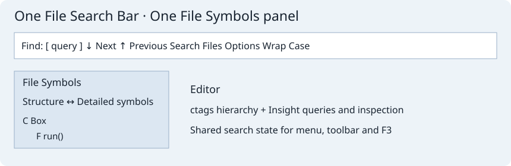
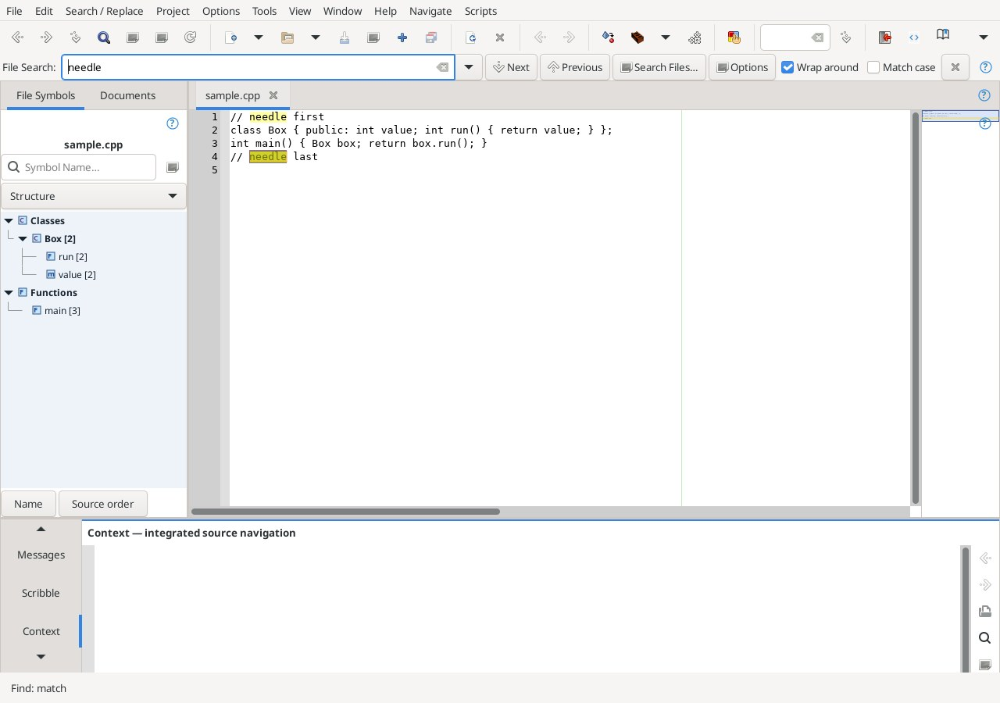

# Unified File Search and File Symbols

The duplicate Geany/Insight file-search surfaces now share one File Search Bar. Ctrl+F, Find menu/toolbar and Quick Find open that bar; F3 / Shift+F3 (or configured Find Next/Previous bindings) repeat its query and options. Native selection-search commands can still seed the shared search state. Replace and project search remain separate tasks.

The query dropdown retains the last 32 successful queries for the current session. The native Focus Symbols command also targets the selected mode of the shared panel.

The bar follows the Source Insight arrangement: query, Next/Previous, Search Files, Options, Wrap around and Match case. Options also retains Geany Find All in Document/Open Documents and Mark All for literal/regex queries (fuzzy queries report that limitation). Options holds whole-word, Perl-compatible regex, select text when found, search while typing and load the cursor word when clicking the navigation buttons. Escape closes the bar and returns focus to the editor. Query and options feed the existing F3 commands; no second Find dialog is created while the workbench is active. Search Files opens the project/file search interface. Existing fuzzy ~term matching remains available when regex is off. The active-file search accepts the editor's signed position range, including files larger than 2 MiB; background/preview collection keeps its existing bounds. Find All/Mark apply multiline and Unicode whole-word boundaries to regex queries as in the bar. Context-sensitive symbol matching and Source Insight's legacy regex dialect are not implemented here. Options are session state.

There is one File Symbols tab, occupying the original native Symbols page. **Structure** is the default and uses Geany's ctags tree, with its real category/class/member relationships, folding, native navigation and context menu. Name and Source order controls are at the bottom. Its background, compact square type glyphs, tree guides and bold data-structure declarations follow the Source Insight Symbol Window reference. GTK/font rendering and the original parser's hierarchy remain platform-dependent; this is not a pixel-identical copy of Source Insight.

**Detailed symbols** switches the same panel to the Insight view, preserving its field queries, history, type masks, scope grouping, columns, Symbol Info, references and caret location controls. Both modes use one visible query field. Structure mode uses the native space-separated name filter; advanced query syntax belongs to Detailed symbols. Enter in Structure focuses its first matching declaration. Floating/docking the shared panel preserves the sidebar's native page positions. The Documents tab remains separate.

References: [File Search Bar Options](https://www.sourceinsight.com/doc/v4/userguide/Manual/Command_Reference/File_Search_Bar_Options.htm), [Symbol Windows](https://www.sourceinsight.com/doc/v4/userguide/Manual/Window_Tour/Symbol_Windows.htm).

## Verified editor capture

Full Linux GTK editor, sample.cpp integration profile.

