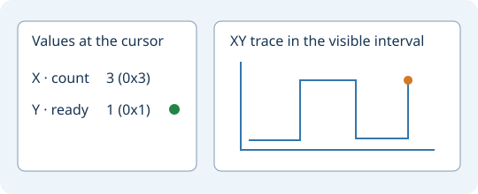

# Verilog and SystemVerilog debugger

Open a saved `.v` or `.sv` testbench in Geany. Choose
**Tools → Verilog / SystemVerilog → Debug Current Verilog File**.
The same command is available in the editor context menu under
**Source tools**. Save any edits before starting.

Use **Debug Verilog Testbench…** to select several files when the design
and its testbench are in separate files. **Run Verilog Testbench…** runs
the selected files without stopping at debugger prompts.

In **Verilog Simulation**, select a source line and add a breakpoint.
Use **Continue**, **Step HDL**, **Step Current Process** and **Next Tick**
to move through execution. **Process Values** displays the selected
process or frame. **Load Lua Observer…** opens an observer script.
Simulator messages and commands appear in the embedded console.

**Preview Waveform** opens the current capture. In the waveform window,
use **Signal Map → HDL Uses… → Connections** to inspect data, guard and
clock dependencies. **VCD Waveforms…** opens an existing recording.

## Port signals

**Debug Current Verilog File** opens **Port Signals**. Leave the recipe
empty for an existing testbench. For a module with ports, enter its name
and one rule per port. For example:

```text
module counter
duration 1000
clock clk 5 5 5
pulse rst_n 0 20 0
bus data 8 40 "step * 3"
output count 8
```

Times are in nanoseconds. `clock` takes the start, high and low durations.
Use `clock-hz clk 5 100000000` for a 100 MHz clock with equal phases.
`pulse` takes start, length and active level. `value data 8 "8'h2a"`
drives a constant. `bus` takes the width, update interval and expression.
`step` starts at zero, and SystemVerilog expressions can also use
`$time`. Use double quotes around expressions with spaces or Verilog
literals containing an apostrophe. `output` records a port in the VCD.

Port recipes are saved by project and source file. **Port Signals…**
on the debugger panel reopens the recipe. Edits made during a run apply
the next time debugging starts.

## Output instruments

Open **Signal Instruments…** in the VCD viewer, including from
**Preview Waveform**. Choose up to three recorded signals. One-bit
signals have a lamp. Known values up to 64 bits appear as unsigned
decimal and hexadecimal. Unknown states remain visible as recorded.



Use the waveform tracks for plots against time. Choose X and Y for an
XY trace and add Z for a fixed XYZ projection. The plot follows the
visible time interval and uses transitions in those signals. Unknown
samples interrupt the trace. The first 2048 samples are shown when
the interval is dense. Zoom in to inspect more detail. The readings
follow the VCD cursor, and named VCD sessions save the axis selections.
