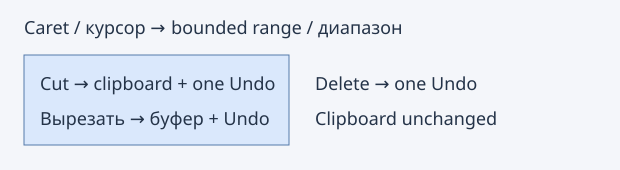

# Word and character operations / Операции со словами и символами

**Edit → Word and character operations** adds four commands.

| Command | Range | Clipboard |
| --- | --- | --- |
| Cut Word | Active caret to end of native character-class run | Replaced by removed text |
| Cut Word Left | Start of the run immediately left of active caret to caret | Replaced by removed text |
| Delete Line | Active caret's entire physical line, including its EOL if present | Preserved |
| Delete Character | Exact selection, or one native character at caret | Preserved |

Word commands use Scintilla's configured word classes: identifier characters,
whitespace and punctuation have their own runs. They can remove a whitespace run
at a word boundary; they do not parse a programming-language symbol. A preexisting
selection is ignored by Cut Word/Left and Delete Line; the active caret is used.
Delete Character replaces the exact forward/reverse selection. CRLF is indivisible.
At EOF/BOF or an empty range nothing changes, including the clipboard and Undo.

Each successful removal creates one Undo/Redo step and collapses the selection
to the removed range's start. One ordinary writable selection without virtual
space is required. Read-only, rectangle/multiple selection, invalid UTF-8, NUL,
partial CRLF and ranges exceeding 1 MiB are rejected. Clipboard ownership changes
are followed by revalidation of document identity/generation/selection.
Existing keyboard bindings and native Delete/Ctrl+Delete behavior are unchanged.

**Правка → Операции со словами и символами**: вырезание слова справа/слева,
удаление строки и символа. Для слов используются классы символов Scintilla,
включая отдельные серии пробелов и знаков пунктуации. Вырезание слов и удаление
строки ориентируются на активный курсор, даже при обратном выделении.
Удаление символа удаляет точное выделение либо один символ; CRLF не разделяется.
Delete-команды сохраняют clipboard, Cut-команды записывают вырезанный текст.
Каждую правку можно отменить одним Undo. Пустые диапазоны ничего не меняют.

References: [Cut Word](https://www.sourceinsight.com/doc/v4/userguide/Manual/Command_Reference/Cut_Word.htm),
[Cut Word Left](https://www.sourceinsight.com/doc/v4/userguide/Manual/Command_Reference/Cut_Word_Left.htm),
[Delete Line](https://www.sourceinsight.com/doc/v4/userguide/Manual/Command_Reference/Delete_Line.htm),
[Delete Character](https://www.sourceinsight.com/doc/v4/userguide/Manual/Command_Reference/Delete_Character.htm).

## Keyboard assignments / Назначения клавиш

The native Preferences → Keybindings page now exposes **Cut Word / Cut Word Left**
in Clipboard, **Delete Line / Delete Character** in Editor and **Command Browser**
in Help. All five start unassigned. Normal user keyfile persistence, conflict
handling and keyboard dispatch apply. Word/delete shortcuts only act while the
current source editor has focus; search/other text fields are not redirected to
source edits. Browser can be invoked from other main-window focus locations.
Current assignments appear in menu accelerators, Key List and Command Browser.
Existing keybinding IDs retain their values; new IDs are appended.

Штатные настройки клавиш: Clipboard — Cut Word/Left, Editor — Delete Line/Character,
Help — Command Browser. По умолчанию сочетания не назначены. Пользовательские
назначения сохраняются обычным механизмом Geany. Сочетания удаления и вырезания
действуют только при фокусе в текущем исходном редакторе, не меняя документ при
вводе в строку поиска или другое поле. Назначения видны в новых списках и меню.
