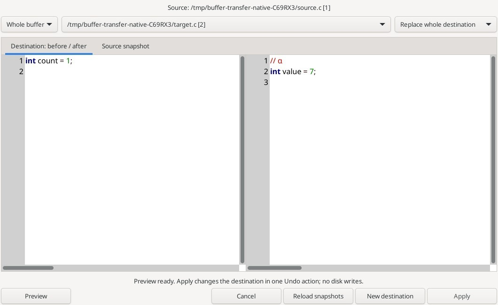

# Вставка, экспорт и перенос текста

Меню **Edit → Insert and clipboard** содержит Insert File, Save Selection, Save a Copy и Copy Text to Buffer.

- **Insert File** вставляет локальный UTF-8 файл вместо выделения или в курсор, одним Undo. Один начальный BOM удаляется. Символы NUL, файлы более 8 МиБ и символические ссылки не принимаются.
- **Save Selection** сохраняет выделенный фрагмент. Если назначение уже открыто, запускается просмотр переноса в буфер без записи на диск. Неоднозначные файловые псевдонимы отклоняются.
- **Save a Copy** экспортирует весь текущий буфер. Открытые назначения защищены. Для закрытого существующего файла требуется подтверждение замены.

## Copy Text to Buffer

Выберите выделенный текст или весь исходник, открытый буфер назначения и режим:

| Режим | Результат |
| --- | --- |
| Append at EOF | Дописать в конец без дополнительного разделителя. |
| Replace whole destination | Заменить весь текст назначения. |
| Insert at destination caret | Вставить в сохранённую позицию курсора. |
| Replace destination selection | Заменить обычное одиночное выделение назначения. |

Вкладка **Source snapshot** показывает снимок исходника. **Preview** показывает назначение до и после переноса в двух окнах с подсветкой синтаксиса и номерами строк. **Apply** изменяет только буфер назначения одним действием Undo/Redo и открывает его вкладку. Сохранение на диск выполняется отдельно. Источник может быть доступен только для чтения; назначение должно разрешать редактирование. Допускается выбрать исходный буфер в качестве назначения.

**New destination** создаёт несохранённую вкладку. **Reload snapshots** явно перечитывает текст и выделения обоих буферов и список открытых документов. После обновления или изменения параметров снова нажмите Preview. Отмена не меняет текст; явно созданная новая вкладка остаётся открыта.

Правки текста, даже с последующим Undo, переименование, закрытие или запрет редактирования назначения блокируют применение старого варианта. Для режимов с выделением проверяются также его границы. Прямоугольные, множественные выделения и виртуальные позиции не поддерживаются. Исходник, назначение и результат ограничены 8 МиБ, должны быть UTF-8 без NUL; нельзя разрывать символ UTF-8 или пару CRLF. Байты и окончания строк сохраняются точно. Если расширение подменило вставку, сообщение предложит проверить назначение и воспользоваться Undo.

Команде можно назначить клавишу в группе Editor; по умолчанию сочетание не назначено.

[Подробности экспорта и ссылки на команды Source Insight](en/file-text.md)

Реальное окно полного редактора под Linux/Xvfb. Исходник и назначение — искусственные C-примеры из native-теста. Показана замена всего буфера назначения с просмотром до и после.
