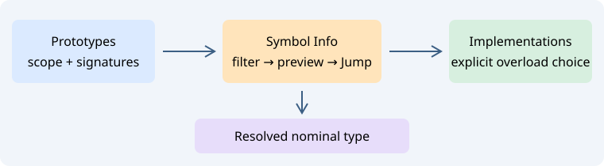

# Function targets and Symbol Info categories

Navigate and the editor context menu provide **Jump To Prototype…** and **Jump To Implementation…**. Both open the existing Symbol Info chooser with the appropriate category selected. Inspect the candidates and source preview, then choose **Jump** (Ctrl+Enter). There is no automatic overload guess, including when only one row is shown.

## Categories and counts

Symbol Info now offers All indexed symbols, Function prototypes, Function implementations, Types and namespaces, and Variables and members. A compact counter shows **displayed / matching** candidates after category and source-language filtering. Filtering happens before the 512-row presentation limit, so an implementation after hundreds of same-name prototypes remains discoverable.

At most 16384 raw name matches are considered. Broader queries are refused explicitly; use a qualified name such as `api::work`. The chooser preserves the native parser's scopes and signatures. Exact overload resolution, argument/type inference, template instantiation and include visibility are not inferred. Parser support determines which declarations are recorded as prototypes. Category selection changes only this window.

## Related targets

Three compact buttons beside the category selector provide:

| Button tooltip | Action |
| --- | --- |
| Browse function prototypes | Query prototypes for the selected candidate's qualified name |
| Browse function implementations | Query implementations in the same recorded scope, retaining overloads |
| Browse underlying nominal type | Browse the resolved type behind a variable/alias, or a function's declared result |

The first two buttons are disabled for noncallable symbols. The nominal-type button appears enabled only when the existing bounded type resolver finds an indexed destination. Cyclic, ambiguous and unknown types do not produce an active link. This follows aliases to a nominal type; it does not walk to the oldest inheritance ancestor or deduce runtime/template types.

## Source guards

Opening either command requires a single normal selection in a buffer up to 2 MiB and a code identifier rather than a comment/string. Previewing and switching categories do not open files in the editor, move its caret, edit text or alter Undo. Jump reuses Symbol Info's before/after source-digest checks and native navigation history; Back returns to the original position. If the source changes after preview, Refresh before jumping.

Refresh uses an index snapshot and updates tags for the current buffer. It does not initiate a full project rescan. Opening ordinary Symbol Info starts with All indexed symbols; counterpart buttons select the relevant category explicitly. Category choices are not stored in project configuration.

Source Insight references: [Jump To Prototype](https://www.sourceinsight.com/doc/v4/userguide/Manual/Command_Reference/Jump_To_Prototype.htm) and [Jump To Caller](https://www.sourceinsight.com/doc/v4/userguide/Manual/Command_Reference/Jump_To_Caller.htm). Caller selection remains in the separate lexical Call sites Relations mode; this series adds declaration/implementation browsing, not semantic caller resolution.
