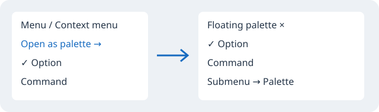

# Geany Insight: руководство пользователя

Geany Insight — редактор исходного кода с индексом символов, независимым окном контекста, отношениями между символами, встроенным сравнением и расширениями Lua. Эта справка описывает функции текущей версии.

## Где искать команды

Главная панель инструментов расположена под меню. Название команды появляется в тултипе при наведении на иконку. В меню та же команда имеет ту же иконку. Книжка открывает документацию, книжка с треугольником — [практические уроки](tutorials.md). Две колонки со стрелкой — внутренний Diff / Merge.

**Help → Geany Insight — Documentation…** открывает это руководство. **Help → Geany Insight — Tutorials…** открывает уроки. **Help → Lua scripting guide…** объясняет расширения. **Help → Markdown / reStructuredText viewer…** открывает произвольный файл справки. Все эти окна немодальные: можно читать и одновременно работать в редакторе.

**Поиск/замена** объединяет поиск в файле, замену в файле, поиск по проекту, открытым документам, выбранным файлам и папке, переходы по результатам. Панели текстового поиска скрыты при запуске. Открывайте их командой меню или кнопкой; закройте крестиком. Escape в поле быстрого поиска закрывает его панель и возвращает фокус редактору.

**Navigate** содержит переход к определению, Symbol Info и переходы по функциям. Поиск символа/файла/употреблений находится в Поиск/замена. **Project** управляет проектом и его файлами. **Scripts** загружает и запускает Lua. **Tools → Diff / Merge…** открывает сравнение. **View → Panels** выбирает панели. **Window → Window List…** показывает открытые буферы. **Options** содержит настройки Geany и документа.

## Открытие проекта и индекс

Откройте существующий проект Geany через Project → Open или выберите исходную папку кнопкой Open source workspace. Индекс помогает искать определения и символы; он не заменяет компилятор и не всегда разрешает перегрузки, макросы и косвенные вызовы.

Project Symbols показывает символы всего индекса; Project Files — файлы. File Symbols показывает символы текущего файла. В полях фильтра введите часть имени. При изменении проекта или внешних файлов используйте Reindex workspace. При большой базе сканирование и отображение выполняются постепенно; Stop отменяет работу.

## Редактор и Context

Основной редактор изменяет документ. Context показывает исходник определения отдельно и доступен только для чтения. Follow cursor обновляет его вслед за курсором; отключите флажок, чтобы удержать место.

Список **Definitions:** слева подписан и содержит найденные определения для выбранного имени. Подчёркиваются только имена с доступным определением, подходящим языку и области видимости. Неизвестные имена, ключевые слова, комментарии и строки не становятся ссылками. Индексирование обновляет ссылки по мере нахождения определений. Для C/C++ допустимы исходники и заголовки этой семьи, а также ASM/S; определения из Shell или VHDL исключаются. Другие языки используют совпадающий язык парсера.

Один клик по имени в Context переходит к определению **только в Context**. Двойной клик в исходнике Context открывает этот файл и строку в основном редакторе и центрирует место по вертикали. Context back/forward возвращает предыдущие места предпросмотра. F12 переходит к известному определению из редактора.

[Подробности контекста и закладок](context-bookmarks.md).

## Закладки

Дважды нажмите на номер строки в редакторе: слева от него появится синий круг. Повторное двойное нажатие снимает закладку. Кнопка книжки с закладкой открывает список всех закладок. Запись содержит имя файла, номер строки и текст. Выбор записи открывает файл на этой строке. Маркеры следуют за изменениями строк открытого буфера.

## Поиск и замена

**Ctrl+F** или кнопка лупы открывает стандартный поиск Geany в текущем файле. **Ctrl+H** или кнопка замены открывает стандартное окно замены. Окна не занимают место до вызова. В них доступны обычные настройки Geany, включая регистр и регулярные выражения. Quick find in file… открывает компактную строку с Previous/Next, Match case, Whole word и Regex.

**Search project…** открывает поле запроса и Search Results. Выберите область Project files / Open documents / Current document / Chosen files or folder. Search folder… и Search selected files… сначала предлагают выбрать входные файлы. Маски `*.c;*.h` ограничивают набор. Search запускает поиск; Stop останавливает его с сохранением частичных результатов.

Keywords / Boolean поддерживает AND по умолчанию, OR, NOT/!, скобки, `=case` и `?"regex"`. Word variations учитывает регулярные английские окончания, но не является языковым словарём. Не включайте эти режимы для обычного буквального поиска без необходимости.

Один выбор результата показывает место в Context. Enter или двойной клик открывает совпадение в редакторе. Alt+Up/Down просматривает результаты в контексте. Shift+F8/F9 открывает предыдущий/следующий результат. Для замены в нескольких файлах используйте Search → Replace Files… с предварительным просмотром и применением в буферы.

## Symbol Info и отношения

Navigate → Symbol Info… или одноимённая кнопка в списке символов показывает имя, сигнатуру, тип, область, место определения, наследование и исходник. Выберите кандидата при нескольких определениях. Jump открывает место в редакторе; Leave file open загружает закрытый файл, сохраняя прежний документ активным; References показывает употребления. Refresh обновляет снимок. Если исходник изменился, старый Jump отклоняется до обновления.

Relations ищет Definitions, References, Calls, Call sites, Members и сведения об иерархии. List и Graph показывают одни результаты, включая сортировку и фильтр. Граф поддерживает выбор, двойной переход, масштаб и направление. Это начальный граф по тегам и лексике, а не полное семантическое дерево программы.

[Symbol Info](symbol-info.md), [Relations и граф](relations-calls.md), [Window List](window-list.md).

## Выделение структуры и расположение окон

Edit → Structural selection содержит расширение выделения до окружающего блока (**Ctrl+Alt+B**), выделение парных скобок (**Ctrl+Alt+M**), строки (**Ctrl+Alt+L**) и функции (**Ctrl+Alt+F**). Navigate → Function Up / Function Down переходит по функциям (Ctrl+Alt+Page Up / Page Down). Разбор поддерживает выбранные языки и имеет ограничения на большой или незавершённый исходник.

View → Panels включает File Symbols, Project Window и Relations и переключает фокус между панелями. Layouts A/B/C/D загружает варианты расположения; Save current layout сохраняет выбранный вариант. Float Project Window делает проект отдельным окном; Dock Project Window возвращает его в редактор. Overview показывает миниатюру текущего файла и перемещает видимую область.

Window → Window List… фильтрует открытые буферы по имени, пути и ближайшему известному символу. Один выбор показывает Context; Activate или Enter переключает основной редактор. Save и Close file используют обычные диалоги Geany и учитывают отмену сохранения/закрытия.

## Внутренний Diff / Merge

Нажмите иконку двух колонок со стрелкой либо Tools → Diff / Merge…. Выберите левый и правый файл. Просматривайте отличающиеся блоки, принимайте левую или правую сторону в редактируемый результат и сохраните его. Undo/Redo относится к результату сведения. Внешний KDiff3 — отдельная необязательная команда для выбранных входов: встроенное сравнение работает без него.

[Точные возможности и ограничения текущего сравнения](internal-diff.md).

## Автоматизация и собственные команды

[Руководство по скриптованию](scripting.md) содержит первый пример, загрузку, горячие клавиши и события. [Lua API](lua-api.md) перечисляет методы, координаты и ограничения. Несохранённый буфер доступен скрипту; сохранять его для обычной работы с текстом не требуется.

## Форматы справки и мультимедиа

Справка хранится в UTF-8 Markdown и reStructuredText. Оглавление сверху переходит к заголовкам; Ctrl+F ищет текст страницы, F3/Shift+F3 переключают совпадения. Help → Preview current Markdown / RST… и кнопка страницы показывают текущий несохранённый буфер; Reload обновляет предпросмотр. Компактный просмотрщик отображает заголовки, выделение, код, ссылки и локальные изображения, включая GIF-анимацию. Multimedia view открывает отформатированную страницу в браузере с изображениями и HTML5-видео. Возможность проиграть конкретный формат зависит от браузера и его кодеков. [Синтаксис, ограничения и примеры](markup-viewer.rst).

## Проверка сборки

Версия скачанного архива определяется его REVISION.txt. Новые функции появляются в новой сборке; один коммит не обновляет ранее распакованную программу. [Запуск, ручная проверка и сборка из исходников](desktop-check-builds.md).

## Настройка языков

Options → Language profiles… и контекстное меню редактора → File language / profile… задают распознавание, совместимые расширения, слова, цвета и шрифты. [Профили языков и CSS](languages.md).

Полная справка: [Режимы поиска/замены и языки запросов](search-replace.md).

## Directory Compare

[Сравнение каталогов / directory comparison](directory-compare.md): Tools → Directory Compare…

[Окна, раскладки и Tab Tray](window-layouts.md) — кнопки панелей, сохранение компоновки и файлы раскладок.

[Git history and read-only colored diff / История Git и цветной дифф](git-history.md) — File → Git History and Diff…

[Project Report / Отчёт по проекту и экспорт списка файлов](project-report.md) — Project → Project Report… / Export Project File List…

[Styled HTML export / Экспорт кода в HTML с оформлением](html-export.md) — File → Export File as HTML… / Export Selection as HTML…

[ИИ-помощник консоли: настройка, разбор ошибок и исправления через Diff/Merge](console-ai.md).

[ИИ исходника и проекта: накопление запросов, варианты, ручной Result и обновление](editor-ai.md).

[Replace Files: предварительный просмотр, выбор совпадений и замена в нескольких буферах](replace-files.md).

В Replace Files доступны диалоги Replace/Skip/Remaining/Cancel, переходы F3/Shift+F3 и Open source in editor. Select next 128 files продолжает оставшийся план снимка, исключая уже применённые файлы.

[Renumber: колонка и несколько выделений](renumber.md) — единая последовательность по исходнику, цветной просмотр до/после, выбор фрагментов и один Undo/Redo.

[Перенос текста между буферами](file-text.md#copy-text-to-buffer) — выделение или весь исходник, четыре режима, цветной просмотр, обновление снимков и один Undo без записи на диск.

[Редактирование определений](structural-selection.md#дополнение-paste-symbol-и-редактирование-определений) — Copy/Cut/Duplicate и вставка перед символом с просмотром и проверками исходника.

[Search Web / Поиск в интернете](web-search.md)

[Shared AI Connections / Общие подключения ИИ](ai-connections.md) — shared profiles, optional key storage and parallel answer selection supersede the earlier single-connection setup.

- [Panel activation / Активация панелей](panel-activation.md)

- [Code outlining / Сворачивание кода](code-outlining.md)

- [Interface style / Стиль интерфейса](interface-style.md)

- [Reload Modified Files / Перечитать изменённые файлы](reload-modified.md)

- [Custom Commands — внешние инструменты](custom-commands.md)

### Плавающие палитры меню

Щёлкните синюю **полоску высотой 7 пикселей** в самом верху меню команд, подменю или меню по правой кнопке, чтобы оторвать его. Плавающее окно содержит само исходное меню GTK: сохраняются геометрия строк, иконки, подписи, колонки горячих клавиш, галочки, радиопереключатели и обработчики команд. Повторный щелчок по полоске возвращает меню; окно можно также закрыть. Подменю работают обычным образом и имеют собственные полоски отрыва. Палитры существуют в текущем сеансе. Списки значений комбобоксов остаются обычными.

