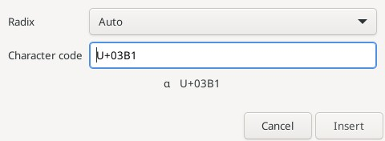
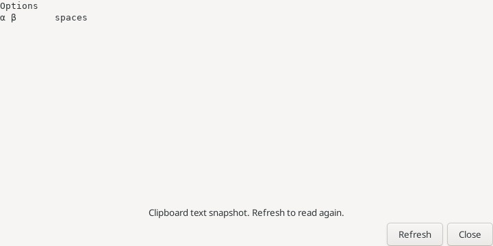

# Вставка и просмотр буфера обмена

Команды находятся в **Edit → Insert and clipboard**.

| Команда | Результат |
| --- | --- |
| Insert GUID | Генерирует новый UUID версии 4 в форме `xxxxxxxx-xxxx-4xxx-yxxx-xxxxxxxxxxxx` и заменяет выделение либо вставляет его у курсора. |
| Insert ASCII / Unicode… | Открывает выбор системы счисления и поля кода символа с предпросмотром. |
| Show Clipboard | Открывает отдельное окно с текущим текстом системного буфера обмена. |

## Числовой код символа

В Auto обычные числа считаются десятичными; префиксы `0x` и `U+` означают шестнадцатеричную запись, `0o` — восьмеричную, `0b` — двоичную. Начальный ноль без префикса остаётся десятичным. Можно выбрать систему явно. Например, `65`, `0x41`, `0o101` и `0b1000001` дают `A`; `U+03B1` даёт `α`.

Предпросмотр показывает символ и Unicode-код; управляющие символы отображаются только кодом. При ошибке Insert недоступна. Допускаются коды U+0001–U+10FFFF без суррогатного диапазона U+D800–U+DFFF. NUL не поддержан. Знаки числа, лишние символы, переполнение и некорректные цифры отклоняются.

Вставка GUID и символа заменяет точное обычное выделение, в том числе обратное, и отменяется одним Undo. Исходный буфер обмена не меняется. Требуется одно обычное выделение без виртуальных позиций и документ с разрешённой записью. Любая правка текста после открытия диалога отменяет запрос. При подтверждении должен оставаться открыт исходный документ с исходными курсором и выделением; закрытие документа или read-only также запрещают вставку. Нажатие Cancel ничего не вставляет.

Символы вставляются как UTF-8, без интеллектуального изменения отступов. Коды 9, 10 и 13 вставляют буквально TAB, LF и CR; переводы строк не преобразуются в формат документа.

## Show Clipboard

Окно показывает снимок текста моноширинным шрифтом, сохраняя пробелы, табуляцию и переводы строк. Текст нельзя редактировать или выделять. **Refresh** читает буфер заново; повторный Show Clipboard обновляет существующее окно. Закрытие окна не меняет буфер и документ.

Чтение асинхронное: закрытое окно не получает запоздалый ответ, более старое чтение не заменяет результат нового Refresh. Поддержан текст UTF-8 до 256 КиБ; для пустого, нетекстового или слишком большого содержимого выводится сообщение. Изображения, RTF и HTML не визуализируются. Окно не следит за буфером автоматически и не сохраняет его содержимое между запусками.

Эталон: [Insert GUID](https://www.sourceinsight.com/doc/v4/userguide/Manual/Command_Reference/Insert_GUID.htm), [Insert ASCII](https://www.sourceinsight.com/doc/v4/userguide/Manual/Command_Reference/Insert_ASCII.htm), [Show Clipboard](https://www.sourceinsight.com/doc/v4/userguide/Manual/Command_Reference/Show_Clipboard.htm). Поддержка Unicode расширяет команду ASCII.

Вставка файла и экспорт текста: [руководство](file-text.md).

[Renumber: колонка и несколько выделений](renumber.md) — единая последовательность по исходнику, цветной просмотр до/после, выбор фрагментов и один Undo/Redo.

[Перенос текста между буферами](file-text.md#copy-text-to-buffer) — выделение или весь исходник, четыре режима, цветной просмотр, обновление снимков и один Undo без записи на диск.
