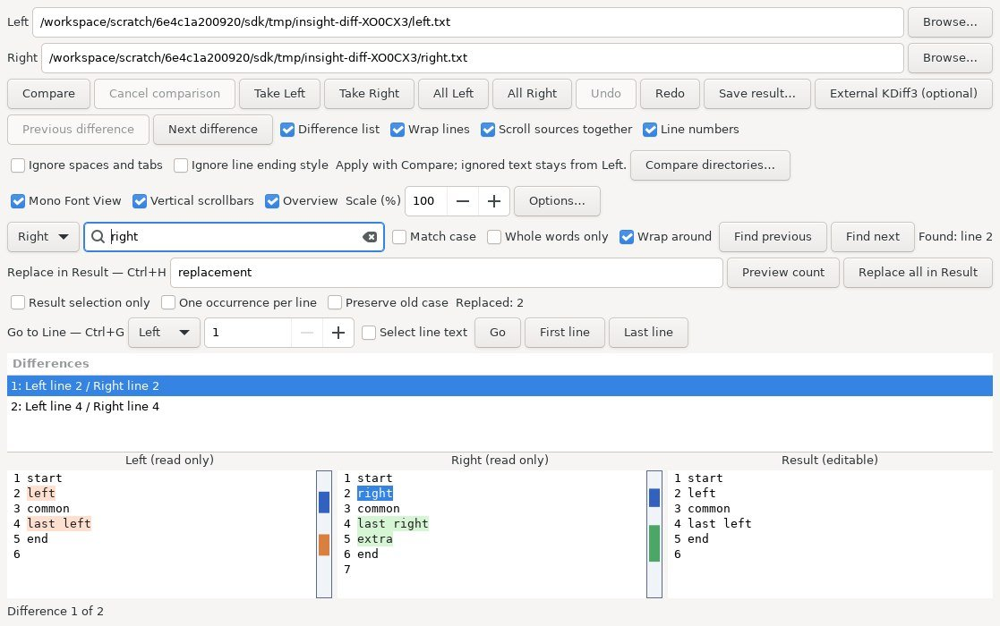
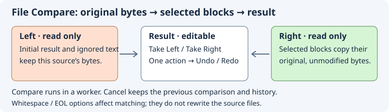
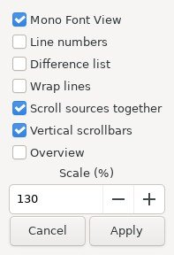

Open the internal comparison window from **Tools → Diff / Merge…**. The Context panel also has a Diff / Merge button.

# Internal Diff / Merge

Open **Diff / Merge…** in the Context header. Choose Left and Right files and press
**Compare**. The nonmodal window displays both read-only sources, highlights changed
lines and lists changed blocks. Selecting a block scrolls all three panes to it.
The editable result initially contains Left. **Take Left** / **Take Right** replaces
only the selected block; either version can be chosen repeatedly. Empty blocks
represent insertions or deletions. Manual edits are allowed in the result.

**Undo** / **Redo**, Ctrl+Z / Ctrl+Shift+Z / Ctrl+Y cover block replacements and
manual edits. A block replacement is a single history operation. Editing after
undo discards redo. Result marks move with edits and are restored with history.
History uses full snapshots, bounded to roughly 32 MiB (the newest snapshot is
always retained). **Save result…** writes to a chosen destination with overwrite
confirmation. Closing or starting another comparison asks before discarding a
changed result. Sources are never saved automatically.

**External KDiff3 (optional)** explicitly launches `kdiff3` from PATH with the two
currently selected files, even when internal comparison exceeds its limits. It
never launches automatically. Missing KDiff3 does not affect the internal tool.
External editing has its own history, outside this window.

Initial scope: two-way, line-based comparison and manual merge; UTF-8 text without
embedded NULs, up to 1 MiB per source. CRLF and final-newline differences are
preserved. The dependency-free LCS engine trims common prefixes/suffixes and caps
its matrix at 4 million cells. This is not yet three-way base-aware merge,
automatic conflict resolution, intraline highlighting, or padding that visually aligns both source panes line for line.
If a manual edit removes several block boundaries, compare again to rebuild the
block list; the list describes the original sources, not a new diff of the result.

Core validation: `python3 insight/tests/diff_test.py` (C99 compiler required).
Native GUI builds include the module in both Meson and Autotools. GTK development
headers are needed to compile and exercise the window.

The line engine recognizes CR, LF and CRLF while retaining their exact bytes. Nonadjacent changes in CR-only sources remain separate blocks. A pure insertion/deletion after trimming shared edges needs one block and no LCS matrix; two-sided comparisons retain the four-million-cell work limit. The UI source-size limit is unchanged.
## File Compare navigation and display

**Previous difference** / **Next difference** and **Ctrl+Up / Ctrl+Down** select
and reveal a block in all three panes. Navigation stops at either end; buttons
are disabled at the boundaries. With no selection, Next selects the first block
and Previous selects the last. Clicking a changed source block also selects it.
The status shows the selected difference number and total count.

**Difference list** hides or shows the block list; navigation keeps working while
it is hidden. **Wrap lines** applies word/character wrapping to all three panes.
These display options last for the lifetime of the comparison window.

**Scroll sources together** is enabled initially. It maps the top visible source
line through the diff, so insertions/deletions do not accumulate a line offset.
Inside a changed block it aligns to the start of the opposite block. Disable it
for independent scrolling. The editable Result scrolls independently; selecting
a difference still reveals its current marked range. This is position linking,
not blank-line padding or pixel-perfect alignment of wrapped lines.

Reference: [Source Insight File Compare](https://www.sourceinsight.com/doc/v4/userguide/Manual/Command_Reference/File_Compare.htm).
The Source Insight commands copy directly between files; this implementation
keeps Take Left/Right directed into the separate result buffer.

Validation for this increment: core suite (9 tests), 3000 randomized diff
reconstructions, bidirectional monotonic offset mapping, UTF-8 boundary checks,
insertions/deletions and the LCS work limit. The production GTK window also passes an isolated Linux/Xvfb fixture with
strict compiler warnings and fatal GLib criticals; this is not a full editor run. Manual check: compare the supplied example, navigate
both ends using buttons and shortcuts, hide the list, click each changed source,
scroll past insertions with linking on/off, toggle wrapping, then take/undo/redo.

## Comparison options

**Ignore spaces and tabs** ignores ASCII horizontal whitespace (space, tab,
vertical tab, form feed) within each logical line. It does not merge lines or
ignore Unicode spaces. **Ignore line ending style** treats CR, LF and CRLF as
the same terminator; a missing final terminator is still a difference. Press
**Compare** to apply changed options. They do not change the loaded comparison
until that command succeeds. The initial mode is exact.

Hunks retain original byte ranges. The result starts from Left, so ignored
changes outside a selected block keep Left's spelling/spacing/endings. Taking
Right copies the original Right bytes of that block. When mixing CR-only and
LF sources could fuse two lines into one CRLF, a neighbouring equal line is
included in the block. Overlapping blocks are combined. Linked source scrolling
uses logical lines, so differing whitespace byte widths do not shift navigation.

Validation adds 2000 random normalized reconstructions in all four option
combinations, monotonic line mapping and a GTK comparison of Cyrillic CRLF/LF
sources. No semantic or language-aware whitespace comparison is claimed.

## Cancellable comparison

File reads, UTF-8 validation and LCS comparison run in a GTask worker. Reads are
bounded to 1 MiB plus one detection byte per regular source file. **Cancel
comparison** keeps the previous sources, result and undo history. A failed read,
invalid UTF-8 or exceeded work limit also leaves them intact. While comparison is
pending, source choices, comparison options and result editing are disabled.
Closing the window cancels the worker; a late completion never accesses destroyed
widgets. Cancellation is checked between phases and LCS rows, not within a
single line comparison. Publishing source text, GTK tags and list rows still
runs on the UI thread; this is not a guarantee of zero UI latency.

The isolated production-widget fixture covers cancellation, rejected directory
input and destroying a window with a pending comparison. Core tests cancel at
several LCS phases and verify that no partial diff escapes.

## Find text and line numbers

The search row selects **Left**, **Right** or **Result**. **Ctrl+F** targets the
focused source/result pane and focuses the query. Enter or **F3** finds the next
literal Unicode match; **Shift+F3** or **Find previous** searches backward.
**Match case** controls case sensitivity. Search wraps at a boundary and reports
that fact, or reports no match. Escape in the query returns focus to the selected
pane. Search changes selection, not source text, result contents or merge history.
The difference list selection continues to identify the block used by Take.

**Line numbers** toggles gutters in all three panes. Numbers follow logical lines,
including CR, LF, CRLF and wrapped lines, and update after result edits. They are
not inserted into text or copied selections. Display settings are independent per window and remembered as defaults.

The JPEG shows the real production window on Linux/Xvfb with synthetic test files;
it is an isolated fixture, not a screenshot of the complete editor. The fixture
also covers literal search, case sensitivity, wraparound, focus and gutter
visibility. A near-four-million-cell comparison lets the main-loop timer run;
this checks that calculation moved off the UI thread, not every possible latency.

GTK fixture: Meson test **Insight isolated Diff Merge GUI** (requires a display).
For standalone checking, compile `insight/tests/diff_gui_test.c` together with
`insight/core/diff.c` using GTK3 flags, then run under Xvfb. It uses production
widgets with stubbed host help/translation functions. Windows/Android were not
executed in this increment.

The Linux fixture additionally checks linked scrolling past a 20-line insertion,
independent scrolling after disabling the link, invalid UTF-8 and a source one
byte above the size limit. The same fixture passes UBSan with fatal GLib
criticals. ASan reached the checks but its leak-scanning runtime could not finish
because `/proc/task` is unavailable in this environment; a clean ASan result is
not claimed. Linux CI now includes both the core and production-widget fixture.

Gutters include the final empty editor line after a terminator. Saving is disabled
while a new comparison is pending, so a save dialog cannot overlap replacement
of the result. The GTK fixture verifies save-control sensitivity.

[Directory Compare — compare directory trees and open a selected pair](directory-compare.md).

## Take all blocks

**All Left / All Right** replaces every difference block in the separate result
as one Undo action. Text manually edited outside the blocks is preserved. Taking
an already matching side does not add history. Undo/Redo restores block marks
with the text, and editing after Undo replaces the redo branch.

**Alt+Left / Alt+Right** takes the selected Left/Right block. Add Shift to take
all blocks. These shortcuts act inside the comparison window and write only
the result buffer. If manual edits made block boundaries touch or overlap, batch
replacement refuses the operation and asks for a fresh comparison. No partial
batch is applied. The production GTK fixture covers single-step undo, no-op,
manual outside text, collapsed boundaries, shortcuts and 150 randomized exact
batch reconstructions, including empty, UTF-8 and mixed-EOL sources.

Repeated-comparison regression: list-selection signals are ignored while source
text, marks and list rows are being replaced. This prevents old selection IDs
from reading the new mark array before it is populated. The randomized batch
fixture exercises 150 successive comparisons in the same production window.

## Display options and scaling

**Options… / Ctrl+Q** opens a single File Compare display dialog. Apply commits the controls together; Cancel preserves the current view. **Mono Font View**, **Vertical scrollbars** and **Scale (%)** affect all three panes. Scale is bounded to 50–250% of a 10-point base; Ctrl+mouse wheel changes it by ten points. Font changes also update the line-number gutters. Display changes preserve source bytes, the merge result and Undo history.

**Overview** adds a narrow map beside each read-only source. Orange/green markers show its difference blocks and the selected block is blue. The outline indicates the viewport; with wrapped lines its physical proportions are approximate. Clicking a marker selects the block in the shared difference list; clicking elsewhere scrolls that source to the corresponding logical line. Linked scrolling remains controlled by Scroll sources together. Marker caches are built in one forward pass over each source, including CR/LF/CRLF and zero-length insertions.

## Source context commands

Right-click either source for **Edit File — Ctrl+E** and **Copy selected difference**, plus the display toggles and Options. Edit File opens the completed comparison’s source in the editor at its caret line, reusing an existing document; editing the path fields does not reroute it. The live file can have changed since comparison. Clipboard copy uses the selected block’s original source bytes, including line endings, and leaves the result/history untouched. The editable result retains the normal GTK text menu. Source filenames are converted between UTF-8 entry text and native filenames and captured as absolute paths when Compare starts.

Display defaults (mono font, numbers, list, wrap, linked scrolling, scrollbars, Overview and scale), text-comparison options and window size are remembered in the workbench configuration. New windows use the last closed defaults; at editor exit the most recently opened live window supplies them. Existing windows stay independent. Invalid values retain the standard defaults. Restoring these settings does not load sources, run a comparison or restore an unsaved result; filenames and merge history are not saved. A directory pair’s explicit comparison flags override saved text-comparison defaults.

This dialog is captured from production GTK widgets in the isolated Linux fixture, with editor-host help and translation stubs. The native editor test separately verifies Ctrl+Q, applying scale/Overview, Ctrl+E source-line navigation and workbench persistence. Syntax formatting and code nesting guides remain outside this GTK comparison-view implementation.

### Search in comparison panes

Ctrl+F targets the focused pane and seeds the query from a single-line selection of up to 4096 characters. **Whole words only** uses identifier boundaries: Unicode letters, digits, combining marks and underscores belong to words. **Wrap around** allows one retry from the opposite end; disable it to stop at the file boundary. F3 and Shift+F3 search forward and backward. Search options apply to the current window and never modify result text or merge history. Regular expressions are not supported.

### Go to Line and pane switching

Ctrl+G targets the focused pane and seeds its current caret line. Enter a logical line number and press Enter or **Go**. Numbers beyond EOF land on the last line; an empty buffer has line 1. **Select line text** selects content without its line ending. **First line** and **Last line** use the selected pane. Escape returns focus from the number field to that pane. Go to Line is also available in the text context menu.

F6 cycles Left → Right → Result; Shift+F6 reverses the order. Search keeps its independent pane choice. Navigation preserves text, selected difference and merge history; Go to Line is blocked while comparison runs. Logical lines do not change when long lines wrap visually. The production-widget capture above includes the navigation bar.

### Replace in the merge result

Ctrl+H targets search at Result and focuses the replacement field. Enter the old literal text in the search bar above and the new text in **Replace in Result**; an empty replacement deletes matches. Match case and whole-word options apply. **Result selection only** restricts edits to the current result selection; **One occurrence per line** uses the first match on each logical line. Otherwise the entire result is processed, independent of caret position or search wrap.

**Preview count** recomputes actual changes without editing. **Replace all in Result** recomputes against current text and settings, then applies the batch as one Undo/Redo action. Identical text is skipped. A preflight limit of 100000 changes and 1 MiB result rejects the whole batch before edits if exceeded during calculation. Replacement is blocked during comparison. This is literal replacement; regex and source-file replacement are not implemented here. Search and replacement strings are not saved in preferences. The production GTK-widget capture above shows the replacement bar.

### Preserving and converting case

**Preserve old case** computes replacement text separately for every match. Unicode cased letters determine the style; digits, punctuation and underscores do not. Mixed-case matches use the literal replacement. Initial-capital style lowercases the replacement and uppercases its first cased letter. Preview and size checks use actual converted strings, including expansions such as `ß → SS`. This option belongs to the current window and is not persisted.

| Old match | Typed replacement | Result |
|---|---|---|
| `foo` | `bAr` | `bar` |
| `FOO` | `bAr` | `BAR` |
| `Foo` | `bAr` | `Bar` |
| `fooBar` | `bAr` | `bAr` |
| `ЁЖ` | `straße` | `STRASSE` |

The Result context menu provides **Uppercase selection**, **Lowercase selection** and **Toggle selection case**. They preserve line endings and select the converted text. Unicode conversion can change character count. Each operation is one Undo action; empty selections, unchanged text and comparison work produce no edits. Conversion is rejected in full if the result would exceed 1 MiB. Source-pane menus omit these editing commands.
