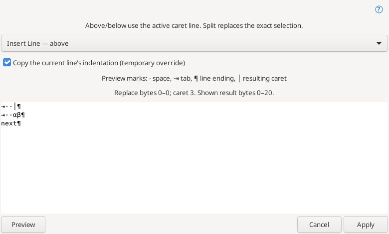
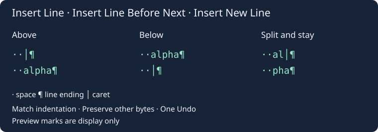

# Line insertion

**Edit → Paragraph and lines** offers three Source Insight style commands and an explicit preview.

| Command | Text operation | Resulting caret |
| --- | --- | --- |
| Insert Line | Insert an empty line above the active caret's line | On the inserted line, after its indentation |
| Insert Line Before Next | Insert an empty line below the active caret's line | On the inserted line, after its indentation |
| Insert New Line | Split at the caret, or replace the exact selection with a line break and indentation | At the beginning of the inserted break, on the original line |

Above/below never delete selected text. They use the selection's **active end**, including reverse selections. Split uses the lower byte boundary of a selection. All commands collapse the selection to the resulting caret and create one Undo action. They use the document's current LF/CRLF/CR mode, preserving existing bytes outside the insertion/replacement. Below an unterminated final line, a separator and new indentation are appended without an extra terminal EOL.

When effective auto-indentation is enabled, the exact leading ASCII spaces/tabs of the reference line are copied. For Split, only indentation before the split position is copied. This implements matching line indentation; language-aware brace/keyword adjustments, comment continuation and native Enter's auto-pair handling are not performed. Insert New Line works independently of the file type's “Enter key inserts new line” preference.

**Line Insertion Preview…** offers the three modes and a temporary indentation override without changing editor/file type settings. Changing an option clears the preview. Press **Preview**, then **Apply**. The view decorates spaces (`·`), tabs (`⇥`), EOLs (`¶`) and the resulting caret (`│`); these marks are never inserted into the document. It shows at most 4000 source bytes on either side of the resulting caret, rounded to character/EOL boundaries. Source text that already contains these symbols can look identical to the marks.

A document edit, changed selection, tab switch, closed document or read-only state while the dialog is open cancels Apply. Only one ordinary selection is supported: rectangular/multiple selections and virtual space are excluded. Text must be UTF-8 without NUL; input and final buffer are limited to 8 MiB. The clipboard is not involved.

References: [Insert Line](https://www.sourceinsight.com/doc/v4/userguide/Manual/Command_Reference/Insert_Line.htm), [Insert Line Before Next](https://www.sourceinsight.com/doc/v4/userguide/Manual/Command_Reference/Insert_Line_Before_Next.htm), [Insert New Line](https://www.sourceinsight.com/doc/v4/userguide/Manual/Command_Reference/Insert_New_Line.htm).
