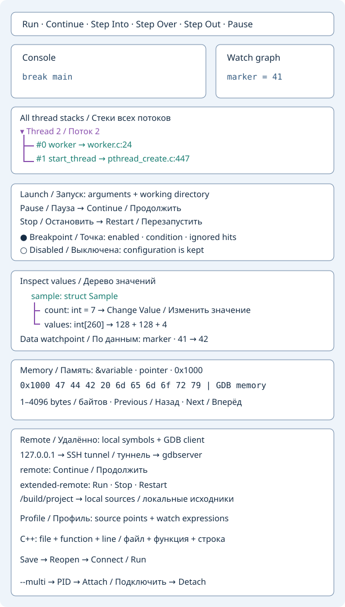
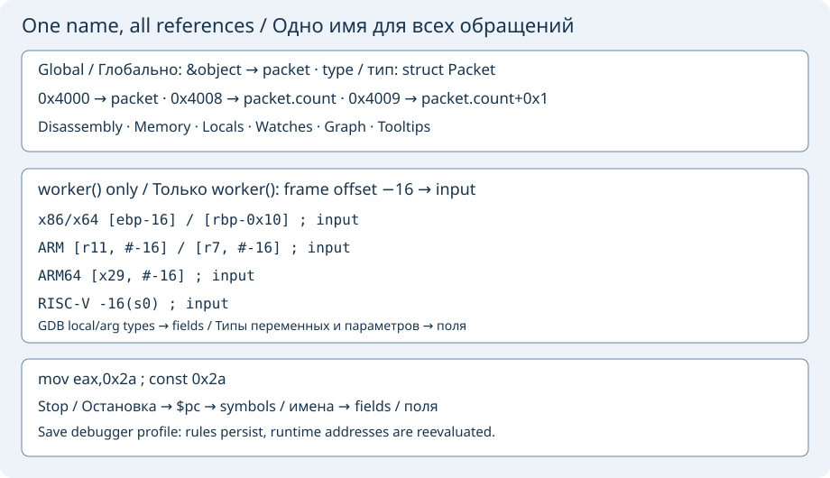

# C/C++ debugging with GDB

While paused, open **Threads and stack** to select the GDB thread.
The table shows up to 64 frames in the selected thread. Selecting a frame
updates variables and watches. Double-click a frame to open its source when
GDB provides a full path and line number.

At each stop, **Variables** shows the locals and arguments of GDB's
selected frame. The same values appear in **Watch graph**. Hover over a
name in the source file where execution stopped to see its frame value.
Use **Watches** for arbitrary expressions.

During debugging, put the caret on a source line and press **F2** or
**Toggle Breakpoint** on the main toolbar. You can also double-click the
line number or use its context menu. The main toolbar shows the commands
available for the active debugger. Focus a debugger window to switch sessions.

Build with debug symbols, for example `cc -g -Og main.c -o app` or
`c++ -g -Og main.cpp -o app`. Install GDB and make it available in
`PATH` before starting Geany.

Open **Tools → C/C++ → Debug C/C++ Executable…** and select the built program.
The C/C++ Debugger window opens with the executable directory as the
working directory.



- Enter `main` or `file.cpp:42`, click **Add Breakpoint**, then **Run**.
  You can also use `break main` in the console.
- Use **Step Into**, **Step Over**, **Step Out**, **Continue**, and **Pause**
  to control execution. **Open Source** opens the current stopped line.
- **Stack** and **Locals** show the current frame information in **Stack and locals**.
  Enter GDB commands such as `print value` or `info threads` there as well.
  The command entry is for GDB. Programs that need terminal input require
  a separate terminal configured through GDB.

## Watches and graph

Open **Watches**, enter an expression such as `marker`, and select
**Add Watch**. GDB refreshes up to 32 expressions at each stop in the
current frame. Use **Remove Watch** with the same expression to remove it.
The **Watch graph** shares the Python and Lua graph controls. It shows GDB
expressions and Lua-published values, with pinning and change highlights
between stops. GDB expression values appear as cards with their text value.

## Lua observer

**Load Lua Observer…** accepts the same callback form as the Python and
Verilog observers. GDB breakpoint stops emit `native-point` with
`event.file`, `event.line`, `event.name` and the snapshot fields
`event.locals.breakpoint` and `event.locals.reason`. Here `event.name`
is the function. Read program locals with **Locals** or GDB commands.

```lua
local hits = 0
return function(event)
    if event.kind ~= "native-point" then return true end
    hits = hits + 1
    watch("Breakpoint hits", hits)
    log(event.name .. ":" .. event.line .. " hit " .. hits)
    return hits >= 2
end
```

`log()` writes to **Observer log** and **Console**. `watch()` updates
**Watches** and **Watch graph**.
Return `false` to continue or `true` to keep the program paused.
Manual pauses and stepping stops stay available for inspection.

## All thread stacks

While paused, open **All thread stacks** to collect a collapsible tree:
threads at the top, their frames underneath. **Expand all** and **Collapse all**
control the branches. Frame numbers, function names and source lines use distinct
colors. Double-click a frame to select its thread and frame, open its source,
and refresh locals, watches and the watch graph in that context.

This view collects at most 64 threads and 64 frames per thread. It refreshes
at stops while the tab is open; while running it keeps the previous snapshot
and labels it accordingly. A thread whose stack cannot be read is marked
**Stack unavailable**. GDB must supply source paths and line numbers for source
navigation; optimized code may lack locals or source locations.


## Launch, pause, stop and restart

Before running, open **Launch settings**. Enter program arguments (quote values
containing spaces) and an existing absolute **Working directory**. An empty
argument field means no arguments. Invalid paths or unmatched quotes open this
tab with an explanation; the target is not started.

**Run** starts an inactive target. **Pause** interrupts it and preserves its
state. **Continue** resumes that state. **Stop** terminates the target while
keeping the debugger open. **Restart** terminates a running or paused target,
then starts a fresh process with the launch settings. Source breakpoints,
conditions, watches and the Lua observer stay configured. Variables, thread
stacks and the stopped-line highlight are cleared when the process exits.
The main editor toolbar also provides **Stop** for the active C/C++ session.

## Manage source breakpoints

**C/C++ breakpoints** lists the GDB snapshot, including points added with
**Add Breakpoint**, F2, the editor margin or GDB console commands. The table
shows the identifier, enabled state, condition, hit count and ignored hits.
Select a row to **Enable / Disable**, **Delete Breakpoint**, set a
**Breakpoint condition**, or configure **Ignore first hits**. An empty
condition makes the point unconditional; zero ignored hits stops on the next
matching hit. Conditions use C/C++ expressions evaluated by GDB. Invalid
expressions are reported by GDB and do not replace the previous condition.

Double-click a resolved point to open its source. Enabled points have red
margin dots, disabled points gray dots, and the current stopped line has a
background highlight. Stops with source coordinates open the editor
automatically. Unresolved points remain in the list until GDB can resolve
them (for example after loading a shared library). Source navigation and dots
require a full source path and line number from GDB. Only the session's own
markers are removed on debugger close.

For C++ overloads and templates, all GDB sub-locations (`1.1`, `1.2`, …) are
listed with their source coordinates. Their condition and counters are inherited
from the parent. **Enable / Disable** can change one sub-location; it becomes
active only when the parent is enabled too. Condition, ignored hits and deletion
apply to the whole parent breakpoint, including all its locations. If several
locations share a source line, its dot is red whenever any location is active.

## C++ exception catchpoints

In **Breakpoints**, choose **C++ throw**, **C++ catch** or **C++ rethrow**,
optionally enter a regular expression for the exception type, then click
**Add Exception Catchpoint** or press Enter in the filter field. Empty matches
all types. For example, `std::.*` matches standard-library exception types when
GDB and the target C++ runtime support type filtering.

The common list shows the event and filter. **Enable / Disable**, **Breakpoint
condition**, **Ignore first hits** and **Delete Breakpoint** also work for these
catchpoints. An invalid regular expression is reported by GDB without replacing
existing points. **Save debugger profile** preserves the event, type filter,
condition, enabled state and remaining ignored-hit count. Version four profiles
restore source and exception points together; older profiles leave current
exception catchpoints intact.

On a hit, the status identifies the catchpoint and its number. GDB may initially
stop inside the C++ runtime; select your application's frame in **Stack** to see
its source, locals, watches and tooltips. If the target runtime cannot filter by
type, remove the filter to catch all exceptions, or use the error in Console to
check target support. These controls use GDB's C++ exception support, including
remote gdbserver sessions.

## Structured values and editing

On a stop, select a variable in **Variables** and choose **Inspect selected
value**, or enter an expression in **Watches** and use **Inspect watch
expression**. **Inspect values** also accepts any C/C++ expression directly.
The tree shows member names, types and values. Expand a structure, class,
array or pointer to request its children from GDB. C++ members use GDB's
resolved expression paths, including access groups and base classes where
supported by GDB. Installed GDB pretty-printers are enabled when available.

Large arrays load 128 children at a time. Activate **Load next 128 members…**
for another page. A tree is limited to 4096 entries and depth 64; inspect a
sub-expression to narrow a large object. **Add selected watch** adds the
selected member's full expression to the regular watches and watch graph.

Double-click a scalar in the tree, use **Change Value**, or select a local
and use **Change selected value**. Enter a C/C++ value expression and apply
it. This modifies the paused program in the selected thread/frame. On success,
locals, watches and graph values refresh; an existing tree is re-created and
can be expanded again. Rejected writes preserve the previous snapshot and
show GDB's error. Run, stop and thread/frame changes clear the tree; inspect
the expression again in the new context. Stale asynchronous replies are discarded.

## Data watchpoints and execution to cursor

On a pause, select a local or a member in the value tree and choose
**Break on Write**, **Break on Read**, or **Break on Access**. The same actions
use the expression entered in **Watches**. These are GDB data watchpoints:
write stops when the value changes, read stops on a read, and access stops
on either read or write. The selected expression must be meaningful in the
current frame. Hardware support and available watchpoint slots depend on
the target; GDB reports unsupported requests. Local watchpoints can be
removed automatically when their scope ends.

The breakpoint table's **Type** distinguishes source breakpoints from data
watchpoints. It supports the same enable, delete, condition and ignored-hit
controls. A data stop opens its source when GDB provides coordinates; the
status includes its expression and old/new values when supplied by GDB.

Place the editor caret on a saved source line and click **Run to Cursor**.
The selected thread runs using GDB's `until` command. Existing breakpoints,
watchpoints, signals or returning from the current frame can stop it before
the requested line. Invalid source locations leave the program paused.

## Memory inspection

Open **Memory** while paused. Enter `&variable` to view a variable's storage,
a pointer or array expression such as `buffer` to view its target, or a numeric
address such as `0x1000`. Choose **Bytes to read** (1–4096) and **Read Memory**,
or press Enter. The snapshot displays 16 bytes per row, their addresses,
hexadecimal bytes and printable ASCII. Byte order stays as stored in memory.

**View Memory** in Variables, Watches or Inspect values uses the selected
expression as an address. For a scalar, change it to `&variable` in Memory.
**Next block** and **Previous block** navigate by the currently selected byte
count from the last successful address. They do not reevaluate pointer expressions.

Snapshots clear on execution, target exit and thread/frame changes. Enable
**Refresh memory at each stop** to reevaluate the current address expression
in the selected frame at each new stop or frame change. Otherwise, read manually.
Expression evaluation follows GDB semantics and can execute target code if you
enter function calls. An inaccessible address or incomplete block clears the
snapshot and shows an error; choose a smaller block or another address.

## Remote gdbserver over SSH

At executable selection, choose a **local copy with debug symbols** matching the
remote program. The extra **GDB executable** field accepts `gdb`, `gdb-multiarch`
or a cross GDB installed for the target architecture. Files are not uploaded.

On the remote POSIX host, start either:

```sh
# One program, already created by gdbserver:
gdbserver 127.0.0.1:2345 /srv/app --argument
# Or a persistent server for Run / Stop / Restart:
gdbserver --multi 127.0.0.1:2345
```

Open **Remote / SSH** in the debugger. Choose **SSH: existing gdbserver** for
the first command or **SSH: extended-remote (--multi)** for the second. Enter
SSH host/config alias, login, SSH port and optional identity/config files.
Port `0` preserves the SSH config alias's port (or OpenSSH's default port 22).
The gdbserver host is resolved **on the SSH server**; normally keep `127.0.0.1`
and port `2345`. For `--multi`, enter the executable's full **remote** path.
Arguments come from **Launch settings**; its local working directory is not
sent to the remote target. Configure the remote directory when starting gdbserver.

Click **Connect gdbserver via SSH**. An owned SSH process forwards a temporary
loopback-only local port. A constant POSIX readiness command confirms the SSH
channel before GDB connects; it never probes/consumes the gdbserver connection.
Keys and SSH agent/config work normally. The packaged SSH clients and askpass
helper are preferred, with PATH and Windows OpenSSH fallback. The tunnel has its
own SSH connection, independently of configured ControlMaster/RemoteCommand.
When `geany-insight-askpass` is available, its GUI handles password/passphrase/host-key prompts; otherwise SSH uses
batch mode and reports failures in Console. Host-key verification remains enabled.
The remote account needs a POSIX shell and permission for local TCP forwarding.
**Detach and close SSH** cancels an in-progress connection. SSH setup has a
120-second deadline; GDB remote responses use a 15-second timeout.

After connecting to an existing program use **Continue**, not Run. In extended
mode use **Run**, **Stop**, or **Restart**; Stop kills the inferior while keeping
the server connection. Both modes use the same source breakpoints, steps, Pause,
threads, stacks, variables, tooltips, watches, graph and memory view.
**Detach and close SSH** interrupts a running target, detaches it so it can
continue, disconnects GDB and closes the owned tunnel. Closing the debugger
also closes its SSH process; detach explicitly first when the remote process
must continue. The editor does not terminate the separately started gdbserver.

### Attach to a running remote process

Start `gdbserver --multi 127.0.0.1:2345` on the remote machine and connect using
**SSH: extended-remote (--multi)**. Open the local executable with matching debug
symbols. In **Remote process PID (--multi)** enter the PID on the gdbserver machine,
then click **Attach remote process** or press Enter in that field. This attaches
to the existing process and pauses it; it does not launch the remote executable.
Use the same stacks, variables, watches, memory, Continue and Pause controls.

An invalid/nonexistent PID or denied tracing permission is shown in connection
status; the SSH tunnel stays open so you can correct the PID and retry. The remote
account must be allowed to trace that process under the operating system's rules.
Attach is unavailable while another target is active and in plain `remote` mode.
**Detach and close SSH** leaves the attached process running; **Stop** terminates it.
PID is deliberately not stored in debugger profiles.

When gdbserver is on the SSH server's loopback address (`127.0.0.1`, `::1`, or
`localhost`), Pause targets the attached PID through the existing SSH channel.
This also works when the process is not a process-group leader. The SSH account
needs permission to signal that process. GDB must confirm the stop before controls
are enabled. The editor sends SIGCONT through the owned SSH channel while GDB
still holds the process stopped. If GDB reports this owned SIGCONT on Continue,
the editor clears it and continues automatically; unrelated stops remain visible.
It clears only this pause's pending SIGSTOP before continuing or
detaching, without changing global signal policies. For gdbserver on a different
forwarded host, Pause uses GDB's normal interrupt command.

If the build recorded paths such as `/build/project`, fill **Source root recorded
in remote build** with that prefix and **Matching local source root** with the
existing local project directory. GDB applies `set substitute-path` before
connection, so resolved stops and stack frames open local source files. Both
roots may be empty. **Local sysroot or target:** accepts a matching local target
library tree, or `target:` to let GDB read target libraries through gdbserver.
Disconnect restores the initial sysroot and removes only this form's source
mapping. A failed connection never falls back to running the local symbol file.
Switch explicitly to **Local program** after disconnect for local debugging.

## Save connection and launch profiles

In **Remote / SSH**, use **Save debugger profile** before connecting, while paused, or after
detaching. It saves the connection mode, SSH host/login/ports, identity/config
file paths, remote executable, source roots, sysroot, and the arguments/working
directory from **Launch settings**. SSH password prompts and key contents are
handled by SSH, outside this settings file.

Opening the same executable in the same project restores its form automatically.
Click **Connect** or **Run** explicitly to proceed. Different projects and different
executable paths have separate profiles; rebuilding at the same path keeps the
profile. The selected GDB client is still chosen in the executable picker.

**Restore debugger profile** reloads the last saved form. **Forget saved profile**
removes the saved file while keeping current form values, so they can be edited
or saved again. Saving is available while idle or paused, including an active SSH connection.
Restore and Forget require an inactive target and tunnel. Changes are saved only
by **Save debugger profile**.

Profiles are private standard INI files under `insight/gdb-profiles/` in the
editor configuration directory, with a hashed filename for project/executable
scope. Hover over the profile buttons for the exact path. Invalid/incomplete
profiles and files larger than 256 KiB show an explanation and preserve the
current form. All required fields are checked before any setting is applied.

### Source breakpoints and watches in a profile

**Save debugger profile** also records up to 256 persistent source/function
and C++ exception breakpoints in total, plus 32 watch expressions. Source points keep their condition,
enabled/disabled state and the remaining ignored-hit count reported by GDB.
On reopening the same project/executable, GDB recreates those source points and
the editor refreshes their margin markers and breakpoint list. Watch expressions
appear as **Awaiting stop** and evaluate in the selected frame at the next stop.
Runtime values and hit totals start afresh.

Restore replaces current persistent source and C++ exception points and watch
expressions with the saved set.
It does not run or connect the target. Pending source points use GDB's normal
resolution when their code becomes available. A rejected GDB command stops the
remaining restoration and shows an error; the saved file stays intact.

Disabled C++ sub-locations are also saved (up to 1024 per profile). The Function
column distinguishes overloads and template specializations. Restoration matches
file, full function name and line under the newly created parent breakpoint;
process addresses and old GDB numbers are never reused. Ambiguous or unavailable
locations remain pending, with a status message, until a later breakpoint refresh
can match them uniquely. Changing these settings manually after restoration takes
precedence. Save retains unresolved selectors for parents that still exist.

Data watchpoints and temporary/absolute-address breakpoints remain session-only.
Versions one through three are readable; Save upgrades to version four. The existing
256 KiB profile limit also includes C++ location metadata. Missing source coordinates
on a disabled location prevent Save with an explanation, preserving the old file.

## Machine instructions

Pause the target and open **Machine instructions**. Enter `$pc` for the selected
frame's program counter, a function such as `main`, or an address such as `0x1000`.
**Read instructions** (or Enter) reads 128 bytes and shows addresses, functions,
offsets and assembly. This is a snapshot: refresh after stepping, changing frames
or restarting. Invalid/unreadable addresses show GDB's error without resuming.

**Step instruction** executes one machine instruction, entering calls.
**Next instruction** steps over a call. Both act on GDB's selected thread and
require a paused target; ordinary breakpoints still apply. These controls also
work through a connected gdbserver. They do not require source lines.

### Symbols, constants and user names

On x86/x64 the page selects **Intel syntax**. ARM, ARM64 and RISC-V 32/64 use
GDB's native syntax for that target; the selected GDB must support the target's
architecture. The same naming rules work with local GDB and remote gdbserver.
Numeric addresses and original instructions remain visible alongside annotations.
GDB resolves actual symbols; unmatched immediate operands are marked `const`.
An assembly operand alone cannot prove whether an integer is a pointer.

Open **Names, frame offsets and data types**:

- **Address name…**: enter an address expression such as `&object` and a display
  name such as `packet`. Selecting a numeric address in the instruction text fills
  the address field. Use a symbol expression instead of a process-specific absolute
  address when the program uses ASLR.
- **Frame name…**: enter a signed displacement such as `-0x20`, a name, a base
  register (`fp`, `sp`, `rbp`, `ebp`, `x29`, `r11`, `r7`, `s0`) and the exact GDB
  function name. This rule applies only inside that function, including matching
  references through equivalent register values at this stop.
- **Typed data…**: enter `&object`, `packet` and a real C/C++ type such as
  `struct Packet`. GDB supplies sizes and member offsets, including nested
  aggregates; addresses inside a field display `packet.field+offset`.
- **Edit name…** and **Delete name** change the selected rule. Adding the same
  rule identity again replaces its name. Manual names take priority over automatic
  names; a more specific field takes priority over its enclosing structure.

Applying, renaming or deleting a rule refreshes the names automatically while
paused. **Read instructions** resolves them again on demand. GDB also supplies addressable
parameters and locals in the selected frame; optimized-out/register-only values
are left unnamed. Frame references are recognized in x86 Intel, ARM/ARM64 bracket
forms and RISC-V `offset(base)` forms. Indexed expressions are left unchanged.
For a different function, select its frame first to resolve that function's locals.

Global names also annotate pointers in locals, value trees, watches, watch graphs, source
hover tooltips and memory addresses. Raw values and program bytes do not change.
Names are cleared on execution and resolved again on the next read. **Save names
in debugger profile** preserves manual rules in the existing per-project/executable
profile; temporary addresses and automatically discovered names are not persisted.

Discovery is bounded to 128 data locations, 64 numeric symbol lookups, 64 members
per aggregate and three nested aggregate levels. It never follows member pointers.
Missing types, inaccessible addresses and bit-fields that have no address are
reported as unresolved queries. No missing debug information is invented.


