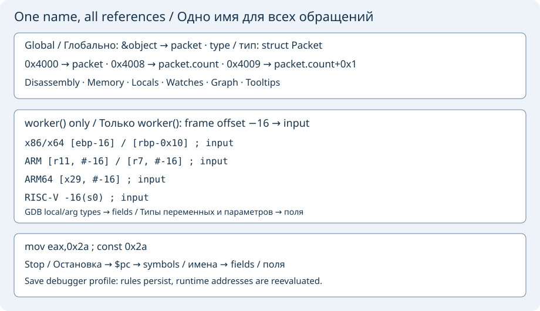
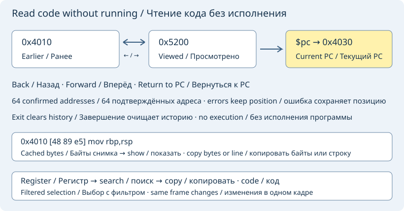

# Disassembly and code navigation

Pause the target and open **Machine instructions**. Enter `$pc` for the selected
frame's program counter, a function such as `main`, or an address such as `0x1000`.
**Read instructions** (or Enter) reads up to 128 bytes and shows addresses, functions,
offsets and assembly. Near unreadable code boundaries, the window is reduced
with at most seven retries instead of discarding a readable short function. This is a snapshot: refresh after stepping, changing frames
or restarting. Invalid/unreadable addresses show GDB's error without resuming.

**Step instruction** executes one machine instruction, entering calls.
**Next instruction** steps over a call. Both act on GDB's selected thread and
require a paused target; ordinary breakpoints still apply. These controls also
work through a connected gdbserver. They do not require source lines.

### Symbols, constants and user names

On x86/x64 the page selects **Intel syntax**. ARM, ARM64 and RISC-V 32/64 use
GDB's native syntax for that target; the selected GDB must support the target's
architecture. The same naming rules work with local GDB and remote gdbserver.
Numeric addresses and original instructions remain visible alongside annotations.
GDB resolves actual symbols; unmatched immediate operands are marked `const`.
An assembly operand alone cannot prove whether an integer is a pointer.

Open **Names, frame offsets and data types**:

- **Address name…**: enter an address expression such as `&object` and a display
  name such as `packet`. Selecting a numeric address in the instruction text fills
  the address field. Use a symbol expression instead of a process-specific absolute
  address when the program uses ASLR.
- **Frame name…**: enter a signed displacement such as `-0x20`, a name, a base
  register (`fp`, `sp`, `rbp`, `ebp`, `x29`, `r11`, `r7`, `s0`) and the exact GDB
  function name. This rule applies only inside that function, including matching
  references through equivalent register values at this stop.
- **Typed data…**: enter `&object`, `packet` and a real C/C++ type such as
  `struct Packet`. GDB supplies sizes and member offsets, including nested
  aggregates; addresses inside a field display `packet.field+offset`. To bind a
  stack structure, use `(char*)$fp-0x20` (or another base register) and set its
  function scope. Out-of-scope bindings are skipped rather than applied to another frame.
- **Edit name…** and **Delete name** change the selected rule. Adding the same
  rule identity again replaces its name. Manual names take priority over automatic
  names; a more specific field takes priority over its enclosing structure.

Applying, renaming or deleting a rule refreshes the names automatically while
paused. **Read instructions** resolves them again on demand. GDB also supplies addressable
parameters and locals in the selected frame, including nested fields and array
elements when their types and addresses are available. Automatic pointer values
are named without following their pointees. Manual names retain priority.
Optimized-out/register-only values and unknown function scopes are left unnamed. Frame references are recognized in x86 Intel, ARM/ARM64 bracket
forms and RISC-V `offset(base)` forms. Simple base+offset references through other general-purpose registers also use
their values at this stop, so `[rax+8]`, `[x0,#8]` and `8(a0)` can show structure
fields. This is a stop snapshot, not symbolic execution of future instructions.
Indexed expressions are left unchanged. Displacements and numbers inside quoted
strings are not reclassified as standalone absolute addresses. Negative immediates
retain their sign. FS/GS-relative references are not matched to flat addresses
without a confirmed segment base.
For a different function, select its frame first to resolve that function's locals.

Global names also annotate pointers in locals, value trees, watches, watch graphs, source
hover tooltips and memory addresses. Raw values and program bytes do not change.
Names are cleared on execution and resolved again on the next read. Switching
threads/frames drops local resolutions while retaining global names in the same process. **Save names
in debugger profile** preserves manual rules in the existing per-project/executable
profile; temporary addresses and automatically discovered names are not persisted.

Discovery is bounded to 128 data locations, 64 numeric symbol lookups, 64 members
per aggregate and three nested aggregate levels. It never follows member pointers.
Missing types, inaccessible addresses and bit-fields that have no address are
reported as unresolved queries. No missing debug information is invented.

### Follow the current instruction

Enable **Follow the selected frame at each stop** on the instruction page to
refresh `$pc`, symbols and field names after a confirmed stop, an instruction
step or a thread/frame selection. The refresh waits for frame variables and
watches; it never interrupts a running program. It runs only while this page is
visible. Pending Continue, Stop, Restart and remote detach take precedence.

Manual address reads remain available. After the next stop, follow mode returns
the address entry to `$pc`. Disable the checkbox to keep a manual snapshot.

The follow-mode choice is saved with debugger profiles. Older profiles without
this option preserve the current checkbox setting.

### Register snapshots

Expand **Registers at the last instruction read**. The table uses GDB's register
names and definition order for the target, showing general-purpose registers in
hex and unsigned decimal, with resolved address/field names. Click **Register**
to sort by name. Values changed since the previous read are highlighted in orange;
comparison restarts when selecting a different thread/frame or restarting a target.

Select a row and use **Watch selected register** to add `$register` to watches,
or **View register address in memory** to inspect the address it contains. Reads
and actions use the selected GDB frame. This is the same snapshot as the
instruction listing: enable follow mode or read again to refresh it.

### Instruction cursor actions

Pause, open **Machine instructions**, and read `$pc` or a function. Put the
cursor on the instruction row itself. **Toggle instruction breakpoint (F2)**
or F2 in the instruction view adds/removes a breakpoint at that numeric
address. The confirmed point also appears in **Breakpoints**: a red ● means
enabled, a gray ○ means disabled. Source/function breakpoints are shown too;
F2 removes only a separate address breakpoint, preserving source rules.

The ▶ highlight identifies the selected frame's confirmed instruction pointer,
not necessarily the first displayed instruction. It disappears while running
or after a frame change until the next instruction read. **Follow the selected
frame at each stop** keeps the visible snapshot refreshed.

**View instruction address in memory** opens bytes at the row's address.
**Run to instruction** uses GDB's `until *address` for the selected thread/frame:
other breakpoints or signals may stop earlier, and returning from the frame
can stop the operation before reaching the address. Selecting the current PC
keeps the program paused. These actions require an idle paused session; the
same commands work with an SSH gdbserver. Numeric address breakpoints belong
to the current GDB session and are not saved as portable profile locations.

### Instruction mouse menu and hardware points

Right-click an instruction row, or use the keyboard's context-menu key at
the cursor. The standard text menu includes instruction actions and captures
the row address when it opens. **Copy instruction address** copies only the
numeric address; **Name this instruction address…** opens the shared naming
editor with that address filled in. Naming does not alter the inferior.
Save the debugger profile to retain rules; a literal address may change after
restart with ASLR, so prefer a symbol expression for a portable name.

Double-click the leading address or its point/PC marker to toggle an address
breakpoint. Double-clicking instruction operands keeps normal text selection.
The menu offers **Add hardware instruction breakpoint** (`hbreak` in GDB).
Hardware support and the number of available slots depend on the target and
remote server. GDB errors remain visible; no software fallback is inserted.

For a confirmed address point, **Enable / Disable**, **Breakpoint condition**
and **Ignore first hits** reuse the common breakpoint editors and list.
These items edit only the address point, preserving source/function rules at
the same address. Create an address point first if the items are unavailable.
Editing and execution actions require an idle paused session; copying a
snapshot address remains available while running. Menus also work when GDB
connects to gdbserver through SSH.

### Source for an instruction

Use **Open source for instruction** in the row menu. GDB supplies the exact
file and line; navigating leaves the execution stop unchanged. Missing debug
information or unavailable local files produce a status message. For SSH,
configure GDB source directories or source-path mapping before navigating.

[Back to debugger guide](native-debugger.md)

## Address history and explicit selection

**Code history back** and **Code history forward** revisit confirmed numeric
addresses, including snapshots read from `$pc`. They do not reevaluate an old
`$pc` expression at its new value. At most 64 entries are retained. Repeated
reads at the current address do not add duplicates. Reading a different address
after going back removes the forward branch. Failed reads leave the history
position intact. History is cleared on target exit/disconnect, because addresses
may change with ASLR on restart; it is not saved in debugger profiles.

**Return to program counter** reads the selected frame's current `$pc`.
**Open selected address as code** accepts one explicitly selected hexadecimal
number from the instruction text. Select the address alone, excluding markers,
names and surrounding operands. The debugger does not guess whether a number
is code or data. Unmapped addresses show GDB's read error. These controls are
available only while paused and idle, and never resume the inferior.

In the instruction text, **Alt+Left** and **Alt+Right** navigate back and forward.
