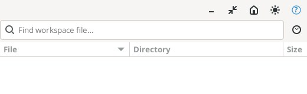
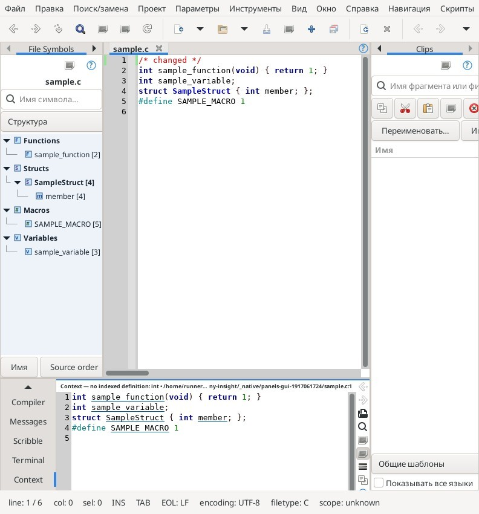
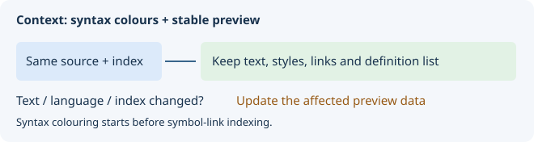

# Context

Definition previews without moving the main editor.

## Controls

Single-click a resolved link to change Context only. Double-click to open the shown file and center its line in the editor. History, definition selector, follow-caret, wrapping and search control the preview. Diff/Merge is on the main toolbar and in Tools.

## Short tutorial

Select a symbol in a list. Click another resolved definition in Context: the editor stays in place. Double-click to open the previewed line in the editor.

The ? button at the upper right opens this page. Help follows the interface language selected in Options.

More: [context-bookmarks.md](context-bookmarks.md).

Member definition links and editor Follow resolve nominal C/C++ typedef/using chains in declaration scopes, including `this` and qualified namespace receivers. Ambiguous/cyclic types decline. Template argument substitution, overload selection and arbitrary chained expressions are not inferred.

Explicit qualified nested types can be inherited: `Derived::Nested`, an alias-qualified inherited alias, and functions returning those types resolve to the recorded declaring owner. Direct nested declarations hide bases. The same declaration reached through a diamond is one type target; different declarations, a non-type declaration hiding the name, missing bases, cycles or limits decline. Base aliases resolve in the owner's declaration scope and eligibility is checked before choosing owners. Inherited nested lookup is bounded to 4096 visited owners, 256 bases per owner, the shared 64-level recursion and 32 alias expansions. Unqualified nominal type names search the nearest class and its inherited types before falling back to enclosing scopes. A direct local type declaration wins, while a hidden or uncertain inherited name declines. Qualified chains select the nearest first component, then stay within that owner: a missing/hidden member does not reopen outer lookup. Reopened namespace declarations share one nominal namespace; namespace members keep use-file preference while class members use declaration context. All attempted alias expansions count toward the work limit, while completed unsuccessful probes do not inflate the displayed alias count. Template substitution, access, include/ODR semantics and exact positional scope for several functions on one source line remain open.

C++ variables whose declaration starts with global `::` qualification are indexed with that prefix retained in the recorded type. Namespace-scope, member and local declaration parsing use the same rule; qualified calls or assignments are not converted into variable declarations.

Для результатов функций nominal-поиск учитывает собственные параметры шаблона: зависимый `T` не выбирает одноимённый глобальный класс. Явный `::T` и обычные результаты разрешаются в контексте объявления; параметры-значения и локальные aliases тела не меняют тип результата. Выведение аргументов шаблонов и выбор перегрузки пока не выполняются.

Полная справка: [Режимы поиска/замены и языки запросов](search-replace.md).

## Компактная правая панель Context

Поиск и список кандидатов определений при запуске скрыты. Значки справа от
исходника расположены вертикально; полное название команды появляется в
подсказке при наведении. При небольшой высоте панель значков прокручивается.

| Значок | Назначение |
| --- | --- |
| Стрелка влево / вправо | Предыдущая / следующая позиция истории Context |
| Открыть документ | Открыть показанную строку в основном редакторе; также Enter |
| Лупа | Показать/скрыть поиск по предпросмотру; Ctrl+F в Context открывает его и фокусирует поле |
| Список | Показать/скрыть кандидатов определений; выбор меняет только Context |
| Прицел | Включить/выключить Follow: слежение за кареткой основного редактора |
| Выравнивание строк | Включить/выключить перенос длинных строк предпросмотра |
| Копировать | Скопировать адрес каретки предпросмотра `файл:строка` |
| Знак вопроса | Открыть эту справку |

Скрытие поиска или списка не очищает запрос/кандидатов и не меняет положение
редактора. Повторное нажатие раскрывает тот же элемент. F3/Shift+F3 повторяют
поиск; Enter в исходнике открывает строку, F12 следует определению только в
Context. Двойной щелчок открывает файл в редакторе.

При первом запуске боковые области открыты примерно на 100 логических пикселей,
Context занимает около четверти рабочей высоты. Разделители можно двигать до
узкой полосы; последние положения восстанавливаются после перезапуска.

## Проверенная навигация Python

Границы функций/классов определяются по отступам из снимка текста, включая
вложенные функции и возврат во внешнюю область после их окончания. Локальные
имена и параметры не выбираются из соседней функции; видимые имена замыканий
сохраняются. `self`/`cls` как первый параметр метода разрешаются в его
индексированном классе; одноимённые поля другого класса не подставляются.
Вложенные замыкания сохраняют этот получатель, пока его не затеняет ближайший
параметр или локальное присваивание, в том числе расположенное ниже обращения.
Первый параметр обычной вложенной функции сам по себе не считается получателем
класса.
Поддержаны непосредственно названные классы и индексированные аннотированные
получатели. Предпросмотр, F12 и автоматический Follow используют эти правила.
`global имя` ограничивает поиск текущим модулем; `nonlocal имя` выбирает
привязку внешней функции, пропуская модуль и промежуточные члены классов.
Объявления действуют на всю область функции. Локальное имя тоже привязано во
всей функции: переход может вести к присваиванию ниже обращения, а не к чужому
внешнему определению. Не найденный `nonlocal` не подменяется именем модуля.
Поддержаны списки через запятую, точка с запятой и явные продолжения строки;
комментарии и строки игнорируются. Некорректные/конфликтующие объявления и
превышение ограничений (64 оператора привязки, включая импорты, 4096 имён объявлений,
бюджет сканирования 32 МиБ)
отключают предположения. Кэш объявлений обновляется вместе со снимком текста
и индекса.

Явные импорты разрешаются по индексированным модулям: `from models import work
as task`, `import models as mod` с обращением `mod.work`, импорт класса
`from models import Thing as Alias` с обращением `Alias.field`. Учитываются
локальные импорты вложенных функций и привязки `global`/`nonlocal`. Для
абсолютного модуля требуется единственный индексированный путь с суффиксом
`models.py` или `models/__init__.py`. Относительный модуль `.models` привязан к
каталогу исходного файла; дополнительные начальные точки поднимают каталог.
Модули не исполняются и автоматически не добавляются в индекс. Неоднозначный
путь, конфликт псевдонимов и отсутствующее определение не подменяются чужим
одноимённым символом. Параметры и присваивания затеняют импорт; порядок
исполнения и динамические типы не выводятся. Поддержаны списки, псевдонимы,
скобки и явные продолжения строки, до 256 имён импорта в операторе.

Ссылки, F12 и Follow используют одно разрешение. В определении выделяется
настоящее имя, даже если обращение использует псевдоним. Обновление индекса Python
обновляет Follow без движения курсора: перенос определения в другом открытом
буфере отражается в Context. Кэш путей модулей действует только для текущего
снимка индекса.

Это ограниченное лексическое разрешение, а не исполнение Python: динамические
атрибуты, произвольные цепочки/результаты вызовов, импорты со звёздочкой,
цепочки реэкспорта, декораторы и полное выведение типов не вычисляются.
Правила исполнения пакетов/`sys.path` не разрешаются. Непривязанное имя другого Python-файла
не считается импортом. Неопределённый получатель не переключается на случайное
одноимённое поле. Строки и комментарии не являются ссылками.

Простые присваивания `self.field = ...` и `cls.field = ...` в непосредственном
методе класса создают в индексе определения его полей. Аннотация сохраняется:
`self.field: Type = value`. Получатель должен быть первым формальным параметром
этого метода; имя параметра может быть любым. Произвольные объекты, цепочки
атрибутов и обычные вложенные функции не создают предполагаемых полей класса. Обычный `@staticmethod` распознаётся даже при выключенном выводе
метаданных декораторов: его параметр не считается неявным экземпляром и не
объявляет поля класса. Остальная семантика декораторов и общее выведение типов по потоку исполнения
пока не реализованы.

Получатель, однократно присвоенный как `obj = LocalClass(...)`, может использовать
этот индексированный класс из того же файла для переходов к полям. Аргументы
могут занимать несколько строк, но правая часть должна состоять из одного вызова.
Повторные присваивания, конкурирующие привязки, переприсваивание параметра,
фабрики, произвольные псевдонимы конструкторов и составные выражения не выводятся.
Это номинальное правило по исходнику, без выполнения `__new__` и анализа потока.
Результат привязан к снимку текста и индекса: изменение конструктора обновляет
Context даже при прежних именах и строках объявлений.

Объявления без присваивания (`name: Type`, поля класса и `self.field: Type`)
тоже индексируются. Это определение/тип для навигации; оно не означает, что
Python создал значение или атрибут во время исполнения.

Первый формальный параметр непосредственного метода может иметь любое имя,
например `me`: получатель определяется позицией и классом объявления.
`builtins.staticmethod` и обычный `staticmethod` отключают его, в том числе
в стеке с многострочными вызовами декораторов. Произвольные преобразования
декораторов не вычисляются.

Прямые обращения `LocalClass(...).field` и `factory(...).field` поддержаны
для однозначного определения в том же файле и простой аннотации результата
с индексированным классом. Тип результата ищется в области объявления, а не
среди локальных имён вызывающей функции. Неизвестные результаты, async-функции,
сложные/объединённые типы и цепочки методов не выводятся; аргументы не типизируются.

Составные импорты поддерживают `pkg.mod.function`, `pkg.mod.Class.field` и
`alias.Class.field`, в том числе индексированные вложенные классы. Несколько
модулей могут иметь общий импортированный корень. Выбирается самый длинный явно
импортированный префикс; неимпортированный подмодуль не считается загруженным.
Префикс атрибутов ограничен 16 компонентами и должен обозначать классы,
а не произвольные объекты.

Imported class instances support simple variable/parameter annotations, one constructor assignment and direct `Alias().field` / `mod.Class().field` calls. An imported type resolves only against its module file; similarly named classes elsewhere do not supply fields. Parameter annotations resolve outside the function body. Imported factory return types and complex annotations remain unsupported.

Navigation caches belong to one immutable source/path/index snapshot. Edits and index publications refresh Follow. Constructor lookup rechecks the current symbol eligibility filter even when a result was cached; an earlier filtered miss cannot hide a later eligible class. Reusing a cache with a different source or changed index declines the lookup.

Lexical identifier lookup and whole-name occurrence searches use Unicode 15.0 XID start/continue boundaries. NBSP, emoji and punctuation separate names; combining marks may continue a valid name. Byte offsets/columns are preserved. Names are compared exactly, without Unicode normalization. This is lexical matching, not language-specific semantic analysis.

Python annotations resolve in their declaration environment. A parameter's type
uses the environment outside its function body, so a body-local variable with
the same name does not change it. Same-file nested class paths such as
`Holder.Inner`, including quoted annotations, are supported up to 16 components.
Competing bindings and complex annotations decline rather than selecting an
arbitrary field. Eligibility filters cannot reopen a hidden outer binding.
A function's return annotation describes `make().field`, never `make.field`:
the latter is a function object, whose dynamic attributes are not inferred.

## Управление окном панели

В заголовке: **Открепить / Закрепить** и **Развернуть / Восстановить**.
Разворачивание доступно в плавающем окне. Закрепление возвращает панель
на штатное место и выбирает вкладку; системное закрытие также закрепляет её.
Размеры и развёрнутое состояние отдельных панелей сохраняются в раскладках A–D. Произвольные места закрепления пока не поддерживаются.

### Полоса свёрнутых окон (Tab Tray)

Кнопка сворачивания переносит плавающую панель в нижнюю полосу. Нажмите её имя,
чтобы восстановить окно. View → Panels → Tab Tray скрывает/показывает полосу,
оставляя панели свёрнутыми. Restore minimized panels восстанавливает все
свёрнутые панели. Пустая полоса скрывается автоматически. Раскладки и настройки
сеанса запоминают свёрнутые панели и видимость полосы. Отдельное окно Window List
и целая группа Project Window в эту полосу пока не включены.

Окно настоящего приложения Linux в автоматическом сценарии проверки:

## Compact layout

When the window narrows, the left panel keeps its area while the editor and Context yield width. Their left edges remain inside the window.

Context keeps its controls in the right rail, including Float/Dock. Minimize and Maximize appear only in a floating window. The smaller location/status line is selectable: select and copy its text. Definitions stay to the left of the rail. Right-click the preview, editor or Project Files row and choose **Show in file manager**. Windows Explorer and FileManager1-compatible Linux desktops select the file; other Linux desktops fall back to its folder.

Tabs use compact spacing; the active editor tab and Project Files names are bold. Overview starts hidden in a new profile and once after upgrading the old always-on default; right-click the editor or Overview to toggle it. A thin editor margin marks unsaved lines orange and saved changes light green; Overview uses the same colors. Later visibility choices are preserved.

Real Linux editor at 792 px width, captured by the native GUI regression after floating and docking the panels.

## Syntax colours and stable updates

Context uses the source language, syntax palette and configured language profile, including files not open in an editor. Initial syntax colouring runs before symbol-link indexing. Monochrome mode remains available through the formatting options.

Following the same source keeps its text, lexer styles, link indicators and unchanged definition list. Moving the caret does not clear and rebuild them. Text edits, a changed index or language settings invalidate the relevant cache; the preview then updates normally.

Old untouched generated profiles affected by the first-use inherited-lexer bug are repaired automatically at startup. Only an exact generated plain-text style snapshot is replaced; the font and user profiles are preserved.
