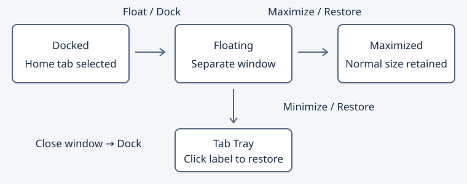

# Project files

Lists files belonging to the current project.

## Controls

The filter narrows the list; sorting changes name and path order. Add and Remove commands change project membership.

## Short tutorial

Open a project. Type part of a name in the filter. Select a file for context; double-click it to open the editor.

The ? button at the upper right opens this page. Help follows the interface language selected in Options.

More: [guide.md](guide.md).

## File list menu and keyboard

Right-click selects a file without moving Context or the editor. The menu opens the file, copies its basename/full path, filters to its exact path, clears the query, resets columns, chooses visible columns and opens this help. Source commands are disabled on empty space and while a snapshot is updating.

In the list, Ctrl+F focuses its query, Ctrl+C copies the basename, Ctrl+Shift+C copies the full path and Ctrl+Enter opens the selected file. Menu or Shift+F10 opens its context menu; Escape returns to the editor. Single selection still previews in Context, and double-click still opens the editor.

## Sorting, columns and history

Sort by basename or full path; the icon-only arrow toggles descending order. Header sorting updates the controls. Resize or reorder headers, and use Visible file columns to hide Path; File remains visible. Reset file columns restores order, widths and visibility, retaining the filter and sorting. Column layout, sorting and filter history are saved independently from the symbol panels. The recent-history button remembers or selects up to 16 valid file queries (256 UTF-8 bytes each), including filename globs. Enter remembers a valid query; wildcard queries filter without opening a file, while other queries retain normal activation; Clear history preserves the query.

The counter shows loaded matching files and a + if additional matches remain after the 10000-row outline cap; project enumeration also has its own limit. Narrow the query to examine another subset. The full path is available as a row tooltip. Open/save/close/activate events refresh the list after the document change completes. Language compatibility continues to restrict eligible files.

Tutorial: find `*.cpp`, remember the query, select a file and copy its full path with Ctrl+Shift+C. Choose exact-file filtering in the menu, clear it, resize Path and reverse the sort order. Restart to restore the layout and history, then press Ctrl+Enter on a file to open it.

## Master File List

To share the project membership through a text file, first use **Export file list…** in Add and Remove Project Files. Choose that existing file in **Master file list** and Apply. Its paths replace the inclusion rules; relative paths are based on the project root. Clearing the field detaches the list. The binding is saved relative to the project root when possible.

The list is checked in a worker about every three seconds. External additions/removals update the project file list and symbol index; project masks/exclusion overlays are respected. Project → Open Project Master File List opens the text, and saving it requests immediate synchronization. Project → Synchronize Master File List requests a check explicitly. Cancel indexing pauses background MFL reads too; explicit synchronization, saving the list, changing its binding or applying membership resumes them.

Manual Add/Remove/Remove all updates the MFL before publishing project membership. Directories and explicit exclusions are flattened to the currently eligible file entries on a manual write, and old explicit exclusion rules are cleared; masks remain. This lets a later external list reintroduce a manually removed file. No source file is deleted. If project settings cannot be saved, the MFL is restored byte-for-byte, provided its new snapshot has not been changed externally. Content digests supplement GIO ETags on filesystems with coarse timestamps. Changed files or stale dialogs decline instead of replacing another version. Save or reload a dirty open MFL before changing membership.

The format is UTF-8 (optional BOM), one literal path per line, with LF or CRLF. Existing directories are recognized; a trailing `/` explicitly requests a directory (a missing directory fails the snapshot). Blank lines and lines beginning with `;` are ignored. A literal name beginning with `;` is written as `./;name` so it round-trips without becoming a comment. Manual membership writes regenerate canonical path lines; guarded rollback retains the original BOM, CRLF and comments byte-for-byte. Limits are 2 MiB, 10000 distinct entries, and a bounded manual directory scan (64 levels, 4096 directories, 100000 entries); generated/hidden directories and symlinks are not followed by that scan. Invalid/missing lists retain the last accepted project. Variables are not expanded inside MFL entry lines; the binding field supports the project variables described below. Quoted paths remain unsupported. The MFL must differ from the project configuration file. Directory monitoring retains its existing 1024-monitor bound; a manual source rescan is available when monitoring is incomplete.

Reference behavior: [Source Insight 4 Master File List](https://www.sourceinsight.com/doc/v4/userguide/Manual/Concepts/Using_a_Master_File_List.htm).

### Filename masks in MFL

Use `src/*.c` or `tw?.c` to include matching regular files directly in a literal directory. `*` and `?` match names; matching is case folded on Windows and case sensitive on other hosts. Child directories and symlinks are not expanded. An existing literal path takes precedence over mask interpretation. Empty matches are valid. Bracket expressions, wildcard directory components, variables inside entry lines and quoted paths are not supported.

Mask enumeration runs in the synchronization worker with cancellation. Limits per snapshot are 256 directory/wildcard rules, 1024 bytes per filename mask, 100000 visited directory entries and the existing 10000 distinct included paths. Errors or limits retain the previous accepted project. Files appearing/disappearing under a mask update membership even when the MFL itself has not changed. A manual write declines a changed expansion rather than replacing a newer file set; successful manual writes flatten masks into explicit paths. Normal filesystem changes during a directory scan are reconciled by later synchronization; this is not an atomic filesystem snapshot.

### Directory entries in MFL

A directory includes regular direct children of known file types, without recursion, as in Source Insight. Known types combine Geany filename patterns (excluding the catch-all None type), custom language extensions and exact per-file language bindings. Thus Makefile can match a native pattern and an otherwise unknown extension can match its explicit language binding. Explicit file entries and filename masks are not restricted to known types. Child symlinks are skipped; a directory entry pointing to a symlink is rejected. Missing directories retain the last accepted project.

Polling detects file creation/removal without modifying the original MFL text. Language profile changes refresh the immutable type snapshot and cancel stale workers. Directory and wildcard rules share the 256-rule/100000-entry limits. A snapshot allows 4096 native patterns, 4096 custom extensions and 10000 exact bindings; invalid snapshots fail without publishing partial membership.

Compatibility change: older versions of this port treated MFL directories recursively. Add explicit subdirectory/file lines or filename masks for desired nested files. The separate Add Tree command retains its recursive behavior. Manual membership writes still flatten expansion into explicit paths. Linux core, service and GUI checks cover these semantics; Windows GUI validation remains deferred.

### Project variables in the master-list path

The Master file list field accepts `%PROJECT_SOURCE_DIR%` (the project source root), `%PROJECT_DATA_DIR%` (the directory containing the `.geany` project file), and `%PROJECT_NAME%` (that file's basename without its final extension). Names are case insensitive. For example, `%PROJECT_SOURCE_DIR%/master.txt` follows a moved source tree; `%PROJECT_DATA_DIR%/%PROJECT_NAME%.txt` follows the project configuration and its name.

Expansion is one pass, with at most 32 substitutions and 16384 bytes for the expression/result. Unknown/unavailable variables or malformed expressions show an error and disable Apply, leaving the candidate binding unchanged. This field uses `%%` for a literal percent sign; Browse escapes literal filenames automatically. Resolution does not inspect the candidate MFL or execute shell commands; GLib may read platform folder configuration. Available system/environment variables are listed below. A dedicated user-variable editor, remaining predefined directories and expansion in other settings remain open.

The expression is saved separately as `master-file-expression` alongside the resolved, preferably relative `master-file` value in the existing version-1 project membership settings. It is re-evaluated when loading the project. Legacy settings without the expression key retain their literal interpretation, including percent characters. Disabling the MFL removes both keys. Variable values are inserted as literal path text and are not recursively expanded.

### Системные каталоги и окружение в пути MFL

Поле пути MFL раскрывает имена переменных окружения без учёта регистра и
`%TEMP_DIR%`, `%DESKTOP_DIR%`, `%MYDOCUMENTS_DIR%`, `%APPDATA_DIR%`,
`%LOCAL_APPDATA_DIR%`. В Windows также доступны `%PROGRAMFILES_DIR%`,
`%PROGRAMFILESX86_DIR%`, `%WINDOWS_DIR%` из соответствующих переменных процесса.
В Unix APPDATA/LOCAL_APPDATA означают каталоги конфигурации/данных GLib.
Недоступные специальные каталоги, пустые значения, некорректный UTF-8,
переносы строк и различные значения одноимённых переменных с разным регистром
отклоняются без изменения прежнего пути. Окружение фиксируется на одну
операцию; подставленные значения повторно не раскрываются. Выражение
сохраняется и вычисляется заново при загрузке проекта. Для получения нового
окружения оболочки нужно перезапустить редактор. Отдельный редактор
пользовательских переменных и остальные специальные каталоги Source Insight
пока не реализованы; строки внутри самого MFL сохраняют буквальные пути.

File, Directory, Size and Path columns show the name, containing directory, byte size and full path. Size sorts numerically; unavailable files have a blank size. Metadata is read in the background when the list refreshes.

### Wildcard commands in Project Files

Enter after a valid file-mask query (for example `z.c?p` or `*.c`) keeps the
filtered list and does not open its first file, including while the background
list refresh is pending. `*` followed by Enter clears the filter; this command
is not added to query history. `**` retains the existing return-to-project
command. Plain fragments, regex and exact quoted queries retain normal Enter
activation. Masks that match nothing leave an empty list.

A mask without path separators matches the basename, independently of containing
directories. `Т?ст.c` therefore finds `inner/Тест.c`, while `*.cpp*` does not match
`folder.cpp/notes.h`. Separator-containing masks and explicit `@path` terms
continue to match the whole path; use `*folder.cpp/*` to select that directory's
files. Other fragment/regex/exact/fuzzy semantics remain unchanged. Existing
language compatibility and list limits still apply.

Legacy two-column File/Path layouts preserve their saved relative order, widths
and valid visibility when loading the expanded four-column list. Directory/Size
are appended with defaults; malformed layouts retain defaults. Reset restores
File/Directory/Size/Path with suitable widths.
Reference: [Source Insight Project File List](https://www.sourceinsight.com/doc/v4/userguide/Manual/Concepts/Project_File_List.htm).

## Управление окном панели

В заголовке: **Открепить / Закрепить** и **Развернуть / Восстановить**.
Разворачивание доступно в плавающем окне. Закрепление возвращает панель
на штатное место и выбирает вкладку; системное закрытие также закрепляет её.
Размеры и развёрнутое состояние отдельных панелей сохраняются в раскладках A–D. Произвольные места закрепления пока не поддерживаются.

