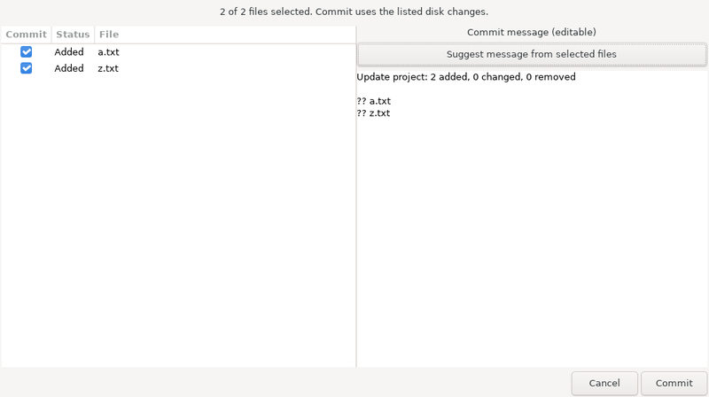
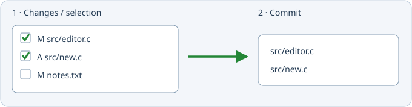

# Git-проекты

Настоящий рабочий GTK-диалог из изолированной GUI-проверки; пример показан на английском. Слева флажками выбирается состав коммита, справа редактируется предложение сообщения и подтверждается операция.

1 — выбор изменений. 2 — в коммит входят только отмеченные пути, даже если остальные файлы уже добавлены в индекс.

Ветка с зелёной галочкой — коммит. Файл с зелёным плюсом — добавление в Git.

В меню «Проект» рядом с созданием обычного проекта доступны «Создать Git-проект» и «Создать проект из Git». Первый пункт инициализирует папку или подключает существующий репозиторий. Второй клонирует локальный репозиторий или удалённый адрес в новую папку. Установленный Git использует обычные настройки пользователя и средства авторизации. Автоматической отправки на сервер нет.

Git хранит состав проекта: список файлов читается из его индекса, а привязка `git_based=true` сохраняется в файле проекта `insight.geany`. Повторное открытие и переиндексация перечитывают Git. Обычные проекты продолжают использовать свои правила состава файлов.

В меню «Файл» и на панели рядом с сохранением расположены:

- **Закоммитить изменения** — иконка ветки с зелёной галочкой.
- **Добавить в Git** — иконка файла с зелёным плюсом. Выбор нескольких файлов учитывает `.gitignore`; файлы вне репозитория не принимаются.

«Проект → Добавить и убрать файлы» для Git-проекта показывает отсортированный список отслеживаемых файлов. Добавление вызывает Git add; удаление выбранных файлов вызывает Git rm --cached. Файлы остаются на диске, а удаление из хранилища попадёт в следующий выбранный коммит. Изменения состава применяются кнопками сразу; закрытие окна не отменяет их.

Перед коммитом редактор предлагает сохранить изменённые документы проекта. Затем слева отображаются изменённые, новые и удалённые файлы, отсортированные по пути. Все флажки включены изначально. Снятый флажок исключает файл, даже если другой Git-клиент уже подготовил его в индексе. Перемещение показывается отдельными удалением и добавлением, чтобы можно было выбрать оба пути явно.

Справа предлагается сообщение с количеством добавлений, изменений, удалений и перечнем файлов. Пока текст не отредактирован, он обновляется при смене флажков. Ручные правки сохраняются; сообщение можно заново сформировать кнопкой по текущему выбору. «Коммит» записывает выбранные файлы целиком с диска; «Отмена» не изменяет Git. Частично подготовленные изменения выбранного файла заменяются его текущей версией с диска. Не выбранные изменения индекса сохраняются.

Изменение файлов или индекса после просмотра отклоняет устаревший выбор. Блокировки и ошибки Git показываются без удаления чужих блокировок. Для коммита нужны настроенные `user.name` и `user.email`; используются обычные настройки Git, подпись и hooks. Во время merge/rebase/cherry-pick выборочные коммиты запрещены. Вложенные репозитории и submodules коммитятся в собственном проекте. Отправка, получение, смена веток и разрешение конфликтов пока выполняются внешним Git-клиентом.

[История Git и сравнение](git-history.md): Файл → История Git и сравнение… — ветки, коммиты, полные сообщения и цветной дифф только для чтения.
